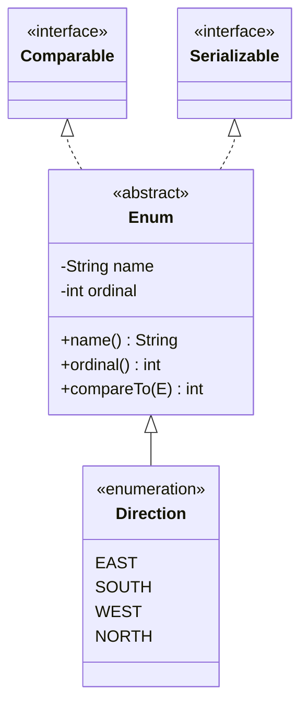
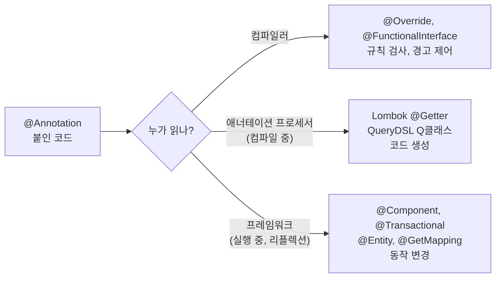
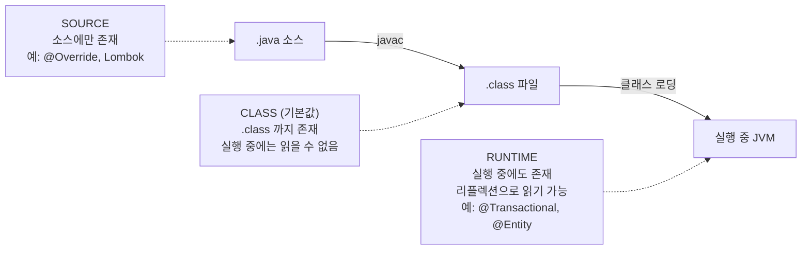

## 개요

| 주제 | 핵심 |
| --- | --- |
| **열거형 (enum)** | 서로 관련된 상수를 **타입 안전하게** 묶는다. 상수마다 값과 동작을 가질 수 있다 |
| **애너테이션 (annotation)** | 코드에 붙이는 **메타데이터**. 컴파일러와 프레임워크(스프링, JPA, Lombok)가 읽고 동작을 바꾼다 |

둘 다 Java 5 에서 추가되었다.

---

# Part 1. 열거형 (enum)

## 1. 열거형이란?

**서로 관련된 상수를 편리하게 선언**하기 위한 것이다. 여러 상수를 정의할 때 쓴다.

### 열거형 이전: 정수 상수

```java
class Card {
    static final int CLOVER = 0;
    static final int HEART  = 1;

    static final int TWO   = 0;
    static final int THREE = 1;

    final int kind;
    final int num;
}

if (Card.CLOVER == Card.TWO) { }   // true: 의미가 다른 상수인데 값이 같아서 같다고 나온다
card.kind = 99;                    // 아무 정수나 들어갈 수 있다
```

### 열거형 사용

```java
class Card {
    enum Kind  { CLOVER, HEART, DIAMOND, SPADE }
    enum Value { TWO, THREE, FOUR }

    final Kind kind;
    final Value value;
}

if (Card.Kind.CLOVER == Card.Value.TWO) { }   // 컴파일 에러: 타입이 다르면 비교 불가
```

| 장점 | 설명 |
| --- | --- |
| **타입 안전** | 값뿐 아니라 **타입까지** 검사한다. 정해진 상수 외의 값은 들어올 수 없다 |
| **재컴파일 불필요** | 정수 상수는 값이 바뀌면 그 상수를 쓰는 클래스도 다시 컴파일해야 했다 |
| **가독성** | 출력하면 `0` 이 아니라 `CLOVER` 처럼 이름이 보인다 |
| **기능 추가 가능** | 필드, 생성자, 메서드를 가질 수 있다 |

---

## 2. 열거형의 정의와 사용

```java
enum Direction { EAST, SOUTH, WEST, NORTH }

Direction d = Direction.EAST;          // 열거형이름.상수이름
```

### 비교

```java
if (d == Direction.EAST) { }           // == 로 비교 가능 (빠르고 null 안전)
if (d.compareTo(Direction.WEST) > 0) { }   // 정의된 순서 비교 (ordinal 차이)
if (d > Direction.WEST) { }            // 에러: 비교 연산자는 쓸 수 없다
```

### switch 문

```java
switch (d) {
    case EAST  -> System.out.println("동");   // case 에는 상수 이름만 (Direction.EAST X)
    case SOUTH -> System.out.println("남");
    case WEST  -> System.out.println("서");
    case NORTH -> System.out.println("북");
}

String label = switch (d) {                   // switch 표현식 (Java 14+)
    case EAST  -> "동";
    case SOUTH -> "남";
    case WEST  -> "서";
    case NORTH -> "북";
};                                            // 모든 상수를 다 쓰면 default 가 없어도 된다
```

> 💡 **실무 꿀팁**: switch **표현식**에서 enum 상수를 모두 다루면 default 가 필요 없고, 나중에 상수를 추가하면 **처리하지 않은 곳에서 컴파일 에러**가 난다. default 를 넣으면 이 검사를 놓치니, 가능하면 빼 둔다.

### 모든 열거형의 조상: java.lang.Enum

| 메서드 | 설명 | 예 (`Direction.WEST`) |
| --- | --- | --- |
| `name()` | 상수 이름 문자열 | `"WEST"` |
| `ordinal()` | 정의된 순서 (0부터) | `2` |
| `compareTo(E)` | 순서 비교 (ordinal 의 차이) | |
| `values()` | 모든 상수를 **배열**로 (컴파일러가 추가) | `[EAST, SOUTH, WEST, NORTH]` |
| `valueOf(String)` | 이름으로 상수 찾기 (컴파일러가 추가) | `Direction.valueOf("WEST")` |
| `getDeclaringClass()` | 열거형의 Class 객체 | |

```java
for (Direction dir : Direction.values()) {
    System.out.println(dir.name() + " = " + dir.ordinal());
}

Direction.valueOf("WEST");    // WEST
Direction.valueOf("west");    // IllegalArgumentException: 대소문자까지 정확해야 한다
```

---

## 3. 열거형에 멤버 추가하기

### 상수에 값 붙이기

```java
enum Direction {
    EAST(1, ">"), SOUTH(5, "V"), WEST(-1, "<"), NORTH(10, "^");   // 상수 목록은 맨 앞, 끝에 ;

    private final int value;          // 값을 저장할 필드 (final 권장)
    private final String symbol;

    Direction(int value, String symbol) {   // 생성자: 접근 제어자는 묵시적으로 private
        this.value = value;
        this.symbol = symbol;
    }

    public int getValue()     { return value; }
    public String getSymbol() { return symbol; }
}

Direction.EAST.getValue();    // 1
new Direction(1, ">");        // 에러: 열거형의 생성자는 외부에서 호출할 수 없다
```

- 열거형의 생성자는 **항상 private**. 상수는 열거형 안에서만 만들어진다.

### 상수마다 다른 동작: 추상 메서드

```java
enum Transportation {
    BUS(100) {
        @Override int fare(int distance) { return distance * basicFare; }
    },
    TRAIN(150) {
        @Override int fare(int distance) { return distance * basicFare; }
    },
    AIRPLANE(300) {
        @Override int fare(int distance) { return distance * basicFare + 5000; }   // 공항세
    };

    protected final int basicFare;     // 상수의 블록에서 쓰려면 protected

    Transportation(int basicFare) { this.basicFare = basicFare; }

    abstract int fare(int distance);   // 각 상수가 반드시 구현
}

Transportation.AIRPLANE.fare(10);      // 8000
```

### 람다로 동작 넣기 (Java 8+)

```java
enum Operation {
    PLUS("+",  (a, b) -> a + b),
    MINUS("-", (a, b) -> a - b),
    TIMES("*", (a, b) -> a * b);

    private final String symbol;
    private final IntBinaryOperator op;

    Operation(String symbol, IntBinaryOperator op) {
        this.symbol = symbol;
        this.op = op;
    }

    public int apply(int a, int b) { return op.applyAsInt(a, b); }
}

Operation.PLUS.apply(3, 4);   // 7
```

> 💡 **실무 꿀팁: if-else 대신 enum 에 로직을 넣기**
> ```java
> // 결제 수단마다 수수료 계산이 다를 때, 서비스 곳곳에 if (type == CARD) ... 를 쓰는 대신
> public enum PaymentType {
>     CARD(amount  -> amount * 3 / 100),
>     BANK(amount  -> 500L),
>     POINT(amount -> 0L);
>
>     private final LongUnaryOperator feePolicy;
>     PaymentType(LongUnaryOperator feePolicy) { this.feePolicy = feePolicy; }
>     public long fee(long amount) { return feePolicy.applyAsLong(amount); }
> }
> ```
> 결제 수단이 추가돼도 **enum 한 곳만** 고치면 된다.

---

## 4. 열거형의 이해

열거형은 컴파일러가 만들어 주는 **특별한 클래스**다. 상수 하나하나가 **그 클래스의 객체**이다.

```java
enum Direction { EAST, SOUTH, WEST, NORTH }

// 컴파일러가 만드는 것과 비슷한 클래스
final class Direction extends Enum<Direction> {
    public static final Direction EAST  = new Direction("EAST", 0);
    public static final Direction SOUTH = new Direction("SOUTH", 1);
    public static final Direction WEST  = new Direction("WEST", 2);
    public static final Direction NORTH = new Direction("NORTH", 3);

    private Direction(String name, int ordinal) { super(name, ordinal); }

    public static Direction[] values() { ... }
    public static Direction valueOf(String name) { ... }
}
```



- 모든 열거형은 **`java.lang.Enum` 을 상속**한다. 그래서 **다른 클래스를 상속할 수 없다** (인터페이스 구현은 가능).
- 각 상수는 `public static final` 객체이고, **딱 하나만** 존재한다 → `==` 로 비교해도 안전하다.
- `Enum` 이 `Comparable` 을 구현해서 `compareTo`, `Collections.sort`, `TreeSet` 에서 **정의 순서**로 정렬된다.

### EnumSet, EnumMap

열거형 전용 컬렉션. 내부가 **비트 벡터·배열**이라 HashSet, HashMap 보다 빠르고 메모리도 적게 쓴다.

```java
EnumSet<Direction> horizontal = EnumSet.of(Direction.EAST, Direction.WEST);
EnumSet<Direction> all        = EnumSet.allOf(Direction.class);

EnumMap<Direction, Integer> moveCount = new EnumMap<>(Direction.class);
moveCount.put(Direction.EAST, 3);     // 키 순서 = enum 정의 순서
```

---

## 열거형 실무 꿀팁 모음

### 1. JPA 에서는 반드시 `EnumType.STRING`

```java
@Enumerated(EnumType.STRING)      // DB 에 "PAID" 로 저장
private OrderStatus status;

@Enumerated(EnumType.ORDINAL)     // 기본값: DB 에 0, 1, 2 숫자로 저장 → 위험
```

- ORDINAL 로 저장하면 enum **중간에 상수를 추가하거나 순서를 바꾸는 순간** 기존 데이터의 의미가 전부 틀어진다.
- 같은 이유로 코드에서도 **`ordinal()` 에 의존하는 로직을 만들지 않는다.** 순서 값이 필요하면 필드로 따로 둔다.

### 2. 상태와 규칙을 함께 두기

```java
public enum OrderStatus {
    ORDERED, PAID, SHIPPED, DELIVERED, CANCELED;

    public boolean canCancel() {
        return this == ORDERED || this == PAID;     // 배송 시작 전에만 취소 가능
    }
}

if (!order.getStatus().canCancel()) {
    throw new IllegalStateException("배송이 시작되어 취소할 수 없습니다.");
}
```

### 3. 외부 코드값 → enum 변환은 static Map 으로

```java
public enum BankCode {
    KB("004"), SHINHAN("088"), WOORI("020");

    private static final Map<String, BankCode> BY_CODE =
            Arrays.stream(values()).collect(Collectors.toMap(b -> b.code, b -> b));

    private final String code;
    BankCode(String code) { this.code = code; }

    public static BankCode fromCode(String code) {
        BankCode bank = BY_CODE.get(code);
        if (bank == null) throw new IllegalArgumentException("알 수 없는 은행 코드: " + code);
        return bank;
    }
}
```

- `values()` 는 호출할 때마다 **새 배열을 만든다.** 자주 찾는다면 Map 을 한 번만 만들어 둔다.

### 4. JSON 변환

- Jackson 은 기본적으로 enum 을 **`name()`** 으로 직렬화한다 (`"PAID"`). 다른 값으로 주고받으려면 `@JsonValue`, `@JsonCreator` 를 쓴다.

### 5. 싱글톤

```java
public enum IdGenerator {
    INSTANCE;
    private final AtomicLong seq = new AtomicLong();
    public long next() { return seq.incrementAndGet(); }
}
```

- 직렬화·리플렉션 공격에도 안전한 가장 간단한 싱글톤 방법이다.

---

# Part 2. 애너테이션 (annotation)

## 5. 애너테이션이란?

소스 코드에 붙이는 **메타데이터(데이터에 대한 데이터)**. 프로그램의 동작에는 **직접 영향을 주지 않고**, **다른 프로그램**(컴파일러, 빌드 도구, 프레임워크)에게 정보를 준다.

```java
@Test                       // "이 메서드는 테스트다" → JUnit 이 찾아서 실행
void createOrder() { }

@Override                   // "조상 메서드를 오버라이딩한다" → 컴파일러가 검사
public String toString() { }
```

- 주석(comment)과 달리 **정해진 형식**이 있어서 프로그램이 읽을 수 있다.
- 쓰임: 컴파일러에게 정보 제공, 빌드 시 코드 생성(Lombok), **실행 중 프레임워크가 읽고 동작**(스프링 DI, JPA 매핑, 검증).



---

## 6. 표준 애너테이션

자바가 기본으로 제공하는 애너테이션. 주로 **컴파일러**를 위한 것이다.

| 애너테이션 | 설명 |
| --- | --- |
| `@Override` | 조상 메서드를 오버라이딩한다는 것을 알린다. 이름·매개변수가 틀리면 **컴파일 에러** |
| `@Deprecated` | 앞으로 사용하지 않을 것을 권장. 쓰면 경고. `@Deprecated(since = "9", forRemoval = true)` |
| `@FunctionalInterface` | 함수형 인터페이스(추상 메서드 **하나**)임을 알린다. 두 개면 컴파일 에러 |
| `@SuppressWarnings` | 특정 경고를 표시하지 않게 한다: `"unchecked"`, `"rawtypes"`, `"deprecation"`, `"unused"` |
| `@SafeVarargs` | 지네릭 가변인자 메서드가 안전하다고 알려 경고를 없앤다 (static, final, private 메서드, 생성자만) |
| `@Native` | 네이티브 코드에서 참조하는 상수에 붙인다 |

```java
@SuppressWarnings({"unchecked", "rawtypes"})   // 여러 개는 배열로
List list = new ArrayList();

@Deprecated(since = "2.0", forRemoval = true)
public void oldMethod() { }
```

> 💡 **실무 꿀팁**: `@Override` 는 **항상** 붙인다. 이름 오타(`toStirng`)로 오버라이딩이 안 된 것을 컴파일러가 잡아 준다. `@SuppressWarnings` 는 클래스 전체가 아니라 **가장 좁은 범위**(변수, 메서드)에 붙인다.

---

## 7. 메타 애너테이션

**애너테이션을 정의할 때 쓰는 애너테이션.** 적용 대상, 유지 기간 등을 정한다. (`java.lang.annotation` 패키지)

| 메타 애너테이션 | 설명 |
| --- | --- |
| **`@Target`** | 애너테이션을 **어디에** 붙일 수 있는지 |
| **`@Retention`** | 애너테이션 정보를 **언제까지** 유지할지 |
| `@Documented` | javadoc 문서에 포함 |
| `@Inherited` | 클래스에 붙인 애너테이션을 **자손 클래스**도 물려받음 |
| `@Repeatable` | 같은 애너테이션을 **여러 번** 붙일 수 있음 |

### @Target 의 대상 (ElementType)

| 값 | 대상 |
| --- | --- |
| `TYPE` | 클래스, 인터페이스, 열거형, 애너테이션 |
| `FIELD` | 멤버 변수, enum 상수 |
| `METHOD` | 메서드 |
| `PARAMETER` | 매개변수 |
| `CONSTRUCTOR` | 생성자 |
| `LOCAL_VARIABLE` | 지역 변수 |
| `ANNOTATION_TYPE` | 애너테이션 (→ 메타 애너테이션을 만들 때) |
| `TYPE_USE` | 타입이 쓰이는 모든 곳 (`List<@NonNull String>`) |
| `RECORD_COMPONENT` | record 의 구성 요소 (Java 16+) |

### @Retention 의 유지 정책 (RetentionPolicy)



| 정책 | 유지 범위 | 예 |
| --- | --- | --- |
| `SOURCE` | 소스 파일에만. 컴파일하면 사라짐 | `@Override`, `@SuppressWarnings`, Lombok |
| `CLASS` (기본값) | 클래스 파일까지. 실행 중에는 읽을 수 없음 | 거의 쓰지 않음 |
| **`RUNTIME`** | **실행 중에도** 유지. 리플렉션으로 읽을 수 있음 | `@FunctionalInterface`, 스프링·JPA·JUnit 애너테이션 |

> 💡 **실무 꿀팁**: 직접 만든 애너테이션을 AOP 나 인터셉터에서 읽으려면 **반드시 `@Retention(RetentionPolicy.RUNTIME)`**. 빠뜨리면 기본값 CLASS 라서 실행 중에 **아무 일도 일어나지 않는다** (에러도 안 난다).

```java
// @Override 의 실제 정의
@Target(ElementType.METHOD)
@Retention(RetentionPolicy.SOURCE)
public @interface Override { }
```

### @Inherited, @Repeatable

```java
@Inherited
@interface SuperAnno { }

@SuperAnno
class Parent { }
class Child extends Parent { }   // Child 에도 @SuperAnno 가 붙은 것으로 인식

@Repeatable(ToDos.class)         // 여러 개를 담을 컨테이너 애너테이션 지정
@interface ToDo { String value(); }

@interface ToDos { ToDo[] value(); }

@ToDo("delete test codes")
@ToDo("override inherited methods")
class MyClass { }
```

---

## 8. 애너테이션 타입 정의하기

```java
@interface 애너테이션이름 {
    타입 요소이름();     // 애너테이션의 요소 (메서드처럼 선언)
}
```

```java
@Target(ElementType.TYPE)
@Retention(RetentionPolicy.RUNTIME)
@interface TestInfo {
    int       count()    default 1;          // 기본값
    String    testedBy();                    // 기본값 없음 → 사용할 때 반드시 지정
    String[]  testTools() default {"JUnit"};
    TestType  testType() default TestType.FIRST;   // enum
    DateTime  testDate();                    // 다른 애너테이션
}

@interface DateTime { String yymmdd(); String hhmmss(); }
enum TestType { FIRST, FINAL }

@TestInfo(testedBy = "kim", testDate = @DateTime(yymmdd = "261117", hhmmss = "235959"))
class NewClass { }
```

### 요소 규칙

| 규칙 | 설명 |
| --- | --- |
| 요소 타입 | **기본형, String, enum, 애너테이션, Class** 와 이들의 **배열**만 가능 |
| 매개변수 | 가질 수 없다 |
| 예외 선언 | 할 수 없다 |
| 타입 매개변수 | 가질 수 없다 (지네릭 X) |
| 기본값 | `default` 로 지정. **null 은 불가** |
| `value` | 요소 이름이 `value` 하나뿐이면 사용할 때 **이름 생략** 가능: `@ToDo("...")` |
| 마커 애너테이션 | 요소가 하나도 없는 애너테이션 (`@Override`, `@Test`) |

- 모든 애너테이션의 조상은 `java.lang.annotation.Annotation` 인터페이스다. 단, `extends` 로 상속받을 수는 없다.

### 리플렉션으로 읽기

```java
Class<NewClass> cls = NewClass.class;
TestInfo info = cls.getAnnotation(TestInfo.class);   // RUNTIME 이어야 null 이 아님

info.testedBy();      // "kim"
info.count();         // 1 (기본값)
info.testDate().yymmdd();
```

---

## 애너테이션 실무 꿀팁 모음

### 1. 스프링은 애너테이션 조합(합성 애너테이션)으로 만들어져 있다

```java
// @RestController 의 실제 정의
@Target(ElementType.TYPE)
@Retention(RetentionPolicy.RUNTIME)
@Documented
@Controller          // 메타 애너테이션으로 붙어 있다
@ResponseBody
public @interface RestController { ... }
```

- `@Service`, `@Repository`, `@Controller` 는 모두 **`@Component` 가 메타 애너테이션**으로 붙어 있다. 그래서 컴포넌트 스캔 대상이 된다.
- 우리도 자주 쓰는 조합을 하나로 묶을 수 있다.

```java
@Target(ElementType.TYPE)
@Retention(RetentionPolicy.RUNTIME)
@Transactional(readOnly = true)
@Service
public @interface ReadOnlyService { }
```

### 2. 직접 만든 애너테이션 + AOP

```java
@Target(ElementType.METHOD)
@Retention(RetentionPolicy.RUNTIME)
public @interface LogExecutionTime { }

@Aspect
@Component
public class TimeTraceAspect {
    @Around("@annotation(com.example.aop.LogExecutionTime)")   // 패키지 포함 전체 이름
    public Object trace(ProceedingJoinPoint pjp) throws Throwable {
        long start = System.currentTimeMillis();
        try {
            return pjp.proceed();
        } finally {
            log.info("{} took {}ms", pjp.getSignature(), System.currentTimeMillis() - start);
        }
    }
}

@LogExecutionTime                  // 붙이기만 하면 실행 시간이 로그에 남는다
public Order placeOrder(...) { }
```

### 3. 컨트롤러 매개변수에 로그인 사용자 주입

```java
@Target(ElementType.PARAMETER)
@Retention(RetentionPolicy.RUNTIME)
public @interface LoginMember { }

@GetMapping("/me")
public MemberDto me(@LoginMember Member member) { ... }
// HandlerMethodArgumentResolver 가 @LoginMember 를 보고 세션/토큰에서 회원을 찾아 넣어 준다
```

### 4. 검증 애너테이션

```java
public record SignUpRequest(
        @NotBlank @Email String email,
        @Size(min = 8, max = 20) String password,
        @Pattern(regexp = "^01[016789]-\\d{3,4}-\\d{4}$") String phone
) { }
```

- Bean Validation 은 `@Constraint` 로 **직접 검증 애너테이션**을 만들 수도 있다.

### 5. Lombok 은 SOURCE 애너테이션

- `@Getter`, `@Builder` 등은 **컴파일 중 애너테이션 프로세서**가 코드를 만들어 넣고 사라진다. 그래서 실행 중 리플렉션으로는 보이지 않는다.

---

# 핵심 정리

### 열거형

- 관련 상수를 **타입 안전**하게 묶는다. 다른 타입의 상수와 비교하면 컴파일 에러.
- 비교는 `==`, `compareTo()`. `>`, `<` 불가. switch 의 case 에는 상수 이름만.
- `values()`, `valueOf()`, `name()`, `ordinal()`. `valueOf` 는 없는 이름이면 **IllegalArgumentException**.
- 필드·생성자(**항상 private**)·메서드 추가 가능. 상수마다 다른 동작은 추상 메서드나 람다로.
- 열거형 = `java.lang.Enum` 을 상속한 클래스, 상수 = `public static final` 객체 **하나**. 다른 클래스는 상속 불가.
- **JPA 는 `EnumType.STRING`**, `ordinal()` 에 의존하지 않는다. enum 전용 컬렉션은 EnumSet, EnumMap.

### 애너테이션

- 코드에 붙이는 **메타데이터**. 컴파일러, 애너테이션 프로세서, 프레임워크가 읽는다.
- 표준: `@Override`(항상 붙이기), `@Deprecated`, `@FunctionalInterface`, `@SuppressWarnings`, `@SafeVarargs`.
- 메타: **`@Target`**(어디에), **`@Retention`**(언제까지: SOURCE / CLASS 기본 / **RUNTIME**), `@Documented`, `@Inherited`, `@Repeatable`.
- 정의: `@interface`, 요소 타입은 기본형·String·enum·애너테이션·Class 와 배열만, 기본값에 null 불가, `value` 는 이름 생략.
- 직접 만든 애너테이션을 실행 중 쓰려면 **RUNTIME 필수**. 스프링 애너테이션은 메타 애너테이션 조합.

---

## 참고 자료

### The Java Tutorials (Oracle, JDK 8 기준)

- 열거형: [Enum Types](https://docs.oracle.com/javase/tutorial/java/javaOO/enum.html)
- 애너테이션: [Lesson: Annotations](https://docs.oracle.com/javase/tutorial/java/annotations/index.html) · [Predefined Annotation Types](https://docs.oracle.com/javase/tutorial/java/annotations/predefined.html) · [Declaring an Annotation Type](https://docs.oracle.com/javase/tutorial/java/annotations/declaring.html) · [Repeating Annotations](https://docs.oracle.com/javase/tutorial/java/annotations/repeating.html)

### API 문서 (Java SE 21)

- [java.lang.Enum](https://docs.oracle.com/en/java/javase/21/docs/api/java.base/java/lang/Enum.html) · [java.util.EnumSet](https://docs.oracle.com/en/java/javase/21/docs/api/java.base/java/util/EnumSet.html) · [java.util.EnumMap](https://docs.oracle.com/en/java/javase/21/docs/api/java.base/java/util/EnumMap.html)
- [java.lang.annotation.ElementType](https://docs.oracle.com/en/java/javase/21/docs/api/java.base/java/lang/annotation/ElementType.html) · [java.lang.annotation.RetentionPolicy](https://docs.oracle.com/en/java/javase/21/docs/api/java.base/java/lang/annotation/RetentionPolicy.html)
