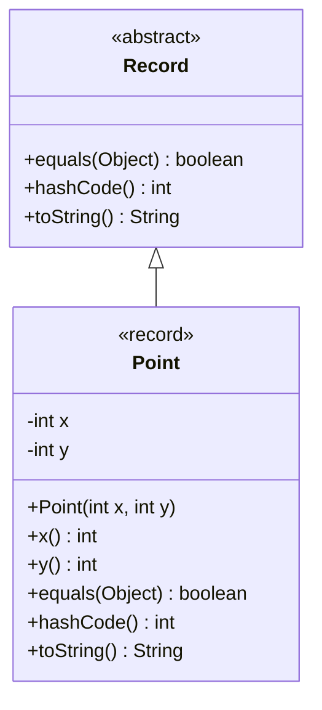
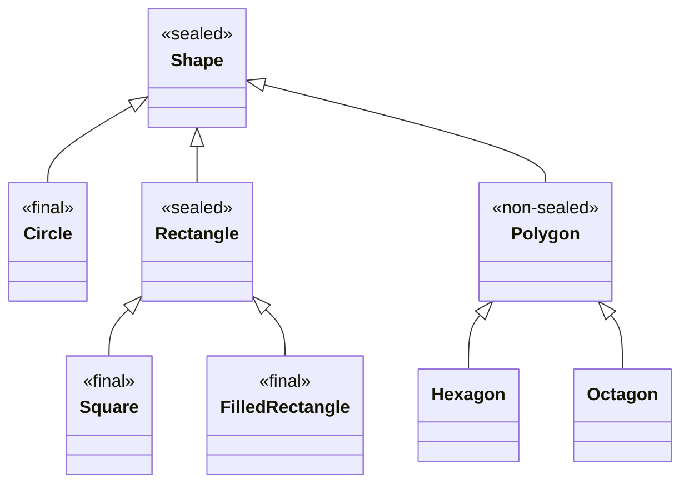
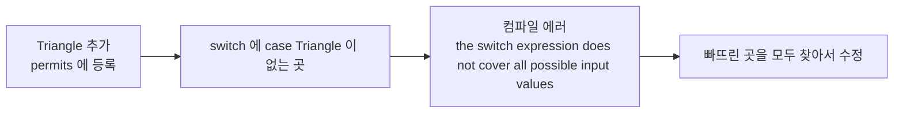

## 개요

| 주제 | 도입 | 핵심 |
| --- | --- | --- |
| **레코드 (record)** | Java 16 | **불변 데이터**를 담는 클래스를 한 줄로 만든다. 생성자, getter, `equals`, `hashCode`, `toString` 자동 생성 |
| **실드 클래스 (sealed class)** | Java 17 | 상속·구현할 수 있는 클래스를 **지정한 것만**으로 제한한다 |
| **레코드 패턴, 패턴 매칭 switch** | Java 21 | 레코드를 분해하고, 실드 계층의 모든 경우를 컴파일러가 검사한다 |

> 레코드 + 실드 인터페이스 + 패턴 매칭 switch 를 함께 쓰면 "정해진 몇 가지 경우 중 하나"인 데이터를 안전하게 다룰 수 있다. 셋이 같이 설계된 기능이다.

---

# Part 1. 레코드 (record)

## 1. 레코드란?

**데이터를 담기만 하는 불변 클래스**를 간단하게 정의하는 특별한 클래스이다.

### 레코드 이전: 반복되는 코드

```java
public final class Point {
    private final int x;
    private final int y;

    public Point(int x, int y) {
        this.x = x;
        this.y = y;
    }

    public int getX() { return x; }
    public int getY() { return y; }

    @Override
    public boolean equals(Object o) {
        if (this == o) return true;
        if (!(o instanceof Point p)) return false;
        return x == p.x && y == p.y;
    }

    @Override
    public int hashCode() { return Objects.hash(x, y); }

    @Override
    public String toString() { return "Point[x=" + x + ", y=" + y + "]"; }
}
```

### 레코드

```java
public record Point(int x, int y) { }    // 위의 코드와 같다
```

```java
Point p = new Point(1, 2);
p.x();                                   // 1    ← getX() 가 아니라 x()
p.toString();                            // Point[x=1, y=2]
p.equals(new Point(1, 2));               // true (값 비교)
```

### 컴파일러가 만들어 주는 것

```text
record Point(int x, int y) { }
             └──────┬─────┘
             레코드 헤더 (구성 요소, component)
```

| 자동 생성 | 내용 |
| --- | --- |
| 필드 | 구성 요소마다 **`private final`** 필드 |
| 표준 생성자 (canonical constructor) | 모든 구성 요소를 받아 필드에 대입 |
| 접근자 메서드 (accessor) | 구성 요소와 **같은 이름**의 메서드: `x()`, `y()` |
| `equals()` | 모든 구성 요소의 값이 같으면 true |
| `hashCode()` | 모든 구성 요소로 계산 |
| `toString()` | `Point[x=1, y=2]` 형식 |



*레코드는 `java.lang.Record` 를 상속한 **final 클래스**로 컴파일된다. 필드는 모두 private final.*

> 💡 **실무 꿀팁**: 레코드의 접근자는 `getX()` 가 아니라 **`x()`** 이다. 그래도 Jackson(2.12+), 스프링 MVC 바인딩, Thymeleaf 등 주요 라이브러리는 레코드를 인식한다.

---

## 2. 레코드의 특징

| 특징 | 설명 |
| --- | --- |
| **final 클래스** | 상속할 수 없다 (자손을 만들 수 없다) |
| **`java.lang.Record` 상속** | 이미 상속하고 있어서 **다른 클래스를 상속할 수 없다** |
| 인터페이스 구현 | **가능** (`record Point(...) implements Comparable<Point>`) |
| 필드 | 구성 요소 필드는 **final**. 추가 **인스턴스 필드는 선언 불가**, static 필드는 가능 |
| 메서드 | 인스턴스 메서드, static 메서드 추가 가능. 접근자 오버라이딩 가능 |
| 생성자 | 표준 생성자를 직접 쓰거나 **간결한(compact) 생성자**로 검증 추가 가능 |
| abstract | 불가 |

```java
public record Point(int x, int y) implements Comparable<Point> {

    public static final Point ORIGIN = new Point(0, 0);    // static 필드 OK
    // private int z;                                      // 에러: 인스턴스 필드 추가 불가

    public double distance(Point other) {                   // 메서드 추가 OK
        return Math.hypot(x - other.x, y - other.y);
    }

    public static Point of(int x, int y) {                  // 정적 팩토리 OK
        return new Point(x, y);
    }

    @Override
    public int compareTo(Point o) {
        return Integer.compare(x, o.x);
    }
}
```

### 간결한 생성자 (Compact Constructor)

**매개변수 목록을 생략**한 생성자. 필드 대입은 컴파일러가 **마지막에 자동으로** 해 준다. 주로 **검증**과 **값 정리**에 쓴다.

```java
public record Range(int start, int end) {
    public Range {                                    // 괄호 () 없음
        if (start > end) {
            throw new IllegalArgumentException("start > end: " + start + ", " + end);
        }
        // this.start = start; this.end = end;        ← 컴파일러가 자동으로 넣는다
    }
}

public record Email(String value) {
    public Email {
        Objects.requireNonNull(value);
        value = value.trim().toLowerCase();           // 매개변수를 바꾸면 바뀐 값이 필드에 들어간다
    }
}
```

### 추가 생성자

- 표준 생성자 외의 생성자는 반드시 **`this(...)` 로 표준 생성자를 호출**해야 한다.

```java
public record Point(int x, int y) {
    public Point() {
        this(0, 0);     // 표준 생성자 호출 필수
    }
}
```

### 주의: 얕은 불변 (shallow immutability)

```java
public record Team(String name, List<String> members) { }

List<String> list = new ArrayList<>(List.of("kim"));
Team team = new Team("dev", list);
list.add("lee");                         // 밖에서 원본을 바꾸면
team.members();                          // [kim, lee] ← 레코드 안의 값도 바뀐다
team.members().add("park");              // 꺼낸 리스트로도 바꿀 수 있다
```

- 필드가 final 이라도 **참조하는 객체가 가변**이면 내용은 바뀐다.
- 컬렉션은 간결한 생성자에서 **불변 복사본**으로 바꿔 둔다.

```java
public record Team(String name, List<String> members) {
    public Team {
        members = List.copyOf(members);  // 불변 복사본 (null 요소는 허용 안 됨)
    }
}
```

> 💡 **실무 꿀팁**: 배열 구성 요소(`int[] scores`)는 `equals` 가 **배열 주소**를 비교해서 내용이 같아도 false 가 나온다. 레코드에는 배열 대신 `List` 를 쓴다.

---

## 3. 레코드의 중첩

레코드 안에, 또는 클래스 안에 레코드를 선언할 수 있다. **중첩 레코드는 자동으로 static** 이다.

```java
public record Order(Long id, Customer customer, List<Item> items) {

    public record Customer(String name, String email) { }        // 중첩 레코드 (static)
    public record Item(String product, int price, int quantity) {
        public int total() { return price * quantity; }
    }

    public int totalPrice() {
        return items.stream().mapToInt(Item::total).sum();
    }
}

var order = new Order(1L,
        new Order.Customer("kim", "kim@test.com"),
        List.of(new Order.Item("pen", 1000, 3), new Order.Item("note", 2000, 1)));
order.totalPrice();   // 5000
```

### 지역 레코드 (Local Record)

메서드 **안에서** 잠깐 쓰는 레코드도 선언할 수 있다. 스트림 중간 결과를 담을 때 편하다.

```java
List<String> topSellers(List<Order> orders) {
    record Sales(String seller, int amount) { }                 // 메서드 안에서만 쓰는 레코드

    return orders.stream()
            .map(o -> new Sales(o.seller(), o.totalPrice()))
            .sorted(Comparator.comparingInt(Sales::amount).reversed())
            .limit(3)
            .map(Sales::seller)
            .toList();
}
```

> 💡 **실무 꿀팁**: 예전에는 중간 결과를 담으려고 `Map.Entry`, `Object[]`, `Pair` 를 썼다. 지역 레코드를 쓰면 `getKey()` 대신 **의미 있는 이름**(`amount()`)으로 읽힌다.

---

## 4. 지네릭 레코드

레코드도 타입 매개변수를 가질 수 있다. (→ [[09. 지네릭스]])

```java
public record Pair<A, B>(A first, B second) { }

Pair<String, Integer> p = new Pair<>("age", 20);
String key = p.first();
Integer value = p.second();
```

### 실무: API 공통 응답

```java
public record ApiResponse<T>(boolean success, T data, ErrorBody error) {

    public record ErrorBody(String code, String message) { }

    public static <T> ApiResponse<T> ok(T data) {
        return new ApiResponse<>(true, data, null);
    }

    public static <T> ApiResponse<T> fail(String code, String message) {
        return new ApiResponse<>(false, null, new ErrorBody(code, message));
    }
}

@GetMapping("/members/{id}")
public ApiResponse<MemberResponse> find(@PathVariable Long id) {
    return ApiResponse.ok(memberService.find(id));
}
```

```json
{ "success": true, "data": { "id": 1, "name": "kim" }, "error": null }
```

---

## 5. 레코드와 애너테이션

레코드 구성 요소에 붙인 애너테이션은 **적용 가능한 곳 모두로 전파**된다. 어디에 적용될지는 애너테이션의 **`@Target`** 이 정한다. (→ [[10. 열거형과 애너테이션]])

```java
public record SignUpRequest(@NotBlank String email) { }
```

```text
@NotBlank String email
        │
        ├── private final 필드 email         (@Target 에 FIELD 가 있으면)
        ├── 표준 생성자의 매개변수 email       (PARAMETER 가 있으면)
        ├── 접근자 메서드 email()             (METHOD 가 있으면)
        ├── 레코드 구성 요소 자체              (RECORD_COMPONENT 가 있으면)
        └── 타입 String                     (TYPE_USE 가 있으면)
```

- 적용 대상이 여러 곳이면 **모두에** 붙는다. 예: `@NotBlank` 는 FIELD, METHOD, PARAMETER, TYPE_USE 등을 대상으로 해서 필드·접근자·매개변수에 붙는다.
- 레코드 구성 요소에만 붙이고 싶으면 `@Target(ElementType.RECORD_COMPONENT)`.

### 실무: 요청 DTO 검증

```java
public record SignUpRequest(
        @NotBlank @Email String email,
        @NotBlank @Size(min = 8, max = 20) String password,
        @JsonProperty("nick_name") String nickname       // JSON 키 이름 지정
) { }

@PostMapping("/members")
public ApiResponse<Long> signUp(@RequestBody @Valid SignUpRequest request) {
    return ApiResponse.ok(memberService.join(request));
}
```

---

## 6. 레코드 패턴 (Java 21)

`instanceof` 와 `switch` 에서 레코드를 **구성 요소로 분해**해서 꺼낼 수 있다.

```java
record Point(int x, int y) { }

// Java 16: 타입 패턴
if (obj instanceof Point p) {
    System.out.println(p.x() + p.y());
}

// Java 21: 레코드 패턴 → 구성 요소를 바로 변수로
if (obj instanceof Point(int x, int y)) {
    System.out.println(x + y);
}

// 중첩 분해
record Line(Point start, Point end) { }

if (obj instanceof Line(Point(var x1, var y1), Point(var x2, var y2))) {
    double length = Math.hypot(x2 - x1, y2 - y1);
}
```

---

## 레코드 실무 꿀팁 모음

| 어디에 | 레코드 사용 | 이유 |
| --- | --- | --- |
| **요청/응답 DTO** | **O** | 데이터만 담고 불변. 가장 많이 쓰는 곳 |
| 값 객체 (Money, Email, Range) | **O** | 값으로 비교, 생성 시 검증 |
| Map 의 키, Set 의 요소 | **O** | equals/hashCode 가 자동이고 불변 |
| 여러 값 반환 | **O** | `Object[]` 나 Map 대신 이름 있는 타입 |
| `@ConfigurationProperties` (Spring Boot 3) | **O** | 설정값을 생성자로 바인딩 |
| JPA 조회 결과(프로젝션) | **O** | `select new com.example.MemberDto(m.id, m.name) from Member m` |
| **JPA 엔티티** | **X** | 엔티티는 기본 생성자, 값 변경, **프록시(상속)**가 필요한데 레코드는 final + 불변 |

```java
// Spring Boot 3: 설정값을 레코드로
@ConfigurationProperties(prefix = "app.jwt")
public record JwtProperties(String secret, Duration accessTokenTtl) { }
```

```yaml
app:
  jwt:
    secret: my-secret
    access-token-ttl: 30m
```

> 💡 **실무 꿀팁**: Lombok 의 `@Value` 와 비슷하지만, 레코드는 **언어 기능**이라 별도 라이브러리가 필요 없다. 다만 레코드는 **빌더가 없다.** 구성 요소가 많으면 생성자 호출이 길어지므로, 필드가 대여섯 개를 넘으면 정적 팩토리 메서드를 두거나 Lombok `@Builder` 를 레코드에 붙여 쓴다.

---

# Part 2. 실드 클래스 (sealed class)

## 7. 실드 클래스란?

**자신을 상속·구현할 수 있는 클래스를 직접 지정**하는 클래스(또는 인터페이스)이다. (Java 17, JEP 409)

```java
public sealed interface Shape permits Circle, Square, Rectangle { }

public record Circle(double radius) implements Shape { }
public record Square(double side) implements Shape { }
public record Rectangle(double width, double height) implements Shape { }

public record Triangle(double base, double height) implements Shape { }   // 에러: permits 에 없음
```

### 왜 필요한가

| 선택지 | 상속 가능한 클래스 | 문제 |
| --- | --- | --- |
| `final` | **없음** | 하위 타입을 둘 수 없다 |
| 일반 클래스 / 인터페이스 | **누구나** | 어떤 하위 타입이 있는지 알 수 없다 → 모든 경우를 처리했는지 검사 불가 |
| **`sealed`** | **지정한 것만** | 하위 타입 목록이 정해져 있어 **컴파일러가 모든 경우를 확인**할 수 있다 |

- 도메인에 **정해진 몇 가지 종류**만 있을 때 쓴다: 도형 = 원·사각형·삼각형, 결제 수단 = 카드·계좌·포인트, 결과 = 성공·실패.
- "누가 상속해도 되는 확장 지점"이 아니라 "**이 목록이 전부**"라는 설계 의도를 코드로 표현한다.

---

## 8. 실드 클래스의 제약 조건



*sealed 계층의 예. 허락된 자손은 각각 `final`(끝), `sealed`(다시 제한), `non-sealed`(다시 개방) 중 하나를 선택한다.*

```java
public sealed abstract class Shape permits Circle, Rectangle, Polygon { }

public final class Circle extends Shape { }                                    // 더 이상 상속 불가

public sealed class Rectangle extends Shape permits Square, FilledRectangle { } // 다시 제한
public final class Square extends Rectangle { }
public final class FilledRectangle extends Rectangle { }

public non-sealed class Polygon extends Shape { }                              // 누구나 상속 가능
public class Hexagon extends Polygon { }
```

### 규칙

| 규칙 | 설명 |
| --- | --- |
| 1. 직접 상속 | `permits` 에 적은 클래스는 실드 클래스를 **직접** 상속·구현해야 한다 |
| 2. 제어자 필수 | 허락된 자손은 **`final`, `sealed`, `non-sealed` 중 하나**를 반드시 붙인다 |
| 3. 같은 위치 | 실드 클래스와 자손은 **같은 모듈**에 있어야 한다. 모듈을 쓰지 않으면 **같은 패키지** |
| 4. permits 생략 | 자손이 **같은 소스 파일**에 있으면 `permits` 를 생략할 수 있다 (컴파일러가 찾는다) |

| 자손의 제어자 | 의미 |
| --- | --- |
| `final` | 더 이상 상속할 수 없다. **레코드는 자동으로 final** 이라 따로 붙이지 않는다 |
| `sealed` | 다시 `permits` 로 자손을 제한한다 |
| `non-sealed` | 제한을 풀어 **누구나** 상속할 수 있게 한다 |

```java
// 같은 파일에 있으면 permits 생략
public sealed interface Result<T> {
    record Success<T>(T value) implements Result<T> { }
    record Failure<T>(String message) implements Result<T> { }
}
```

> 참고: **열거형(enum)** 은 상수 목록이 고정된 **값**의 집합이고, 실드 클래스는 하위 **타입**의 집합이다. 상수마다 다른 데이터를 가져야 하면 sealed + record 가 맞다.

---

## 9. 실드 클래스와 switch 식

실드 계층은 하위 타입이 정해져 있어서, **패턴 매칭 switch**(Java 21)에서 **모든 경우를 다뤘는지** 컴파일러가 확인한다. **default 가 필요 없다.**

```java
sealed interface Shape permits Circle, Square, Rectangle { }
record Circle(double radius) implements Shape { }
record Square(double side) implements Shape { }
record Rectangle(double width, double height) implements Shape { }

double area(Shape shape) {
    return switch (shape) {
        case Circle c    -> Math.PI * c.radius() * c.radius();
        case Square s    -> s.side() * s.side();
        case Rectangle r -> r.width() * r.height();
        // default 없음: 세 경우가 전부라는 걸 컴파일러가 안다
    };
}
```

### 레코드 패턴 + when 조건

```java
String describe(Shape shape) {
    return switch (shape) {
        case Circle(double r) when r == 0       -> "점";
        case Circle(double r)                   -> "반지름 " + r + " 인 원";
        case Square(double s)                   -> "한 변이 " + s + " 인 정사각형";
        case Rectangle(double w, double h) when w == h -> "정사각형 모양의 직사각형";
        case Rectangle(double w, double h)      -> w + " x " + h + " 직사각형";
    };
}
```

- `when` 으로 **조건을 추가**한다. 더 구체적인 case 를 **위에** 둔다. (위의 case 가 아래를 완전히 덮으면 컴파일 에러)

### 새 하위 타입을 추가하면



- default 를 넣어 두면 이 검사가 **동작하지 않는다.** 새 타입이 조용히 default 로 빠진다.

> 💡 **실무 꿀팁**: 실드 계층을 switch 할 때는 **default 를 쓰지 않는다.** 타입이 추가되면 처리해야 할 곳을 컴파일러가 전부 알려 준다. 리팩터링할 때 가장 든든한 안전장치다.

---

## 실드 클래스 실무 꿀팁 모음

### 1. 성공/실패 결과 타입

```java
public sealed interface PaymentResult {
    record Approved(String transactionId, long amount) implements PaymentResult { }
    record Declined(String reason) implements PaymentResult { }
    record Pending(Duration retryAfter) implements PaymentResult { }
}

PaymentResult result = paymentGateway.pay(request);

String message = switch (result) {
    case PaymentResult.Approved(var txId, var amount) -> "결제 완료: " + txId;
    case PaymentResult.Declined(var reason)           -> "결제 거절: " + reason;
    case PaymentResult.Pending(var retry)             -> retry.toSeconds() + "초 후 재시도";
};
```

- 예외를 던지는 대신 **결과를 타입으로** 표현한다. 호출하는 쪽이 모든 경우를 처리하도록 컴파일러가 강제한다.

### 2. 도메인 이벤트, 명령(Command)

```java
public sealed interface OrderEvent permits OrderPlaced, OrderPaid, OrderCanceled { }
public record OrderPlaced(Long orderId, LocalDateTime at) implements OrderEvent { }
public record OrderPaid(Long orderId, long amount) implements OrderEvent { }
public record OrderCanceled(Long orderId, String reason) implements OrderEvent { }
```

### 3. JSON 다형성

- 실드 인터페이스를 JSON 으로 주고받을 때는 Jackson 의 `@JsonTypeInfo` + `@JsonSubTypes` 로 타입 정보를 넣는다.

```java
@JsonTypeInfo(use = JsonTypeInfo.Id.NAME, property = "type")
@JsonSubTypes({
        @JsonSubTypes.Type(value = Circle.class, name = "circle"),
        @JsonSubTypes.Type(value = Square.class, name = "square")
})
public sealed interface Shape permits Circle, Square { }
// {"type": "circle", "radius": 3.0}
```

### 4. 언제 쓰지 않나

- 외부 개발자가 **새 구현을 추가**해야 하는 확장 지점(플러그인, 스프링의 `HandlerInterceptor` 같은 것)은 일반 인터페이스로 둔다.

---

# 핵심 정리

### 레코드

- `record Point(int x, int y) {}` → **private final 필드, 표준 생성자, 접근자 `x()`, equals/hashCode/toString** 자동.
- **final** 이고 `java.lang.Record` 를 상속 → 상속 X, 다른 클래스 상속 X, **인터페이스 구현 O**.
- 인스턴스 필드 추가 X (static O), 메서드 추가 O.
- **간결한 생성자**로 검증·정규화. 추가 생성자는 `this(...)` 필수.
- **얕은 불변**: 컬렉션은 `List.copyOf()` 로 복사, 배열 대신 List.
- 중첩 레코드는 자동 static, **지역 레코드**로 중간 결과 담기, 지네릭 레코드 가능.
- 구성 요소의 애너테이션은 `@Target` 에 맞는 **필드·매개변수·접근자 모두**에 전파.
- DTO, 값 객체, 설정, 프로젝션에 사용. **JPA 엔티티로는 쓰지 않는다.**

### 실드 클래스

- `sealed ... permits A, B` 로 **허락된 자손만** 상속·구현.
- 자손은 **final / sealed / non-sealed** 중 하나 (레코드는 자동 final). 같은 모듈(또는 패키지), 같은 파일이면 permits 생략.
- 패턴 매칭 switch 에서 **모든 경우를 다루면 default 불필요**, 타입이 추가되면 **컴파일 에러**로 알려 준다 → default 를 쓰지 않는다.
- sealed 인터페이스 + record = 결과 타입, 이벤트, 도메인 모델링.

---

## 참고 자료

### Java 21 언어 가이드 (Oracle)

- [Record Classes](https://docs.oracle.com/en/java/javase/21/language/records.html)
- [Sealed Classes](https://docs.oracle.com/en/java/javase/21/language/sealed-classes-and-interfaces.html)
- [Record Patterns](https://docs.oracle.com/en/java/javase/21/language/record-patterns.html)
- [Pattern Matching for switch Expressions and Statements](https://docs.oracle.com/en/java/javase/21/language/pattern-matching-switch.html)
- API: [java.lang.Record](https://docs.oracle.com/en/java/javase/21/docs/api/java.base/java/lang/Record.html)

### JEP (OpenJDK)

- [JEP 395: Records](https://openjdk.org/jeps/395) (Java 16)
- [JEP 409: Sealed Classes](https://openjdk.org/jeps/409) (Java 17)
- [JEP 440: Record Patterns](https://openjdk.org/jeps/440) (Java 21)
- [JEP 441: Pattern Matching for switch](https://openjdk.org/jeps/441) (Java 21)
