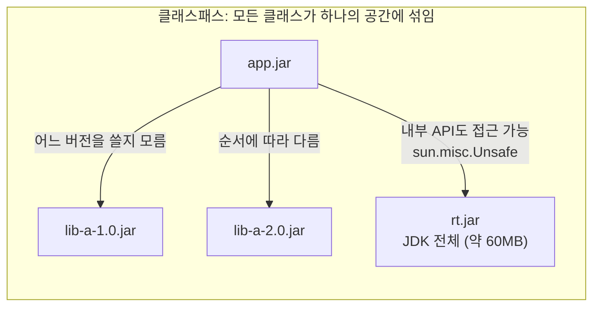
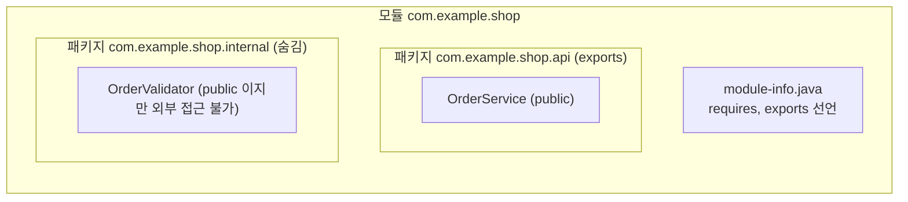
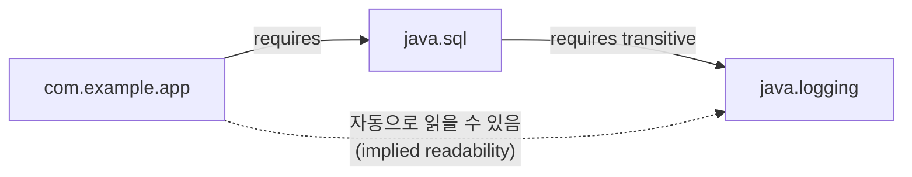
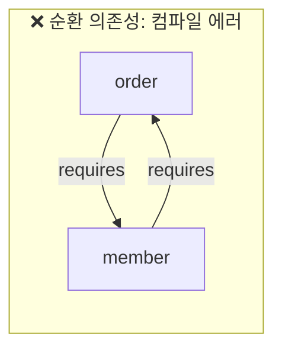
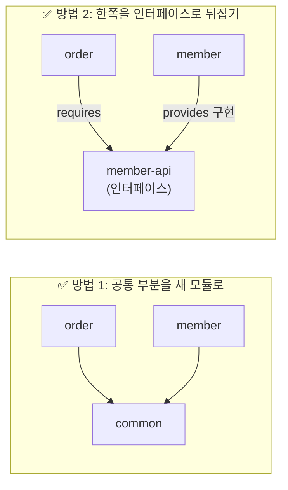
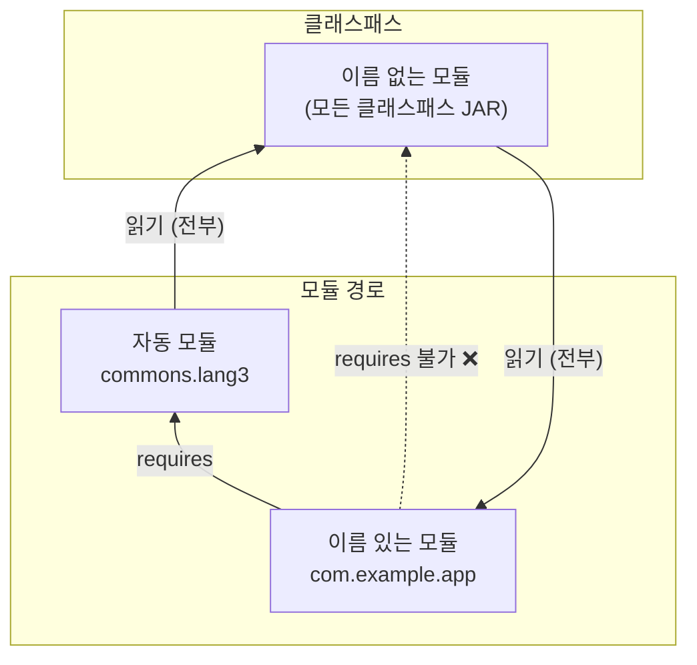

## 개요

**모듈(module)**은 **관련된 패키지들을 하나로 묶고**, 그중 **무엇을 밖에 공개하고 무엇에 의존하는지**를 명시하는 단위이다. Java 9 에서 도입된 **자바 플랫폼 모듈 시스템(JPMS, Java Platform Module System)**, 프로젝트 이름으로는 **Jigsaw** 이다.

| 주제 | 핵심 |
| --- | --- |
| 모듈 | 패키지의 묶음 + `module-info.java` |
| 모듈 설명자 | `requires`(의존), `exports`(공개), `opens`(리플렉션 허용) 등을 선언 |
| 이름 없는 모듈, java.base | 클래스패스의 코드, 모든 모듈이 기본으로 의존하는 모듈 |
| 전이적 · 순환 의존성 | `requires transitive`, 순환은 금지 |
| 컴파일과 실행 | `--module-path`, `-m`, `jlink` |
| 자동 모듈 | module-info 가 없는 JAR 를 모듈 경로에 둔 것 |

> ⚠️ **헷갈리기 쉬운 것**: Gradle/Maven 의 **멀티 모듈 프로젝트**(`:api`, `:core` 서브프로젝트)와 **JPMS 모듈**은 **다른 개념**이다. 빌드 도구의 모듈은 빌드 단위, JPMS 모듈은 언어·JVM 차원의 캡슐화 단위이다.

---

# 1. 모듈이란?

## 모듈 이전의 문제: 클래스패스

Java 8 까지는 모든 JAR 를 **클래스패스(classpath)** 에 한꺼번에 올렸다.



| 문제 | 설명 |
| --- | --- |
| **약한 캡슐화** | `public` 이면 **누구나** 접근할 수 있다. 라이브러리 내부용 클래스도 숨길 방법이 없다 |
| **의존성 누락을 늦게 발견** | 필요한 JAR 가 없으면 **실행 중** 그 클래스를 처음 쓸 때 `NoClassDefFoundError` |
| **JAR 지옥** | 같은 클래스가 여러 JAR 에 있으면 클래스패스 **순서**에 따라 어떤 것이 쓰일지 달라진다 |
| **거대한 JDK** | 작은 프로그램도 JDK 전체(`rt.jar`)를 가지고 다녀야 했다 |

## 모듈이 해결하는 것

| 목표 | 설명 |
| --- | --- |
| **강한 캡슐화** | 모듈이 **`exports` 한 패키지의 public 타입만** 밖에서 쓸 수 있다 |
| **신뢰할 수 있는 구성** | 모듈마다 의존성을 명시하고, **시작할 때** 필요한 모듈이 모두 있는지 검사한다 |
| **확장 가능한 플랫폼** | JDK 자체를 약 70개 모듈로 나눴다 (JEP 200). 필요한 모듈만 골라 **작은 런타임**을 만들 수 있다 (`jlink`) |

## 모듈 · 패키지 · 클래스



### public 의 의미가 바뀌었다

| 상황 | 다른 모듈에서 접근 |
| --- | --- |
| public 클래스 + 패키지를 **exports** | **O** |
| public 클래스 + 패키지를 exports **안 함** | **X** (모듈 안에서만 public) |
| default / private | X |

- 모듈 시스템에서 `public` 은 "**모든 곳**"이 아니라 "**이 모듈 안 + 이 모듈을 읽는 모듈 중 exports 된 패키지**"를 뜻한다.

### JDK 도 모듈로 나뉘어 있다


*`java.se` 모듈의 의존 그래프. Java SE 전체가 여러 모듈로 나뉘어 있고, 맨 아래 **java.base** 에 모두 의존한다 (출처: Oracle, Java SE 21 API 문서, java.se 모듈)*

```bash
java --list-modules                  # JDK 에 있는 모든 모듈 목록
java --describe-module java.sql      # 모듈 설명자 보기
```

---

# 2. 모듈 설명자 (module-info.java)

모듈의 **루트 디렉터리**에 두는 `module-info.java` 파일. 모듈의 이름, 의존성, 공개할 패키지를 선언한다.

```text
src/
└── com.example.shop/                  ← 모듈 디렉터리 (이름은 보통 모듈 이름과 같게)
    ├── module-info.java               ← 모듈 설명자
    └── com/example/shop/
        ├── api/OrderService.java
        └── internal/OrderValidator.java
```

```java
module com.example.shop {                       // 모듈 이름: 패키지처럼 도메인을 거꾸로
    requires java.sql;                          // 의존하는 모듈
    requires transitive com.example.common;     // 의존 + 나를 쓰는 모듈에게도 전달
    requires static lombok;                     // 컴파일할 때만 필요 (실행 시 없어도 됨)

    exports com.example.shop.api;               // 이 패키지를 모든 모듈에 공개
    exports com.example.shop.spi to com.example.plugin;   // 지정한 모듈에만 공개

    opens com.example.shop.domain;              // 리플렉션(깊은 접근) 허용

    uses com.example.shop.spi.PaymentProvider;                     // 서비스 사용
    provides com.example.shop.spi.PaymentProvider
        with com.example.shop.internal.CardPaymentProvider;       // 서비스 구현 제공
}
```

## 지시어 정리

| 지시어 | 의미 |
| --- | --- |
| `requires M` | 모듈 M 에 **의존**한다 (M 이 exports 한 패키지를 읽을 수 있다) |
| `requires transitive M` | M 에 의존하고, **나를 requires 하는 모듈도 M 을 읽게** 한다 |
| `requires static M` | **컴파일할 때만** 필요하다. 실행할 때는 없어도 된다 (선택적 의존성) |
| `exports P` | 패키지 P 의 public 타입을 **모든 모듈**에 공개한다 (컴파일·실행 모두) |
| `exports P to M` | 패키지 P 를 **지정한 모듈 M 에만** 공개한다 (qualified export) |
| `opens P` / `opens P to M` | 패키지 P 를 **실행 중 리플렉션**으로 접근하게 허용한다 (private 멤버 포함) |
| `open module X { }` | 모듈의 **모든 패키지**를 리플렉션에 연다 |
| `uses S` | 서비스 인터페이스 S 의 구현을 `ServiceLoader` 로 **찾아 쓴다** |
| `provides S with I` | 서비스 S 의 구현 I 를 **제공**한다 |

## exports vs opens

| 구분 | exports | opens |
| --- | --- | --- |
| 컴파일 시점 접근 | **O** | X |
| 실행 시점 일반 접근 (public) | **O** | X (exports 도 해야 함) |
| 리플렉션으로 **private** 접근 | X | **O** |
| 쓰임 | 다른 모듈이 **API 로 사용** | 프레임워크가 **리플렉션**으로 필드를 읽고 쓰기 (Jackson, Hibernate, Spring) |

> 💡 **실무 꿀팁**: JPMS 를 적용한 모듈에서 Jackson 직렬화나 JPA 엔티티 매핑이 안 되고 `InaccessibleObjectException` 이 나면, 대부분 그 패키지를 **`opens`** 하지 않아서다.
> ```java
> opens com.example.shop.domain to com.fasterxml.jackson.databind, org.hibernate.orm.core;
> ```

## 서비스 (uses / provides)

**인터페이스를 쓰는 쪽과 구현하는 쪽 모듈을 분리**하는 방법. 쓰는 쪽은 구현 모듈을 `requires` 하지 않는다.

```java
// 사용하는 쪽
ServiceLoader<PaymentProvider> loader = ServiceLoader.load(PaymentProvider.class);
for (PaymentProvider p : loader) {
    p.pay(...);
}
```

- JDBC 드라이버가 이 방식으로 로딩된다 (`java.sql.Driver` 서비스). 그래서 `Class.forName("com.mysql.cj.jdbc.Driver")` 를 더 이상 쓰지 않아도 된다.

---

# 3. 이름 없는 모듈과 java.base 모듈

## java.base 모듈

- 자바의 **가장 기본이 되는 모듈**. `java.lang`, `java.util`, `java.io`, `java.time`, `java.math`, `java.net`, `java.nio` 등이 들어 있다.
- **모든 모듈은 자동으로 java.base 를 requires** 한다. 직접 쓰지 않아도 된다.
- java.base 는 **어떤 모듈에도 의존하지 않는다.** 모듈 그래프의 맨 아래이다.


*java.base 는 의존하는 모듈이 없다 (출처: Oracle, Java SE 21 API 문서, java.base 모듈)*

## 이름 없는 모듈 (Unnamed Module)

**클래스패스**에 있는 모든 클래스(JAR)는 **하나의 이름 없는 모듈**에 속한다.

| 특징 | 내용 |
| --- | --- |
| 읽기 | **모든 모듈**을 읽을 수 있다 |
| 공개 | 자신의 **모든 패키지**를 exports, opens 한 것으로 본다 |
| 제약 | 이름이 없으니 **이름 있는 모듈이 requires 할 수 없다** |

- 그래서 module-info.java 가 없는 기존 프로그램(Java 8 이전 방식)도 **그대로 동작**한다. 모듈 시스템과의 호환을 위한 장치이다.

> 💡 **실무 꿀팁**: 대부분의 **스프링 부트 애플리케이션은 module-info.java 없이** 클래스패스로 실행된다. 즉 우리 코드는 이름 없는 모듈이다. 그래도 JDK 는 모듈로 나뉘어 있어서, 아래처럼 JDK 내부에 리플렉션으로 접근하는 **오래된 라이브러리**에서 에러가 날 수 있다.
> ```text
> java.lang.reflect.InaccessibleObjectException:
>   Unable to make field private final byte[] java.lang.String.value accessible:
>   module java.base does not "opens java.lang" to unnamed module @1a2b3c
> ```
> Java 16 부터 JDK 내부를 강하게 캡슐화했기 때문이다 (JEP 396, Java 17 JEP 403). **라이브러리를 최신 버전으로 올리는 것**이 정답이고, 당장 어렵다면 실행 옵션으로 열어 준다.
> ```bash
> java --add-opens java.base/java.lang=ALL-UNNAMED -jar app.jar
> ```

---

# 4. 전이적 의존성과 순환 의존성

## 전이적 의존성 (requires transitive)

A 가 B 를 requires 하고, B 가 C 를 **requires transitive** 하면, A 는 C 를 따로 requires 하지 않아도 **C 를 읽을 수 있다** (implied readability).

### 왜 필요한가

```java
// java.sql 모듈의 Driver 인터페이스
public interface Driver {
    Logger getParentLogger();     // java.util.logging.Logger → java.logging 모듈의 타입
}
```

- java.sql 을 쓰는 코드는 `getParentLogger()` 의 반환 타입 `Logger` 도 쓸 수 있어야 한다.
- java.sql 의 API 에 **다른 모듈의 타입이 노출**되므로, java.sql 은 그 모듈을 `requires transitive` 로 선언한다.


*java.sql 모듈의 의존 그래프. java.logging, java.xml, java.transaction.xa 를 **requires transitive** 한다 (진한 화살표). 모든 모듈은 java.base 에 의존한다 (연한 화살표) (출처: Oracle, Java SE 21 API 문서, java.sql 모듈)*

```java
module java.sql {
    requires transitive java.logging;
    requires transitive java.transaction.xa;
    requires transitive java.xml;
    exports java.sql;
    exports javax.sql;
    uses java.sql.Driver;
}

module com.example.app {
    requires java.sql;            // java.logging 을 따로 requires 하지 않아도 Logger 사용 가능
}
```



| 언제 transitive | 예 |
| --- | --- |
| 내 모듈의 **공개 API**(exports 한 타입의 메서드 시그니처)에 그 모듈의 타입이 나올 때 | 반환 타입, 매개변수 타입, 상속한 타입 |
| 내부 구현에서만 쓸 때 | **transitive 를 붙이지 않는다** (필요 이상으로 의존성이 퍼진다) |

## 순환 의존성 (Cyclic Dependency)

두 모듈이 **서로를 requires** 하는 것. 모듈 시스템은 **컴파일 시점에 금지**한다.



```text
error: cyclic dependence involving order
```

### 해결 방법



- 순환 의존은 두 모듈이 **사실상 하나**라는 신호다. 구조를 다시 나누거나, 의존 방향을 한쪽으로 정리한다.

> 💡 **실무 꿀팁**: JPMS 를 쓰지 않는 스프링 프로젝트에서도 **패키지 간 순환 의존**은 같은 문제를 만든다. **ArchUnit**(테스트로 의존 규칙 검사)이나 **Spring Modulith**(애플리케이션 모듈 경계 검증)로 순환을 막을 수 있다.

---

# 5. 모듈의 컴파일과 실행

## 클래스패스 vs 모듈 경로

| 구분 | 클래스패스 (`-cp`) | 모듈 경로 (`-p`, `--module-path`) |
| --- | --- | --- |
| module-info 가 **있는** JAR | 이름 없는 모듈의 일부로 취급 (module-info 무시) | **이름 있는 모듈** |
| module-info 가 **없는** JAR | 이름 없는 모듈 | **자동 모듈** |

## 컴파일

```bash
# 모듈 하나
javac -d out/com.example.shop \
      src/com.example.shop/module-info.java \
      $(find src/com.example.shop -name "*.java")

# 여러 모듈을 한 번에
javac -d out --module-source-path src -m com.example.shop,com.example.app
```

## 실행

```bash
java --module-path out --module com.example.app/com.example.app.Main
java -p out -m com.example.app/com.example.app.Main          # 짧은 옵션

# 모듈 JAR 로 만들기 (메인 클래스 지정)
jar --create --file mods/app.jar --main-class com.example.app.Main -C out/com.example.app .
java -p mods -m com.example.app                              # 메인 클래스 생략 가능
```

## 자주 쓰는 옵션

| 옵션 | 설명 |
| --- | --- |
| `-p`, `--module-path` | 모듈을 찾을 경로 |
| `-m`, `--module` | 실행(컴파일)할 모듈, `모듈/메인클래스` |
| `--add-modules M` | 기본으로 해석되지 않는 모듈을 추가 |
| `--add-exports M/P=TARGET` | exports 하지 않은 패키지를 강제로 공개 |
| `--add-opens M/P=TARGET` | 리플렉션 접근을 강제로 허용 (`ALL-UNNAMED` = 클래스패스 코드) |
| `--add-reads M=TARGET` | 모듈이 다른 모듈을 읽게 추가 |
| `--describe-module M` | 모듈 설명자 출력 |
| `--show-module-resolution` | 시작할 때 모듈이 해석되는 과정 출력 |

## jdeps 와 jlink

| 도구 | 하는 일 |
| --- | --- |
| **jdeps** | JAR/클래스가 **어떤 모듈과 패키지에 의존**하는지 분석. JDK 내부 API 사용도 찾아 준다 |
| **jlink** | 필요한 모듈만 모아 **나만의 작은 Java 런타임**을 만든다 |

```bash
# 1. 이 애플리케이션이 쓰는 JDK 모듈 확인
jdeps --print-module-deps --ignore-missing-deps app.jar
# java.base,java.logging,java.sql,java.naming

# 2. 그 모듈만 넣은 런타임 만들기
jlink --add-modules java.base,java.logging,java.sql,java.naming \
      --strip-debug --no-header-files --no-man-pages --compress zip-6 \
      --output custom-jre

custom-jre/bin/java -jar app.jar
```

> 💡 **실무 꿀팁: 도커 이미지 줄이기**
> ```dockerfile
> FROM eclipse-temurin:21-jdk AS build
> COPY app.jar /app/app.jar
> RUN jlink --add-modules $(jdeps --print-module-deps --ignore-missing-deps /app/app.jar) \
>           --strip-debug --no-header-files --no-man-pages --compress zip-6 --output /jre
>
> FROM debian:bookworm-slim
> COPY --from=build /jre /opt/jre
> COPY --from=build /app/app.jar /app/app.jar
> ENTRYPOINT ["/opt/jre/bin/java", "-jar", "/app/app.jar"]
> ```
> 전체 JDK 대신 필요한 모듈만 담아 이미지 크기를 크게 줄일 수 있다. 스프링 부트처럼 리플렉션을 많이 쓰는 앱은 jdeps 가 놓치는 모듈이 있을 수 있으니 **실행 테스트**를 꼭 한다.

---

# 6. 자동 모듈 (Automatic Module)

module-info.java 가 **없는 일반 JAR** 를 **모듈 경로**에 두면 **자동 모듈**이 된다. 아직 모듈화되지 않은 라이브러리를 모듈 프로젝트에서 쓸 수 있게 해 주는 **다리** 역할이다.

### 자동 모듈의 이름

1. JAR 의 `META-INF/MANIFEST.MF` 에 **`Automatic-Module-Name`** 이 있으면 그 이름
2. 없으면 **JAR 파일 이름**에서 만든다: `commons-lang3-3.14.0.jar` → `commons.lang3` (버전 제거, `-` 는 `.` 으로)

### 자동 모듈의 특징

| 특징 | 내용 |
| --- | --- |
| exports / opens | JAR 의 **모든 패키지**를 exports, opens 한다 |
| requires | **모든 모듈**(이름 없는 모듈 포함)을 읽는다 |
| 이름 | 있다 → 이름 있는 모듈이 **requires 할 수 있다** |

## 세 종류 모듈 비교

| 구분 | 이름 있는 모듈 | 자동 모듈 | 이름 없는 모듈 |
| --- | --- | --- | --- |
| 만들어지는 방법 | module-info 가 있는 JAR 를 **모듈 경로**에 | module-info 가 **없는** JAR 를 **모듈 경로**에 | **클래스패스**의 모든 코드 |
| 이름 | module-info 에 선언 | Manifest 또는 파일 이름 | 없음 |
| 공개하는 패키지 | exports 한 것만 | **전부** | **전부** |
| 읽을 수 있는 모듈 | requires 한 것만 | **전부** (이름 없는 모듈 포함) | **전부** |
| 다른 모듈이 requires | O | **O** | **X** |



## 기존 프로젝트를 모듈로 옮기는 방법

| 방식 | 설명 |
| --- | --- |
| **상향식 (bottom-up)** | 의존성이 없는 **맨 아래 라이브러리부터** module-info 를 추가해 이름 있는 모듈로 만든다 |
| **하향식 (top-down)** | 애플리케이션부터 모듈로 만들고, 아직 모듈이 아닌 라이브러리는 **자동 모듈**로 쓴다 |

> 💡 **실무 꿀팁**: 라이브러리를 만들어 배포한다면, module-info 를 넣지 않더라도 **`Automatic-Module-Name`** 을 Manifest 에 꼭 넣는다. 파일 이름에서 만들어진 이름은 버전이나 파일명이 바뀌면 달라질 수 있어서, 사용하는 쪽의 `requires` 가 깨진다.
> ```kotlin
> // Gradle (Kotlin DSL)
> tasks.jar {
>     manifest { attributes("Automatic-Module-Name" to "com.example.mylib") }
> }
> ```

---

# 핵심 정리

- 모듈 = **패키지 묶음 + module-info.java**. 목표는 **강한 캡슐화**, **신뢰할 수 있는 구성**, **작은 런타임**.
- 모듈에서 public 은 **exports 한 패키지**에서만 밖으로 보인다.
- `requires`(의존), `requires transitive`(나를 쓰는 쪽에도 전달), `requires static`(컴파일 전용), `exports`(API 공개), `opens`(리플렉션 허용), `uses`/`provides`(서비스).
- **java.base** 는 모든 모듈이 자동으로 의존. 클래스패스 코드는 **이름 없는 모듈**: 모든 걸 읽고 모든 걸 공개하지만, 이름 있는 모듈이 requires 할 수 없다.
- 공개 API 에 다른 모듈의 타입이 나오면 **requires transitive** (예: java.sql → java.logging). **순환 의존은 금지**.
- 실행: `java -p 모듈경로 -m 모듈/메인클래스`. 분석은 **jdeps**, 작은 런타임은 **jlink**.
- module-info 없는 JAR 를 모듈 경로에 두면 **자동 모듈**: 이름은 `Automatic-Module-Name` 또는 파일 이름, 모든 패키지 공개.
- 스프링 부트 앱은 보통 클래스패스(이름 없는 모듈)로 실행. 오래된 라이브러리의 `InaccessibleObjectException` 은 **업그레이드** 또는 `--add-opens`.
- **Gradle 멀티 모듈 ≠ JPMS 모듈.**

---

## 참고 자료

### JEP (OpenJDK)

- [JEP 261: Module System](https://openjdk.org/jeps/261)
- [JEP 200: The Modular JDK](https://openjdk.org/jeps/200)
- [JEP 282: jlink: The Java Linker](https://openjdk.org/jeps/282)
- [JEP 396: Strongly Encapsulate JDK Internals by Default](https://openjdk.org/jeps/396) · [JEP 403: Strongly Encapsulate JDK Internals](https://openjdk.org/jeps/403)
- [The State of the Module System](https://openjdk.org/projects/jigsaw/spec/sotms/): 모듈 시스템 설계 문서

### Oracle (Java SE 21)

- 모듈 그래프: [java.se](https://docs.oracle.com/en/java/javase/21/docs/api/java.se/module-summary.html) · [java.base](https://docs.oracle.com/en/java/javase/21/docs/api/java.base/module-summary.html) · [java.sql](https://docs.oracle.com/en/java/javase/21/docs/api/java.sql/module-summary.html)
- 도구: [java](https://docs.oracle.com/en/java/javase/21/docs/specs/man/java.html) · [javac](https://docs.oracle.com/en/java/javase/21/docs/specs/man/javac.html) · [jdeps](https://docs.oracle.com/en/java/javase/21/docs/specs/man/jdeps.html) · [jlink](https://docs.oracle.com/en/java/javase/21/docs/specs/man/jlink.html)
- API: [java.lang.Module](https://docs.oracle.com/en/java/javase/21/docs/api/java.base/java/lang/Module.html) · [java.util.ServiceLoader](https://docs.oracle.com/en/java/javase/21/docs/api/java.base/java/util/ServiceLoader.html)
