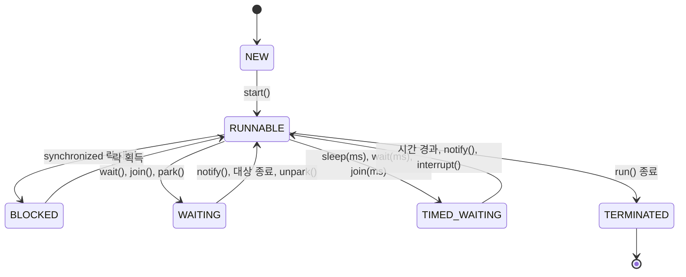
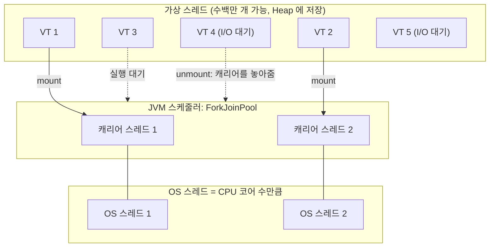
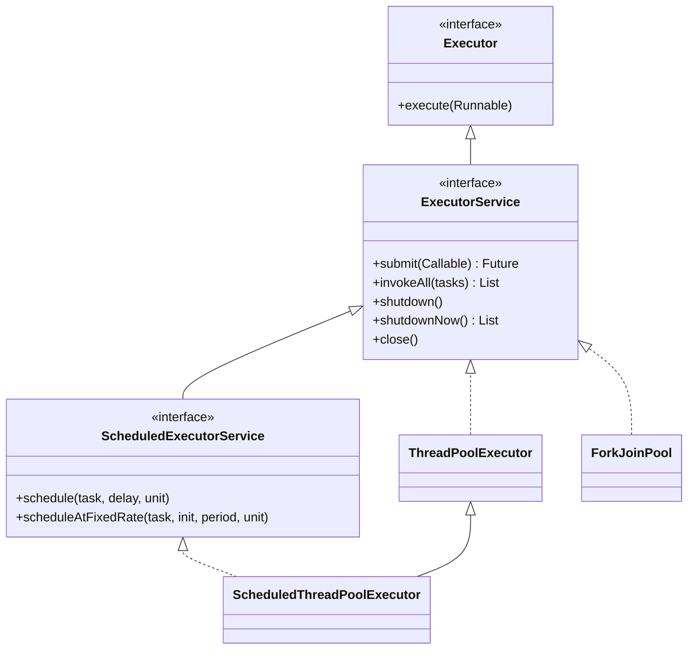

## 개요

**스레드(thread)**는 프로그램 안에서 실제로 작업을 수행하는 **실행 흐름**이다. 하나의 프로그램이 여러 스레드로 **동시에 여러 일**을 할 수 있다.

| 파트 | 주제 |
| --- | --- |
| 1. 기초 | 프로세스와 스레드, 멀티스레딩, 스레드 생성·실행, 우선순위, 그룹, 데몬 |
| 2. 실행 제어 | 스레드 상태, sleep, interrupt, join |
| 3. 동기화 | synchronized, wait/notify, Lock/Condition, volatile |
| 4. 병렬 처리 | Fork/Join 프레임워크 |
| 5. 가상 스레드 (Java 21) | 개념, 생성, 플랫폼 스레드와 비교, 상태, 주의사항, Continuation |
| 6. 실행 프레임워크 | Executor, ThreadFactory, ExecutorService, 스레드 풀, Future, CompletableFuture |

> 메모리 구조(스레드마다 따로 있는 Call Stack, 공유하는 Heap)는 → [[02. JVM]]

---

# Part 1. 스레드 기초

## 1. 프로세스와 스레드

| 구분 | 프로세스 (process) | 스레드 (thread) |
| --- | --- | --- |
| 정의 | **실행 중인 프로그램** | 프로세스 안에서 **실제로 작업을 수행하는 단위** |
| 자원 | OS 로부터 메모리, 파일 등 **자원을 할당받는다** | 프로세스의 자원을 **공유**한다 |
| 관계 | 스레드를 **최소 1개** 가진다 | 반드시 어떤 프로세스에 속한다 |
| 비유 | 공장 | 공장 안의 일꾼 |


*디스크의 **프로그램**이 메모리에 올라가 **프로세스**가 되고, 그 안의 **스레드**들을 OS 스케줄러가 골라 CPU 에서 실행한다 (출처: [Wikimedia Commons](https://commons.wikimedia.org/wiki/File:Program_Process_Thread_Infographic.svg), Trara123 외, CC BY-SA 4.0)*

### 스레드가 공유하는 것, 따로 가지는 것


*싱글 스레드 프로세스와 멀티 스레드 프로세스. code, data, heap 은 **공유**하고 **stack 은 스레드마다 따로** 가진다 (출처: [Wikimedia Commons](https://commons.wikimedia.org/wiki/File:Single_vs_multithreaded_processes.jpg), TomV13, CC BY-SA 3.0)*

| 공유 | 스레드마다 따로 |
| --- | --- |
| Heap (객체, 인스턴스 변수) | **Call Stack** (지역 변수, 매개변수) |
| Method Area (클래스 정보, static 변수) | PC Register (현재 실행 위치) |

> 💡 **실무 꿀팁**: 공유되는 **Heap 의 객체와 static 변수**가 동시성 버그의 원인이다. 스프링 빈은 기본이 **싱글톤**이라 모든 요청 스레드가 같은 객체를 쓴다. 서비스·컨트롤러에 **요청마다 바뀌는 값을 필드로 두면 안 된다.** 지역 변수는 스레드마다 따로라 안전하다.

---

## 2. 멀티태스킹과 멀티스레딩

| 용어 | 의미 |
| --- | --- |
| **멀티태스킹** | 여러 **프로세스**를 동시에 실행 (음악 들으며 문서 작성) |
| **멀티스레딩** | 하나의 프로세스 안에서 여러 **스레드**를 동시에 실행 (메신저: 채팅 + 파일 전송) |


*하나의 프로세스 안에서 두 스레드가 시간에 따라 번갈아 실행된다 (출처: [Wikimedia Commons](https://commons.wikimedia.org/wiki/File:Multithreaded_process.svg), Cburnett, CC BY-SA 3.0)*

### 동시성 vs 병렬성


*병렬성은 여러 코어가 **실제로 동시에**, 동시성은 한 코어가 **번갈아 가며** 실행해 동시에 실행되는 것처럼 보이게 한다 (출처: [Wikimedia Commons](https://commons.wikimedia.org/wiki/File:Parallelism_vs_concurrency.png), Azarboon, CC BY-SA 4.0)*

| 구분 | 동시성 (Concurrency) | 병렬성 (Parallelism) |
| --- | --- | --- |
| 의미 | 여러 작업을 **번갈아** 처리 | 여러 작업을 **동시에** 처리 |
| 필요 조건 | 코어 1개로도 가능 | **코어가 여러 개** |

- 코어 수보다 스레드가 많으면 OS 가 아주 짧은 시간씩 번갈아 실행한다. 이때 다른 스레드로 바꾸는 것을 **문맥 교환(context switching)** 이라고 하고, 실행 상태를 저장·복원하는 **비용**이 든다.

---

## 3. 멀티스레딩의 장단점

| 장점 | 단점 |
| --- | --- |
| **CPU 사용률** 향상 | **동기화** 문제: 공유 자원을 동시에 바꾸면 값이 깨진다 |
| 자원을 **효율적으로** 사용 | **교착 상태(deadlock)**: 서로 상대의 자원을 기다리며 멈춤 |
| **응답성** 향상 (UI 가 멈추지 않음) | **기아(starvation)**: 특정 스레드가 계속 실행 기회를 못 얻음 |
| 작업이 분리되어 코드가 간결 | 디버깅이 어렵다 (실행할 때마다 결과가 다를 수 있음) |

### 교착 상태 (Deadlock)


*P1 은 R1 을 가진 채 R2 를 기다리고, P2 는 R2 를 가진 채 R1 을 기다린다. 둘 다 영원히 진행할 수 없다 (출처: [Wikimedia Commons](https://commons.wikimedia.org/wiki/File:Process_deadlock.svg), VolodyA! V Anarhist, GFDL)*


*식사하는 철학자 문제: 모두가 왼쪽 포크를 먼저 들면 아무도 오른쪽 포크를 들 수 없어 교착 상태가 된다 (출처: [Wikimedia Commons](https://commons.wikimedia.org/wiki/File:An_illustration_of_the_dining_philosophers_problem.png), Benjamin D. Esham, CC BY-SA 3.0)*

> 💡 **실무 꿀팁**: 교착 상태는 **락을 얻는 순서를 항상 같게** 하면 대부분 막을 수 있다 (예: 계좌 이체에서 계좌 ID 가 작은 쪽부터 잠금). DB 트랜잭션 데드락도 같은 원리다. 멈춘 것 같으면 `jstack <pid>` 로 스레드 덤프를 떠서 `Found one Java-level deadlock` 을 찾는다.

---

## 4. 스레드의 구현과 실행

### 방법 1: Thread 클래스 상속

```java
class MyThread extends Thread {
    @Override
    public void run() {                       // 스레드가 할 작업
        System.out.println(getName());        // Thread 의 메서드를 바로 사용
    }
}

new MyThread().start();
```

### 방법 2: Runnable 인터페이스 구현 (권장)

```java
class MyTask implements Runnable {
    @Override
    public void run() {
        System.out.println(Thread.currentThread().getName());
    }
}

new Thread(new MyTask()).start();
new Thread(() -> System.out.println("람다로 간단히")).start();   // Runnable 은 함수형 인터페이스
```

| 구분 | Thread 상속 | Runnable 구현 |
| --- | --- | --- |
| 다른 클래스 상속 | **불가** (단일 상속) | 가능 |
| 작업과 실행 분리 | X | **O** (같은 작업을 스레드 풀, 가상 스레드에 넘길 수 있다) |
| 권장 | | **O** |

### Java 21 빌더

```java
Thread t = Thread.ofPlatform()
        .name("worker-", 0)              // worker-0, worker-1 ...
        .daemon(true)
        .start(() -> doWork());
```

### start() vs run()

```java
t.run();     // 그냥 메서드 호출: 현재(main) 스레드에서 실행된다. 새 스레드 X
t.start();   // 새 Call Stack 을 만들고, 그 위에서 run() 을 실행한다
```

```text
t.run() 호출                      t.start() 호출
┌────────┐                       main 스레드         새 스레드
│ run    │                       ┌────────┐          ┌────────┐
│ main   │                       │ main   │          │ run    │   ← 각자의 Call Stack
└────────┘                       └────────┘          └────────┘
(한 스택에서 순서대로)               (독립적으로 실행)
```

- **한 번 종료된 스레드는 다시 start() 할 수 없다** → `IllegalThreadStateException`. 다시 실행하려면 새 스레드를 만든다.
- main 스레드가 끝나도 **다른 사용자 스레드가 남아 있으면 프로그램은 끝나지 않는다.**

> 💡 **실무 꿀팁**: 스레드에는 **이름을 붙인다** (`order-worker-1`). 로그와 스레드 덤프에서 `Thread-23` 보다 훨씬 빨리 원인을 찾는다.

---

## 5. 싱글 스레드와 멀티 스레드

| 작업 종류 | 멀티 스레드 효과 |
| --- | --- |
| **CPU 바운드** (계산, 압축, 암호화) | 코어 수만큼만 빨라진다. 스레드를 코어보다 많이 만들면 **문맥 교환 비용**으로 오히려 느려질 수 있다 |
| **I/O 바운드** (DB, 외부 API, 파일) | 한 스레드가 응답을 기다리는 동안 다른 스레드가 일한다 → **크게 빨라진다** |

```text
싱글 스레드:  [작업A 계산][A 입력 대기........][작업B 계산]
멀티 스레드:  [작업A 계산][A 입력 대기........]
                         [작업B 계산]              ← 기다리는 동안 B 진행
```

> 💡 **실무 꿀팁**: 백엔드 서버 작업은 대부분 **I/O 바운드**(DB 조회, 외부 API 호출)다. 그래서 톰캣은 요청마다 스레드를 하나씩 쓰고(기본 최대 200개), Java 21 의 **가상 스레드**가 큰 효과를 낸다.

---

## 6. 스레드의 우선순위

```java
t.setPriority(Thread.MAX_PRIORITY);   // 1 ~ 10
```

| 상수 | 값 |
| --- | --- |
| `Thread.MIN_PRIORITY` | 1 |
| `Thread.NORM_PRIORITY` | **5** (기본값, main 스레드도 5) |
| `Thread.MAX_PRIORITY` | 10 |

- 스레드를 만든 스레드의 우선순위를 **물려받는다.**
- 우선순위는 OS 스케줄러에 주는 **힌트**일 뿐, 실행 순서를 **보장하지 않는다.** OS 마다 다르게 동작한다.
- 가상 스레드의 우선순위는 항상 NORM(5)이고 바꿀 수 없다.

> 💡 **실무 꿀팁**: 우선순위로 실행 순서를 제어하려고 하지 않는다. 순서가 필요하면 `join()`, `CountDownLatch`, `CompletableFuture` 체이닝을 쓴다.

---

## 7. 스레드 그룹

- 서로 관련된 스레드를 **그룹으로 묶어** 관리하려고 만든 것이다. 모든 스레드는 반드시 어떤 그룹에 속한다 (지정하지 않으면 만든 스레드의 그룹).
- 원래 보안(다른 그룹의 스레드 변경 제한)이 목적이었지만, 지금은 **사실상 레거시**다. Java 19 부터 `destroy()`, `setDaemon()` 등 여러 기능이 동작하지 않게 바뀌었다.
- 가상 스레드는 모두 하나의 고정된 그룹에 속한다.

```java
ThreadGroup group = new ThreadGroup("workers");
Thread t = new Thread(group, task, "worker-1");
```

### 그룹 대신: 처리되지 않은 예외 처리기

스레드에서 잡지 못한 예외는 그 스레드만 종료시키고, **조용히 사라질 수 있다.** 처리기를 등록해 로그를 남긴다.

```java
Thread.setDefaultUncaughtExceptionHandler((thread, ex) ->
        log.error("스레드 {} 에서 처리되지 않은 예외", thread.getName(), ex));
```

---

## 8. 데몬 스레드

**다른 일반(사용자) 스레드를 돕는 보조 스레드.** 일반 스레드가 **모두 끝나면 데몬 스레드는 자동으로 종료**된다.

- 예: GC, 자동 저장, 화면 갱신, 하트비트

```java
Thread autoSave = new Thread(() -> {
    while (true) {
        try { Thread.sleep(3000); } catch (InterruptedException e) { return; }
        save();
    }
});
autoSave.setDaemon(true);   // start() 전에 호출해야 한다. 이후에 호출하면 IllegalThreadStateException
autoSave.start();
```

| 구분 | 사용자 스레드 | 데몬 스레드 |
| --- | --- | --- |
| JVM 종료 조건 | **모두 끝나야** JVM 종료 | 남아 있어도 JVM 종료 (강제 종료됨) |
| 기본값 | 만든 스레드를 따른다 (main 은 사용자 스레드) | |

- 데몬 스레드가 만든 스레드는 자동으로 데몬이다. **가상 스레드는 항상 데몬**이다.

> 💡 **실무 꿀팁**: 데몬 스레드는 JVM 이 끝날 때 **finally 블록도 실행되지 않고 바로 끝날 수 있다.** 파일 쓰기, DB 저장처럼 중간에 끊기면 안 되는 작업은 데몬으로 만들지 않는다.

---

# Part 2. 스레드 실행 제어

## 9. 스레드의 상태와 실행 제어

### 스레드의 상태 (Thread.State)



*자바 스레드의 6가지 상태. 자바 공식 그림이 없어 `Thread.State` API 문서를 기준으로 그렸다.*

| 상태 | 의미 |
| --- | --- |
| `NEW` | 생성되었지만 아직 `start()` 하지 않음 |
| `RUNNABLE` | 실행 중이거나 **실행할 수 있는** 상태 (OS 에서 CPU 를 기다리는 것도 포함) |
| `BLOCKED` | **synchronized 블록의 락**을 얻으려고 기다리는 중 |
| `WAITING` | 다른 스레드가 깨워 줄 때까지 **무기한** 대기 (`wait()`, `join()`, `LockSupport.park()`) |
| `TIMED_WAITING` | **시간 제한**이 있는 대기 (`sleep(ms)`, `wait(ms)`, `join(ms)`) |
| `TERMINATED` | 실행 완료 |

```java
t.getState();   // 현재 상태 확인
```

### 실행 제어 메서드

| 메서드 | 설명 |
| --- | --- |
| `static sleep(ms)` | **현재 스레드**를 지정 시간 동안 멈춤 (TIMED_WAITING) |
| `interrupt()` | 스레드에게 **작업을 멈추라고 요청** (인터럽트 플래그 true). 대기 중이면 `InterruptedException` 으로 깨움 |
| `isInterrupted()` | 인터럽트 플래그 확인 (그대로 둠) |
| `static interrupted()` | 현재 스레드의 플래그 확인 후 **false 로 초기화** |
| `join()` / `join(ms)` | 다른 스레드가 **끝날 때까지 기다림** |
| `static yield()` | 실행 기회를 다른 스레드에게 양보 (힌트일 뿐) |
| ~~`stop()`, `suspend()`, `resume()`~~ | 교착 상태·데이터 손상 위험으로 deprecated. **Java 20 부터 호출하면 `UnsupportedOperationException`** |

### sleep() 은 static 이다

```java
t.sleep(1000);         // t 가 아니라 '현재 실행 중인 스레드'가 잔다 (헷갈리게 만드는 코드)
Thread.sleep(1000);    // 이렇게 쓴다
```

### interrupt(): 스레드를 멈추는 올바른 방법

자바에는 스레드를 **강제로 멈추는 방법이 없다.** `interrupt()` 로 **요청**하고, 스레드가 확인해서 **스스로 정리하고 끝낸다.**

```java
Thread worker = new Thread(() -> {
    while (!Thread.currentThread().isInterrupted()) {     // 1. 플래그를 확인하며 반복
        try {
            process();
            Thread.sleep(1000);
        } catch (InterruptedException e) {                // 2. 대기 중 interrupt → 예외 + 플래그 false 로 초기화
            Thread.currentThread().interrupt();           // 3. 플래그를 다시 true 로 복원
        }
    }
    cleanUp();
});
worker.start();
worker.interrupt();                                       // 멈추라고 요청
```

> 💡 **실무 꿀팁**: `catch (InterruptedException e) {}` 처럼 **삼키지 않는다.** 예외가 나면서 인터럽트 플래그가 지워지기 때문에, 위처럼 `Thread.currentThread().interrupt()` 로 **복원**하거나 예외를 다시 던져서 호출한 쪽이 멈출 수 있게 한다. 스레드 풀의 `shutdownNow()` 도 interrupt 로 동작한다.

### join(): 다른 스레드 기다리기

```java
Thread t1 = new Thread(() -> sum(1, 50));
Thread t2 = new Thread(() -> sum(51, 100));
t1.start();
t2.start();

t1.join();      // t1 이 끝날 때까지 main 이 기다림
t2.join();
System.out.println("합계 계산 완료");
```

---

# Part 3. 스레드의 동기화

## 10. 스레드의 동기화

여러 스레드가 **같은 데이터를 동시에 바꾸면** 값이 꼬인다 (**경쟁 상태, race condition**).

```java
class Counter {
    private int count = 0;
    void increment() { count++; }     // 한 줄이지만 원자적이지 않다
}
```

```text
count++ 는 실제로 3단계: ① 읽기 → ② 1 더하기 → ③ 쓰기

스레드 A: ① count 읽음 (0)
스레드 B: ① count 읽음 (0)          ← A 가 쓰기 전에 B 가 읽음
스레드 A: ② ③ count = 1
스레드 B: ② ③ count = 1             ← 2 가 되어야 하는데 1 (A 의 결과가 덮어써짐)
```

- **임계 영역(critical section)**: 공유 데이터를 사용하는 코드 영역. **한 번에 하나의 스레드만** 들어가야 한다.
- **락(lock)**: 임계 영역에 들어가는 열쇠. 락을 가진 스레드만 실행하고, 나머지는 기다린다.
- **동기화(synchronization)**: 한 스레드가 진행 중인 작업을 다른 스레드가 간섭하지 못하게 막는 것.

| 동기화 방법 | 특징 |
| --- | --- |
| `synchronized` | 가장 간단. 자바 키워드 |
| `wait()` / `notify()` | synchronized 안에서 조건이 될 때까지 기다리기 |
| `Lock` / `Condition` | 더 세밀한 제어 (타임아웃, 공정성, 여러 대기열) |
| `volatile` | 가시성만 보장 (원자성 X) |
| `Atomic*` 클래스 | 락 없이 원자적 연산 (CAS) |

---

## 11. synchronized 를 이용한 동기화

```java
// 1. 메서드 전체를 임계 영역으로
public synchronized void withdraw(int money) {
    if (balance >= money) {
        balance -= money;
    }
}

// 2. 특정 영역만 임계 영역으로 (권장: 범위를 최소로)
public void withdraw(int money) {
    log.info("출금 요청 {}", money);          // 동기화가 필요 없는 부분
    synchronized (this) {                     // 락을 걸 객체 지정
        if (balance >= money) {
            balance -= money;
        }
    }
}
```

| 형태 | 락 대상 |
| --- | --- |
| `synchronized` 인스턴스 메서드 | `this` (그 객체) |
| `static synchronized` 메서드 | 그 클래스의 `Class` 객체 (`Account.class`) |
| `synchronized (obj) { }` | 지정한 객체 `obj` |

- 모든 객체는 **락(모니터)을 하나씩** 가지고 있다. 락을 얻지 못한 스레드는 **BLOCKED** 상태로 기다린다.
- **재진입 가능(reentrant)**: 락을 가진 스레드가 같은 락이 필요한 다른 synchronized 메서드를 호출해도 막히지 않는다.

```java
// 위의 Counter 문제 해결
class Counter {
    private int count = 0;
    synchronized void increment() { count++; }
    synchronized int get() { return count; }      // 읽기도 동기화해야 최신 값을 본다
}
```

> 💡 **실무 꿀팁**
> - 락 범위는 **최소로**. 외부 API 호출, DB 조회 같은 **느린 작업을 락 안에서 하지 않는다.**
> - `synchronized ("LOCK")`, `synchronized (Integer.valueOf(1))` 처럼 **문자열 리터럴·래퍼 객체**에 락을 걸지 않는다. 다른 코드와 같은 객체를 공유하게 될 수 있다. `private final Object lock = new Object();` 를 쓴다.
> - 서버가 **여러 대**면 synchronized 는 소용없다 (JVM 하나 안에서만 동작). 재고 차감 같은 경우는 **DB 락**이나 **Redis 분산 락**을 쓴다.

---

## 12. wait() 과 notify()

synchronized 로 락을 잡은 스레드가 **조건이 맞지 않아 진행할 수 없을 때**, 락을 계속 붙잡고 있으면 다른 스레드도 아무것도 못 한다. 그래서 **락을 내려놓고 기다린다.**

| 메서드 | 설명 |
| --- | --- |
| `wait()` | **락을 반납**하고 그 객체의 **대기실(waiting pool)** 에서 기다린다 |
| `notify()` | 대기실의 스레드 **하나를** 깨운다 (어떤 스레드일지는 모름) |
| `notifyAll()` | 대기실의 **모든** 스레드를 깨운다 (깨어난 뒤 락을 다시 경쟁) |

- **Object 의 메서드**이고, **synchronized 블록 안에서만** 호출할 수 있다. 밖에서 호출하면 `IllegalMonitorStateException`.

```java
class Table {                                         // 요리사(생산자)와 손님(소비자)이 공유
    private final List<String> dishes = new ArrayList<>();
    private static final int MAX = 5;

    public synchronized void add(String dish) throws InterruptedException {
        while (dishes.size() >= MAX) {                // if 가 아니라 while
            wait();                                   // 꽉 찼으면 요리사가 기다림
        }
        dishes.add(dish);
        notifyAll();                                  // 기다리는 손님 깨우기
    }

    public synchronized String remove() throws InterruptedException {
        while (dishes.isEmpty()) {
            wait();                                   // 비었으면 손님이 기다림
        }
        String dish = dishes.remove(0);
        notifyAll();                                  // 기다리는 요리사 깨우기
        return dish;
    }
}
```

### 왜 while 인가

- 깨어났을 때 조건이 **여전히 맞는다는 보장이 없다.** 다른 스레드가 먼저 음식을 가져갔을 수 있고, 아무 이유 없이 깨어나는 **가짜 깨어남(spurious wakeup)** 도 있다. 깨어나면 **조건을 다시 확인**한다.

### 한계

- 요리사와 손님이 **같은 대기실**을 쓴다. `notify()` 로 손님을 깨우려 했는데 요리사가 깨어날 수 있다 → 그래서 `notifyAll()` 을 써야 하고, 불필요하게 많이 깨운다. 이 문제를 **Condition** 이 해결한다.

> 💡 **실무 꿀팁**: 생산자-소비자는 직접 구현하지 말고 **`BlockingQueue`** 를 쓴다. 위 Table 전체가 `ArrayBlockingQueue<String> table = new ArrayBlockingQueue<>(5);` 의 `put()`, `take()` 한 줄로 끝난다.

---

## 13. Lock 과 Condition 을 이용한 동기화

`java.util.concurrent.locks` 패키지 (Java 5+). synchronized 보다 **유연한** 락이다.

| 클래스 | 특징 |
| --- | --- |
| **`ReentrantLock`** | 가장 일반적인 락. synchronized 와 같은 재진입 락 + 추가 기능 |
| **`ReentrantReadWriteLock`** | **읽기 락은 여러 스레드가 동시에**, 쓰기 락은 하나만. 읽기가 많을 때 유리 |
| `StampedLock` | 읽기 락 없이 읽은 뒤 바뀌었는지 확인하는 **낙관적 읽기** 지원 (Java 8+) |

```java
private final ReentrantLock lock = new ReentrantLock();

public void withdraw(int money) {
    lock.lock();
    try {
        balance -= money;
    } finally {
        lock.unlock();          // 반드시 finally 에서 해제. 예외가 나도 풀려야 한다
    }
}
```

### synchronized vs ReentrantLock

| 기능 | synchronized | ReentrantLock |
| --- | --- | --- |
| 락 해제 | 블록을 벗어나면 **자동** | `unlock()` **직접** (finally 필수) |
| 기다리다 포기 | 불가 | `tryLock()`, `tryLock(시간)` |
| 대기 중 interrupt | 불가 | `lockInterruptibly()` |
| 공정성 (오래 기다린 순서대로) | 보장 X | `new ReentrantLock(true)` |
| 대기실 | 객체당 1개 | **Condition 으로 여러 개** |

```java
if (lock.tryLock(1, TimeUnit.SECONDS)) {     // 1초 기다려도 못 얻으면 포기 → 교착 상태 예방
    try { ... } finally { lock.unlock(); }
} else {
    throw new IllegalStateException("잠시 후 다시 시도해 주세요");
}
```

### Condition: 대기실을 나누기

```java
private final ReentrantLock lock = new ReentrantLock();
private final Condition forCook  = lock.newCondition();   // 요리사 대기실
private final Condition forGuest = lock.newCondition();   // 손님 대기실

public void add(String dish) throws InterruptedException {
    lock.lock();
    try {
        while (dishes.size() >= MAX) forCook.await();      // wait() 대신 await()
        dishes.add(dish);
        forGuest.signal();                                  // 손님만 골라서 깨움
    } finally {
        lock.unlock();
    }
}

public String remove() throws InterruptedException {
    lock.lock();
    try {
        while (dishes.isEmpty()) forGuest.await();
        String dish = dishes.remove(0);
        forCook.signal();                                   // 요리사만 골라서 깨움
        return dish;
    } finally {
        lock.unlock();
    }
}
```

| Object | Condition |
| --- | --- |
| `wait()` | `await()` |
| `notify()` | `signal()` |
| `notifyAll()` | `signalAll()` |

> 💡 **실무 꿀팁**: **Java 21 ~ 23 에서 가상 스레드를 쓴다면** synchronized 블록 안에서 I/O 로 기다릴 때 가상 스레드가 캐리어 스레드에 **고정(pinning)** 된다 (→ 가상 스레드 주의사항). 이 버전에서는 synchronized 대신 **ReentrantLock** 을 쓰는 것이 권장된다. JDK 24 에서 해결되었다 (JEP 491).

---

## 14. volatile

### 문제: CPU 캐시와 가시성

```text
   코어 1                코어 2
┌──────────┐         ┌──────────┐
│ cache    │         │ cache    │
│ stop=true│         │stop=false│   ← 코어 2 는 자기 캐시의 옛날 값을 계속 읽는다
└────┬─────┘         └────┬─────┘
     └────────┬───────────┘
          메인 메모리
          stop=true
```

```java
class Worker {
    private boolean stop = false;            // volatile 이 없으면

    void run() {
        while (!stop) { }                    // 다른 스레드가 stop=true 로 바꿔도 영원히 반복할 수 있다
    }
    void shutdown() { stop = true; }
}
```

- 각 코어는 성능을 위해 메인 메모리의 값을 **캐시에 복사**해서 쓴다. 한 스레드가 값을 바꿔도 다른 스레드는 **캐시의 옛 값**을 볼 수 있다 (**가시성 문제**).

### volatile 의 역할

```java
private volatile boolean stop = false;
```

- volatile 변수는 **항상 메인 메모리에서 읽고 쓴다.** 한 스레드가 바꾸면 다른 스레드가 **바로 본다.**
- 컴파일러·CPU 가 **명령어 순서를 바꾸는 것(재정렬)** 도 막아 준다.
- `long`, `double` 은 32비트 JVM 에서 두 번에 나눠 읽고 쓸 수 있는데, volatile 을 붙이면 **한 번에(원자적으로)** 읽고 쓴다.

### volatile 은 원자성을 보장하지 않는다

```java
private volatile int count = 0;
count++;                       // 여전히 읽기-더하기-쓰기 3단계 → 경쟁 상태 발생
```

| 상황 | 해결 |
| --- | --- |
| 한 스레드가 쓰고, 여러 스레드가 **읽기만** (플래그) | **volatile** |
| 여러 스레드가 **수정** (카운터) | `AtomicInteger`, `LongAdder`, synchronized, Lock |

```java
private final AtomicInteger count = new AtomicInteger();
count.incrementAndGet();       // 락 없이 원자적으로 +1 (CAS: Compare-And-Swap)

private final LongAdder hits = new LongAdder();
hits.increment();              // 스레드가 아주 많이 동시에 더할 때 AtomicLong 보다 빠름
```

> 💡 **실무 꿀팁**: 동시성 문제는 직접 동기화하기보다 **이미 안전하게 만들어진 클래스**를 쓰는 게 가장 좋다: `ConcurrentHashMap`, `AtomicInteger`, `LongAdder`, `BlockingQueue`, `CopyOnWriteArrayList`. 그리고 **불변 객체**(record, final 필드)는 동기화가 아예 필요 없다.

---

# Part 4. Fork/Join 프레임워크

## 15. Fork/Join 프레임워크

**큰 작업을 작게 나누어(fork) 여러 스레드가 병렬로 처리하고, 결과를 합치는(join)** 프레임워크 (Java 7+). **분할 정복** 방식이다.


*마스터 스레드가 작업을 여러 개로 나눠(fork) 병렬로 실행하고, 모두 끝나면 다시 합친다(join) (출처: [Wikimedia Commons](https://commons.wikimedia.org/wiki/File:Fork_join.svg), Wikipedia user A1, CC BY 3.0)*

| 클래스 | 용도 |
| --- | --- |
| `RecursiveTask<V>` | **결과를 반환**하는 작업 |
| `RecursiveAction` | 결과가 없는 작업 |
| `ForkJoinPool` | 작업을 실행하는 스레드 풀 |

```java
class SumTask extends RecursiveTask<Long> {
    private static final int THRESHOLD = 10_000;     // 이보다 작으면 직접 계산
    private final long[] arr;
    private final int from, to;

    SumTask(long[] arr, int from, int to) { this.arr = arr; this.from = from; this.to = to; }

    @Override
    protected Long compute() {
        if (to - from <= THRESHOLD) {                 // 1. 충분히 작으면 직접 계산
            long sum = 0;
            for (int i = from; i < to; i++) sum += arr[i];
            return sum;
        }
        int mid = (from + to) / 2;                    // 2. 반으로 나눈다
        SumTask left  = new SumTask(arr, from, mid);
        SumTask right = new SumTask(arr, mid, to);

        left.fork();                                  // 3. 왼쪽은 다른 스레드에 맡기고 (비동기)
        long rightResult = right.compute();           // 4. 오른쪽은 내가 직접 계산
        long leftResult  = left.join();               // 5. 왼쪽 결과를 기다려서 합친다
        return leftResult + rightResult;
    }
}

long total = ForkJoinPool.commonPool().invoke(new SumTask(arr, 0, arr.length));
```

| 메서드 | 설명 |
| --- | --- |
| `fork()` | 작업을 **작업 큐에 넣는다** (비동기, 바로 반환) |
| `join()` | 작업이 끝날 때까지 기다려 **결과를 받는다** (동기) |
| `compute()` | 작업 내용 (직접 구현) |
| `pool.invoke(task)` | 작업을 실행하고 결과를 기다린다 |

### 작업 훔치기 (Work Stealing)

- ForkJoinPool 의 스레드는 **각자 작업 큐(덱)** 를 가진다. 자기 큐가 비면 **다른 스레드의 큐에서 작업을 가져와** 처리한다.
- 작업이 고르게 나뉘지 않아도 놀고 있는 스레드가 생기지 않는다.

> 💡 **실무 꿀팁**
> - `parallelStream()` 은 내부적으로 **`ForkJoinPool.commonPool()`**(스레드 수 = 코어 수 - 1)을 쓴다. 여기서 **DB 조회나 API 호출 같은 블로킹 작업**을 하면 공용 풀이 막혀 **같은 풀을 쓰는 다른 코드까지 느려진다.**
> - 병렬 스트림은 **데이터가 크고, 계산이 무겁고, 순서가 중요하지 않을 때만** 효과가 있다. 작은 리스트에서는 나누고 합치는 비용 때문에 오히려 느리다. 웹 요청 처리 코드에서는 거의 쓰지 않는다.

---

# Part 5. 가상 스레드 (Virtual Thread)

## 16. 가상 스레드란?

**JVM 이 관리하는 가벼운 스레드** (Java 21, JEP 444). OS 스레드에 1:1 로 묶이지 않고, 적은 수의 OS 스레드 위에서 **수백만 개**를 실행할 수 있다.

### 왜 필요한가: 요청당 스레드 모델의 한계

```text
톰캣 기본: 요청 1개 = 플랫폼 스레드 1개 (최대 200개)

요청 처리 시간 1초 중
├── CPU 로 계산: 0.01초
└── DB, 외부 API 응답 대기: 0.99초   ← 스레드는 그냥 기다리며 자리만 차지

→ 동시 요청 201번째부터는 스레드가 없어서 대기
→ 스레드를 늘리면? OS 스레드는 비싸다 (스택 약 1MB, 생성·문맥 교환 비용) → 수천 개가 한계
```

| 기존 해결책 | 문제 |
| --- | --- |
| 스레드 풀 크기 늘리기 | OS 스레드라 수천 개가 한계 |
| **비동기 / 리액티브** (WebFlux, CompletableFuture) | 처리량은 좋지만 코드가 복잡하고, 디버깅·스택 트레이스가 어렵다 |
| **가상 스레드** | **동기식 코드 그대로** 쓰면서, 기다리는 동안 OS 스레드를 놓아 준다 |

### 동작 원리: M:N 스케줄링



- 가상 스레드를 실행할 때 **캐리어 스레드**(플랫폼 스레드) 위에 **올린다(mount)**.
- 가상 스레드가 I/O 나 `sleep()`, 락으로 **기다리게 되면 캐리어에서 내린다(unmount)**. 캐리어는 그동안 **다른 가상 스레드**를 실행한다.
- 기다림이 끝나면 다시 아무 캐리어에 올라가 이어서 실행한다.


*플랫폼 스레드 풀은 **작업(task)** 을 큐에 쌓고, 가상 스레드는 **스레드 자체**가 작업이라 세마포어 앞에서 기다린다. 동시 실행 수를 제한하는 구조는 같다 (출처: Oracle, Java SE 21 Core Libraries, Virtual Threads)*

---

## 17. 가상 스레드의 생성과 사용

```java
// 1. 바로 시작
Thread vt = Thread.startVirtualThread(() -> callApi());

// 2. 빌더
Thread vt2 = Thread.ofVirtual()
        .name("order-", 0)
        .start(() -> callApi());

// 3. 시작하지 않은 상태로 생성
Thread vt3 = Thread.ofVirtual().unstarted(() -> callApi());
vt3.start();

// 4. ThreadFactory
ThreadFactory factory = Thread.ofVirtual().name("worker-", 0).factory();

// 5. 작업마다 가상 스레드 하나 (가장 많이 쓰는 방법)
try (ExecutorService executor = Executors.newVirtualThreadPerTaskExecutor()) {
    for (int i = 0; i < 10_000; i++) {
        executor.submit(() -> {
            Thread.sleep(Duration.ofSeconds(1));   // 1만 개가 동시에 기다려도 OK
            return callApi();
        });
    }
}   // try-with-resources: 모든 작업이 끝날 때까지 기다린 뒤 종료 (Java 19+)

vt.isVirtual();   // true
```

### 스프링 부트에서 켜기

```yaml
# Spring Boot 3.2+ / Java 21+
spring:
  threads:
    virtual:
      enabled: true      # 톰캣 요청 처리, @Async, 스케줄러 등이 가상 스레드로 실행된다
```

---

## 18. 가상 스레드의 특징

| 특징 | 설명 |
| --- | --- |
| **가볍다** | 스택을 **Heap 에** 필요한 만큼만 저장한다. 생성 비용이 아주 작아 **수백만 개** 생성 가능 |
| **블로킹해도 괜찮다** | 기다리는 동안 캐리어 스레드를 놓아주므로, 동기식 코드를 그대로 쓴다 |
| **항상 데몬** | `setDaemon(false)` 불가 |
| **우선순위 고정** | 항상 NORM_PRIORITY(5), 바꿀 수 없다 |
| **스레드 그룹 고정** | 모두 같은 그룹 |
| 같은 API | `Thread` 클래스 그대로. `ThreadLocal`, `synchronized`, `interrupt` 모두 지원 |
| 빠르지 않다 | 코드를 **더 빠르게 실행하는 게 아니라**, 동시에 **더 많이** 처리한다 (처리량 ↑) |

## 19. 플랫폼 스레드와 가상 스레드

| 구분 | 플랫폼 스레드 | 가상 스레드 |
| --- | --- | --- |
| 관리 주체 | **OS** (OS 스레드와 1:1) | **JVM** (캐리어 위에서 M:N) |
| 스택 | OS 가 고정 크기로 할당 (기본 약 1MB) | **Heap** 에 필요한 만큼 (작게 시작해 늘어남) |
| 생성 비용 | 비쌈 (OS 호출) | 매우 쌈 (객체 생성 수준) |
| 최대 개수 | 수천 개 | **수백만 개** |
| 문맥 교환 | OS 커널 (비쌈) | JVM 안에서 (쌈) |
| 블로킹 I/O | OS 스레드가 **그대로 묶임** | 캐리어를 **놓아줌** |
| 풀링 | **해야 한다** (생성 비용 때문) | **하지 않는다** (작업마다 새로 생성) |
| 적합한 작업 | CPU 바운드, 오래 실행되는 작업 | **I/O 바운드**, 많은 동시 요청 |
| 데몬 | 선택 | 항상 데몬 |

---

## 20. 가상 스레드의 상태

- `getState()` 는 플랫폼 스레드와 **같은 6가지 Thread.State** 를 반환한다.
- 내부적으로는 **캐리어에 올라가 있는지(mounted)** 에 따라 동작이 달라진다.

| 상황 | 캐리어 스레드 | Thread.State |
| --- | --- | --- |
| 계산 중 | **mount** (점유) | RUNNABLE |
| 실행할 캐리어를 기다림 | 없음 | RUNNABLE |
| `sleep()`, 소켓 I/O, `BlockingQueue.take()`, `ReentrantLock` 대기 | **unmount** (캐리어 반환) | TIMED_WAITING / WAITING |
| **고정(pinned)** 상태에서 블로킹 | **mount 유지** (캐리어도 같이 멈춤) | WAITING / BLOCKED |

### 고정 (Pinning)

가상 스레드가 블로킹되어도 **캐리어에서 내려오지 못하는** 경우이다. 캐리어 스레드까지 함께 멈추므로, 많이 생기면 처리량이 플랫폼 스레드 수준으로 떨어진다.

| 원인 | 비고 |
| --- | --- |
| **`synchronized` 블록·메서드 안에서 블로킹** | **Java 21 ~ 23**. JDK 24 에서 해결 (JEP 491) |
| 네이티브 메서드, 외부 함수 호출 중 | 계속 해당 |

```bash
# 고정 감지 (JDK 21 ~ 23): 고정될 때 스택 트레이스 출력
java -Djdk.tracePinnedThreads=full -jar app.jar

# JFR 이벤트로 감지 (기본 20ms 이상 고정되면 기록)
jfr print --events jdk.VirtualThreadPinned recording.jfr
```

---

## 21. 가상 스레드 작성 시 주의사항

### 1. 풀링하지 않는다

```java
ExecutorService pool = Executors.newFixedThreadPool(100, Thread.ofVirtual().factory());  // ❌
ExecutorService exec = Executors.newVirtualThreadPerTaskExecutor();                     // ✅
```

- 가상 스레드는 싸다. 재사용할 이유가 없고, **작업 1개 = 가상 스레드 1개**가 기본이다.

### 2. 동시 실행 수 제한은 세마포어로

- 풀 크기로 동시 실행 수를 제한하던 습관을 버린다. 외부 API 가 동시 10개까지만 받는다면 **Semaphore** 로 제한한다. (위 Oracle 그림 참고)

```java
private final Semaphore apiLimit = new Semaphore(10);

String call() throws InterruptedException {
    apiLimit.acquire();
    try {
        return externalApi.call();
    } finally {
        apiLimit.release();
    }
}
```

### 3. (Java 21 ~ 23) synchronized 안에서 오래 블로킹하지 않는다

```java
synchronized (lock) {
    httpClient.send(request);       // ❌ 고정 발생: 캐리어 스레드까지 묶임
}

reentrantLock.lock();
try {
    httpClient.send(request);       // ✅ ReentrantLock 은 고정되지 않음
} finally {
    reentrantLock.unlock();
}
```

- 사용하는 라이브러리(JDBC 드라이버 등)도 내부에 synchronized 가 있을 수 있다. 가상 스레드를 지원하는 **최신 버전**으로 올린다.

### 4. ThreadLocal 에 무거운 객체를 캐시하지 않는다

- 플랫폼 스레드는 풀에서 재사용되니 `ThreadLocal` 에 비싼 객체(포맷터, 버퍼)를 캐시해 두는 패턴이 있었다.
- 가상 스레드는 **작업마다 새로 생기므로** 캐시 효과가 없고, 수백만 개가 각자 복사본을 만들어 **메모리가 폭증**한다.

### 5. CPU 바운드 작업에는 효과가 없다

- 계산만 하는 작업은 코어 수 이상으로 빨라질 수 없다. 가상 스레드는 **기다리는 시간이 긴 작업**에서 효과가 있다.

> 💡 **실무 꿀팁: 병목은 다른 곳으로 옮겨 갈 뿐이다**
> 가상 스레드로 동시 요청을 1만 개 받아도, **DB 커넥션 풀(HikariCP 기본 10개)** 은 그대로다. 요청들이 이제 스레드가 아니라 **커넥션을 기다리며** 쌓인다. 가상 스레드를 켤 때는 커넥션 풀, 외부 API 동시 호출 제한, 타임아웃 설정을 함께 점검한다.

---

## 22. Continuation 과 StackChunk

가상 스레드가 캐리어에서 **내려왔다가 다시 올라가도 이어서 실행**할 수 있는 원리이다. (JDK 내부 구현, 직접 쓸 일은 없다)

| 구성 | 역할 |
| --- | --- |
| **Continuation** (`jdk.internal.vm.Continuation`) | **중간에 멈췄다가(yield) 이어서 실행(run)** 할 수 있는 코드 실행 단위. 가상 스레드 = Continuation + 스케줄러 |
| **StackChunk** (`jdk.internal.vm.StackChunk`) | 멈춘 가상 스레드의 **스택 프레임을 Heap 에 저장하는 객체** |


- 스택을 Heap 에 저장하므로 **GC 의 관리 대상**이 된다. 그래서 가상 스레드는 필요한 만큼만 메모리를 쓰고, 다 쓰면 회수된다.
- 다시 올라갈 때는 프레임을 **필요한 만큼만** 복사해서(lazy copy) 전환 비용을 줄인다.

---

# Part 6. 실행 프레임워크 (java.util.concurrent)

스레드를 **직접 만들고 관리하지 않고**, 작업만 넘기면 알아서 실행해 주는 프레임워크.



## 23. Executor

**작업(Runnable)을 실행하는 방법을 추상화**한 가장 기본 인터페이스. 메서드는 `execute()` 하나다.

```java
public interface Executor {
    void execute(Runnable command);
}

Executor executor = Executors.newFixedThreadPool(4);
executor.execute(() -> sendEmail());     // 어떤 스레드에서 언제 실행할지는 Executor 가 결정
```

- "작업을 **제출**하는 쪽"과 "작업을 **어떻게 실행**하는지(새 스레드, 풀, 가상 스레드)"를 **분리**한다.

## 24. ThreadFactory

Executor 가 **새 스레드를 만들 때 쓰는** 인터페이스. 이름, 데몬 여부, 예외 처리기 등을 정한다.

```java
ThreadFactory factory = Thread.ofPlatform()
        .name("payment-worker-", 0)
        .daemon(false)
        .uncaughtExceptionHandler((t, e) -> log.error("{} 에서 예외", t.getName(), e))
        .factory();

ExecutorService pool = Executors.newFixedThreadPool(8, factory);
```

> 💡 **실무 꿀팁**: 스레드 풀마다 **이름 접두어**를 다르게 준다. 장애가 났을 때 스레드 덤프에서 `pool-3-thread-7` 이 아니라 `payment-worker-7` 로 보이면 어느 기능이 막혔는지 바로 안다.

## 25. ExecutorService

Executor 에 **결과 받기, 일괄 실행, 종료** 기능을 더한 인터페이스. 실제로 가장 많이 쓴다.

| 메서드 | 설명 |
| --- | --- |
| `submit(Runnable / Callable)` | 작업 제출, **Future** 반환 |
| `invokeAll(tasks)` | 모든 작업을 실행하고 **모두 끝날 때까지** 기다림 |
| `invokeAny(tasks)` | 가장 먼저 성공한 하나의 결과 반환, 나머지 취소 |
| `shutdown()` | 새 작업은 거부, **제출된 작업은 끝까지** 실행 후 종료 |
| `shutdownNow()` | 실행 중인 작업에 **interrupt**, 대기 중인 작업 목록 반환 |
| `awaitTermination(시간)` | 종료될 때까지 기다림 |
| `close()` | shutdown + 모든 작업 완료까지 대기 (Java 19+, try-with-resources) |

### Runnable vs Callable

| 구분 | Runnable | Callable<V> |
| --- | --- | --- |
| 메서드 | `void run()` | `V call() throws Exception` |
| 반환값 | 없음 | **있음** |
| Checked 예외 | 던질 수 없음 | **던질 수 있음** |

### 올바른 종료

```java
ExecutorService pool = Executors.newFixedThreadPool(4);
try {
    pool.submit(task);
} finally {
    pool.shutdown();
    if (!pool.awaitTermination(30, TimeUnit.SECONDS)) {
        pool.shutdownNow();          // 30초 안에 안 끝나면 강제 중단 요청
    }
}
```

> 💡 **실무 꿀팁**: shutdown 하지 않은 스레드 풀은 사용자 스레드가 살아 있어서 **프로그램이 끝나지 않는다.** 스프링에서는 직접 만들지 말고 `ThreadPoolTaskExecutor` 를 **빈으로 등록**하면 종료를 스프링이 관리한다.

## 26. 스레드 풀

**스레드를 미리 만들어 두고 재사용**하는 것. 작업이 오면 놀고 있는 스레드가 꺼내 처리하고, 끝나면 다시 풀로 돌아간다.


*작업 큐에서 작업을 꺼내 스레드 풀의 스레드가 처리하고, 끝난 작업은 완료 목록으로 간다 (출처: [Wikimedia Commons](https://commons.wikimedia.org/wiki/File:Thread_pool.svg), Cburnett, CC BY-SA 3.0)*

- 스레드 생성·소멸 비용을 줄이고, 스레드 수를 **제한**해 시스템이 과부하로 무너지는 것을 막는다.

### Executors 의 팩토리 메서드

| 메서드 | 특징 | 주의 |
| --- | --- | --- |
| `newFixedThreadPool(n)` | 스레드 n 개 고정 | 작업 큐가 **무제한** → 작업이 쌓이면 **OutOfMemoryError** |
| `newCachedThreadPool()` | 필요하면 스레드를 계속 만듦, 60초 놀면 제거 | 스레드 수가 **무제한** → 요청 폭주 시 스레드 폭증 |
| `newSingleThreadExecutor()` | 스레드 1개, 순서대로 실행 | 큐 무제한 |
| `newScheduledThreadPool(n)` | 지연·주기 실행 | |
| `newWorkStealingPool()` | ForkJoinPool | |
| **`newVirtualThreadPerTaskExecutor()`** | 작업마다 가상 스레드 (Java 21) | I/O 작업용 |

### ThreadPoolExecutor 직접 설정

```java
ThreadPoolExecutor pool = new ThreadPoolExecutor(
        10,                                   // corePoolSize: 기본 스레드 수
        50,                                   // maximumPoolSize: 최대 스레드 수
        60, TimeUnit.SECONDS,                 // keepAliveTime: core 초과 스레드가 놀면 제거
        new ArrayBlockingQueue<>(1000),       // 작업 큐: 크기를 제한한다
        factory,                              // ThreadFactory
        new ThreadPoolExecutor.CallerRunsPolicy()   // 큐도 꽉 차면? 거부 정책
);
```

```text
작업 제출
  1. 실행 중인 스레드 < core       → 새 스레드 생성해서 실행
  2. core 꽉 참                    → 큐에 넣는다
  3. 큐도 꽉 참, 스레드 < max       → 새 스레드 추가 생성 (큐가 차야 max 까지 늘어난다!)
  4. 큐도 꽉 차고 스레드도 max      → 거부 정책 실행
```

| 거부 정책 | 동작 |
| --- | --- |
| `AbortPolicy` (기본) | `RejectedExecutionException` |
| `CallerRunsPolicy` | **작업을 제출한 스레드**가 직접 실행 (자연스러운 속도 조절) |
| `DiscardPolicy` | 조용히 버림 |
| `DiscardOldestPolicy` | 큐에서 가장 오래된 작업을 버리고 다시 시도 |

> 💡 **실무 꿀팁: 스레드 풀 크기 정하기**
> - CPU 바운드: **코어 수 (+1)**
> - I/O 바운드: 코어 수 × (1 + 대기 시간 / 계산 시간). 대기가 길수록 많이 필요하다 → 이런 작업은 **가상 스레드**가 더 잘 맞는다.
> - 무제한 큐(`newFixedThreadPool`)는 장애를 **늦게, 크게** 만든다. 큐 크기를 제한하고 거부 정책을 정한다.
> - 용도별로 풀을 **분리**한다 (메일 발송이 밀려도 결제는 처리되도록 = 벌크헤드 패턴).

## 27. Future

`submit()` 으로 제출한 작업의 **미래의 결과**를 나타내는 객체.

```java
Future<Integer> future = pool.submit(() -> {
    Thread.sleep(1000);
    return 42;
});

doOtherWork();                                       // 기다리는 동안 다른 일

Integer result = future.get();                       // 결과가 나올 때까지 블로킹
Integer result2 = future.get(2, TimeUnit.SECONDS);   // 2초 넘으면 TimeoutException
```

| 메서드 | 설명 |
| --- | --- |
| `get()` | 결과가 나올 때까지 **기다림** (작업의 예외는 `ExecutionException` 으로 감싸져 나옴) |
| `get(시간)` | 시간 제한 |
| `isDone()` | 완료 여부 |
| `cancel(mayInterrupt)` | 작업 취소 |
| `state()`, `resultNow()` | 상태 확인, 완료된 결과 즉시 꺼내기 (Java 19+) |

### Future 의 한계

- `get()` 이 **블로킹**이다. 결과를 기다리느라 스레드가 묶인다.
- "A 가 끝나면 B 를 실행하고, 실패하면 C" 같은 **조합**을 표현할 수 없다.
- 직접 완료시킬 수 없다. → 이를 해결한 것이 **CompletableFuture**.

> 💡 **실무 꿀팁**: `future.get()` 은 **반드시 타임아웃**과 함께 쓴다. 외부 시스템이 응답하지 않으면 스레드가 영원히 기다린다.

## 28. CompletableFuture

**비동기 작업을 연결(체이닝)하고 조합**할 수 있는 Future (Java 8+).

```java
CompletableFuture<User> userF = CompletableFuture.supplyAsync(() -> userApi.find(id), executor);

userF.thenApply(user -> user.getName())             // 결과 변환
     .thenAccept(name -> log.info("이름 {}", name))  // 결과 소비
     .exceptionally(ex -> {                          // 앞 단계에서 예외가 나면
         log.error("조회 실패", ex);
         return null;
     });
```

| 메서드 | 설명 | 비유 (Stream) |
| --- | --- | --- |
| `supplyAsync(supplier, executor)` | 결과가 있는 작업을 비동기로 시작 | |
| `runAsync(runnable, executor)` | 결과 없는 작업 시작 | |
| `thenApply(fn)` | 결과를 **변환** | `map` |
| `thenAccept(consumer)` | 결과를 **소비** (반환 없음) | `forEach` |
| `thenCompose(fn)` | 결과로 **다음 비동기 작업** 연결 | `flatMap` |
| `thenCombine(other, fn)` | **두 작업**의 결과를 합침 | `zip` |
| `allOf(f1, f2, ...)` | **모두** 끝나면 완료 | |
| `anyOf(f1, f2, ...)` | **하나라도** 끝나면 완료 | |
| `exceptionally(fn)` | 예외 발생 시 대체 값 | |
| `handle((result, ex) -> ...)` | 성공·실패 모두 처리 | |
| `orTimeout(시간)` / `completeOnTimeout(값, 시간)` | 시간 제한 (Java 9+) | |
| `join()` | 결과를 기다림 (unchecked 예외) | |

### 실무 예: 여러 API 를 동시에 호출해 합치기

```java
// 순차 호출: 0.3 + 0.5 + 0.4 = 1.2초
// 병렬 호출: max(0.3, 0.5, 0.4) = 0.5초
CompletableFuture<User>        userF   = supplyAsync(() -> userApi.find(id),        executor);
CompletableFuture<List<Order>> ordersF = supplyAsync(() -> orderApi.findAll(id),    executor);
CompletableFuture<Point>       pointF  = supplyAsync(() -> pointApi.balance(id),    executor)
                                            .completeOnTimeout(Point.ZERO, 1, TimeUnit.SECONDS);  // 포인트는 실패해도 기본값

MyPageResponse response = CompletableFuture.allOf(userF, ordersF, pointF)
        .thenApply(v -> new MyPageResponse(userF.join(), ordersF.join(), pointF.join()))
        .orTimeout(2, TimeUnit.SECONDS)
        .join();
```

> 💡 **실무 꿀팁**
> - `supplyAsync(supplier)` 처럼 **executor 를 생략하면 `ForkJoinPool.commonPool()`** 을 쓴다. 여기서 블로킹 I/O 를 하면 공용 풀이 막힌다. **항상 전용 executor 를 넘긴다** (Java 21 이면 가상 스레드 executor 도 좋다).
> - 가상 스레드를 쓰면 이런 병렬 호출도 **그냥 동기 코드 + 가상 스레드 여러 개**로 단순하게 쓸 수 있다. 앞으로는 **Structured Concurrency**(`StructuredTaskScope`, Java 21 에서 preview)가 이 역할을 대신할 예정이다.
> - `@Async` 메서드 안의 예외, `CompletableFuture` 의 예외는 **로그를 남기지 않으면 조용히 사라진다.** `exceptionally` / `handle` 로 반드시 처리한다.

---

# 핵심 정리

- 프로세스 = 실행 중인 프로그램, 스레드 = 실제 작업 단위. 스레드는 **Heap·Method Area 는 공유**, **Stack 은 따로**.
- 구현은 **Runnable**(람다) 권장. **`start()`** 가 새 Call Stack 을 만든다. `run()` 직접 호출은 그냥 메서드 호출. 종료된 스레드는 재시작 불가.
- 우선순위는 힌트일 뿐, 스레드 그룹은 레거시, **데몬 스레드**는 사용자 스레드가 끝나면 함께 종료 (가상 스레드는 항상 데몬).
- 상태: NEW → RUNNABLE → (BLOCKED / WAITING / TIMED_WAITING) → TERMINATED.
- 멈추기는 **interrupt()**. `InterruptedException` 을 삼키지 말고 플래그 복원. `sleep()` 은 static.
- 경쟁 상태는 **synchronized**(최소 범위) / **ReentrantLock**(finally 에서 unlock, tryLock). wait/notify 는 **while** 로 조건 재확인, 실무는 **BlockingQueue**.
- **volatile = 가시성**, 원자성 X → 카운터는 `AtomicInteger`, `LongAdder`.
- Fork/Join = 분할 정복 + 작업 훔치기. `parallelStream()` 과 기본 `CompletableFuture` 는 **commonPool** 을 쓰니 블로킹 금지.
- **가상 스레드**: JVM 이 관리하는 가벼운 스레드, 블로킹 시 캐리어에서 **unmount**. I/O 바운드에서 처리량 ↑. **풀링 금지**, 동시 실행 제한은 **Semaphore**, Java 21~23 은 **synchronized 고정(pinning)** 주의, DB 커넥션 풀이 새 병목.
- 실행 프레임워크: Executor → ExecutorService(submit, shutdown) → 스레드 풀(큐 크기 제한, 거부 정책) → Future(블로킹 get, 타임아웃 필수) → **CompletableFuture**(체이닝, 조합, 전용 executor).

---

## 참고 자료

### Oracle

- [The Java Tutorials: Concurrency](https://docs.oracle.com/javase/tutorial/essential/concurrency/index.html) (JDK 8 기준)
  - [Processes and Threads](https://docs.oracle.com/javase/tutorial/essential/concurrency/procthread.html) · [Defining and Starting a Thread](https://docs.oracle.com/javase/tutorial/essential/concurrency/runthread.html) · [Interrupts](https://docs.oracle.com/javase/tutorial/essential/concurrency/interrupt.html) · [Joins](https://docs.oracle.com/javase/tutorial/essential/concurrency/join.html)
  - [Synchronization](https://docs.oracle.com/javase/tutorial/essential/concurrency/sync.html) · [Deadlock](https://docs.oracle.com/javase/tutorial/essential/concurrency/deadlock.html) · [Guarded Blocks](https://docs.oracle.com/javase/tutorial/essential/concurrency/guardmeth.html) (wait/notify) · [Lock Objects](https://docs.oracle.com/javase/tutorial/essential/concurrency/newlocks.html)
  - [Executors](https://docs.oracle.com/javase/tutorial/essential/concurrency/executors.html) · [Thread Pools](https://docs.oracle.com/javase/tutorial/essential/concurrency/pools.html) · [Fork/Join](https://docs.oracle.com/javase/tutorial/essential/concurrency/forkjoin.html) · [Atomic Variables](https://docs.oracle.com/javase/tutorial/essential/concurrency/atomicvars.html)
- [Java SE 21 Core Libraries: Virtual Threads](https://docs.oracle.com/en/java/javase/21/core/virtual-threads.html)
- API (Java 21): [Thread](https://docs.oracle.com/en/java/javase/21/docs/api/java.base/java/lang/Thread.html) · [Thread.State](https://docs.oracle.com/en/java/javase/21/docs/api/java.base/java/lang/Thread.State.html) · [ExecutorService](https://docs.oracle.com/en/java/javase/21/docs/api/java.base/java/util/concurrent/ExecutorService.html) · [ThreadPoolExecutor](https://docs.oracle.com/en/java/javase/21/docs/api/java.base/java/util/concurrent/ThreadPoolExecutor.html) · [CompletableFuture](https://docs.oracle.com/en/java/javase/21/docs/api/java.base/java/util/concurrent/CompletableFuture.html) · [ReentrantLock](https://docs.oracle.com/en/java/javase/21/docs/api/java.base/java/util/concurrent/locks/ReentrantLock.html) · [ForkJoinPool](https://docs.oracle.com/en/java/javase/21/docs/api/java.base/java/util/concurrent/ForkJoinPool.html)

### JEP (OpenJDK)

- [JEP 444: Virtual Threads](https://openjdk.org/jeps/444) (Java 21)
- [JEP 491: Synchronize Virtual Threads without Pinning](https://openjdk.org/jeps/491) (JDK 24)
- [JEP 453: Structured Concurrency (Preview)](https://openjdk.org/jeps/453) (Java 21)

### 그림 출처 (Wikimedia Commons, 각 그림 아래에 작성자·라이선스 표기)

- [Program Process Thread Infographic](https://commons.wikimedia.org/wiki/File:Program_Process_Thread_Infographic.svg) · [Single vs multithreaded processes](https://commons.wikimedia.org/wiki/File:Single_vs_multithreaded_processes.jpg) · [Multithreaded process](https://commons.wikimedia.org/wiki/File:Multithreaded_process.svg) · [Parallelism vs concurrency](https://commons.wikimedia.org/wiki/File:Parallelism_vs_concurrency.png) · [Process deadlock](https://commons.wikimedia.org/wiki/File:Process_deadlock.svg) · [Dining philosophers](https://commons.wikimedia.org/wiki/File:An_illustration_of_the_dining_philosophers_problem.png) · [Fork join](https://commons.wikimedia.org/wiki/File:Fork_join.svg) · [Thread pool](https://commons.wikimedia.org/wiki/File:Thread_pool.svg)
