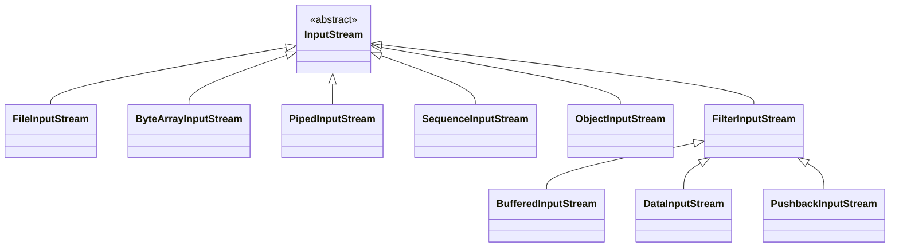
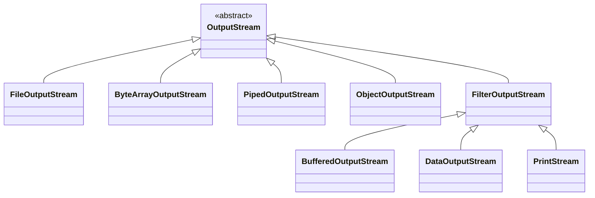
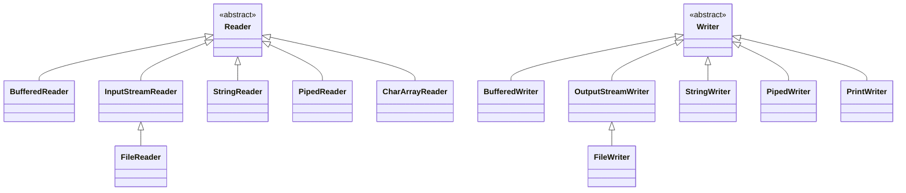
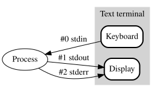

## 개요

**입출력(I/O, Input/Output)** 은 프로그램과 외부(파일, 키보드, 화면, 네트워크, 다른 프로그램) 사이에 **데이터를 주고받는 것**이다. 자바는 `java.io` 패키지의 **스트림**으로 입출력을 한다.

| 파트 | 절 | 주제 |
| --- | --- | --- |
| **1. 기본 개념** | 1 ~ 4 | 입출력, 스트림, 바이트 기반 스트림, 보조 스트림, 문자 기반 스트림 |
| **2. 바이트 기반 스트림** | 5 ~ 7 | InputStream · OutputStream, ByteArray, File |
| **3. 바이트 기반 보조 스트림** | 8 ~ 12 | Filter, Buffered, Data, Sequence, PrintStream |
| **4. 문자 기반 스트림** | 13 ~ 16 | Reader · Writer, File, Piped, String |
| **5. 문자 기반 보조 스트림** | 17 ~ 18 | BufferedReader · BufferedWriter, InputStreamReader · OutputStreamWriter |
| **6. 표준 입출력과 File** | 19 ~ 22 | System.in · out · err, 대상 변경, RandomAccessFile, File |
| **7. 직렬화** | 23 ~ 25 | 직렬화, Serializable · transient, 버전 관리 |

> ⚠️ 여기서 말하는 **입출력 스트림**은 [[14. 람다와 스트림]] 의 **Stream API** 와 이름만 같고 **전혀 다른 것**이다.

---

# Part 1. 기본 개념

## 1. 입출력이란?

| 방향 | 의미 | 예 |
| --- | --- | --- |
| **입력 (Input)** | 외부 → 프로그램 | 키보드 입력, 파일 읽기, 네트워크 수신 |
| **출력 (Output)** | 프로그램 → 외부 | 화면 출력, 파일 쓰기, 네트워크 전송 |

## 2. 스트림이란?

**데이터를 운반하는 연결 통로**. 물이 흐르는 관처럼, 데이터가 한쪽에서 다른 쪽으로 **순서대로** 흐른다.


*입력 스트림: 데이터 소스(파일, 서버 등)에서 프로그램으로 데이터가 흘러 들어온다 (출처: Oracle, The Java Tutorials, I/O Streams)*


*출력 스트림: 프로그램에서 목적지로 데이터가 흘러 나간다 (출처: Oracle, The Java Tutorials, I/O Streams)*

| 특징 | 설명 |
| --- | --- |
| **단방향** | 하나의 스트림은 입력 **또는** 출력만 한다. 둘 다 하려면 스트림 **두 개**가 필요하다 |
| **FIFO** | 먼저 보낸 데이터를 먼저 받는다 (큐처럼 순서대로) |
| **연속적** | 데이터를 중간에 건너뛸 수 없다 (RandomAccessFile 은 예외) |

---

## 3. 바이트 기반 스트림

데이터를 **1 byte 단위**로 주고받는 스트림. 이미지, 동영상, 압축 파일 등 **모든 종류의 데이터**를 다룰 수 있다.

- 조상: 입력은 **`InputStream`**, 출력은 **`OutputStream`** (둘 다 추상 클래스)

| 입력 스트림 | 출력 스트림 | 입출력 대상 |
| --- | --- | --- |
| `FileInputStream` | `FileOutputStream` | **파일** |
| `ByteArrayInputStream` | `ByteArrayOutputStream` | **메모리** (byte 배열) |
| `PipedInputStream` | `PipedOutputStream` | 다른 **스레드** |
| `AudioInputStream` (javax.sound) | ─ | 오디오 데이터 |

- 이름 규칙: **대상 + InputStream / OutputStream**. 어떤 대상이든 **같은 메서드**(`read()`, `write()`)로 다룬다.


*바이트 스트림으로 복사: 입력 스트림에서 1 byte 를 `read()` 하고, 그대로 출력 스트림에 `write()` 하는 것을 끝까지 반복한다 (출처: Oracle, The Java Tutorials, Byte Streams)*

---

## 3-1. 보조 스트림

**실제로 데이터를 주고받지는 않고**, 다른 스트림에 **기능을 더해 주는** 스트림. 혼자서는 입출력을 할 수 없고, 반드시 **기반 스트림을 감싸서** 쓴다.

```java
FileInputStream fis = new FileInputStream("data.txt");      // 기반 스트림: 실제 파일과 연결
BufferedInputStream bis = new BufferedInputStream(fis);     // 보조 스트림: 버퍼 기능 추가
bis.read();                                                 // 보조 스트림으로 읽는다
```

```text
프로그램 ◀── BufferedInputStream ◀── FileInputStream ◀── 파일
              (버퍼 기능 추가)          (실제로 읽음)
```

### 데코레이터 패턴

보조 스트림은 **데코레이터 패턴**으로 만들어졌다. 원래 객체를 **같은 타입의 객체로 감싸서** 기능을 덧붙인다.


*데코레이터 패턴: Decorator 는 Component 를 **상속하면서 동시에 Component 를 가지고 있다.** 그래서 여러 겹으로 감쌀 수 있다 (출처: [Wikimedia Commons](https://commons.wikimedia.org/wiki/File:Decorator_UML_class_diagram.svg), Trashtoy, Public domain)*

| 데코레이터 패턴 | java.io |
| --- | --- |
| Component | `InputStream` |
| ConcreteComponent (실제 대상) | `FileInputStream`, `ByteArrayInputStream` |
| Decorator | `FilterInputStream` |
| ConcreteDecorator (기능 추가) | `BufferedInputStream`, `DataInputStream` |

```java
// 여러 겹으로 감싸기: 파일에서 버퍼링하며 int, double 단위로 읽기
DataInputStream in = new DataInputStream(
                         new BufferedInputStream(
                             new FileInputStream("score.dat")));
```

| 보조 스트림 (입력 / 출력) | 추가하는 기능 |
| --- | --- |
| `FilterInputStream` / `FilterOutputStream` | 필터 보조 스트림의 **조상** |
| `BufferedInputStream` / `BufferedOutputStream` | **버퍼**로 입출력 횟수를 줄여 성능 향상 |
| `DataInputStream` / `DataOutputStream` | `int`, `double` 등 **기본형 단위**로 읽고 쓰기 |
| `SequenceInputStream` | 여러 입력 스트림을 **하나로 연결** |
| `ObjectInputStream` / `ObjectOutputStream` | **객체**를 읽고 쓰기 (직렬화) |
| ─ / `PrintStream` | `print`, `println`, `printf` 로 **편하게 출력** |
| `PushbackInputStream` / ─ | 읽은 데이터를 다시 되돌리기 |

> 💡 **실무 꿀팁**: 보조 스트림을 닫으면 **감싸고 있는 기반 스트림도 함께 닫힌다.** 가장 바깥 스트림만 닫으면 된다. try-with-resources 로 바깥 스트림을 선언하는 것이 가장 안전하다.

---

## 4. 문자 기반 스트림

자바의 `char` 는 **2 byte**(UTF-16)이다. 바이트 스트림으로 문자를 다루면 한글처럼 여러 byte 로 된 문자가 깨질 수 있다. 그래서 **문자 단위**로 다루는 스트림이 따로 있다.

- 조상: 입력은 **`Reader`**, 출력은 **`Writer`**
- 파일의 **인코딩**(UTF-8, MS949 ...)과 자바의 UTF-16 사이를 **자동으로 변환**해 준다.

| 바이트 기반 | 문자 기반 |
| --- | --- |
| `InputStream` / `OutputStream` | **`Reader` / `Writer`** |
| `FileInputStream` / `FileOutputStream` | `FileReader` / `FileWriter` |
| `ByteArrayInputStream` / `ByteArrayOutputStream` | `CharArrayReader` / `CharArrayWriter` |
| `PipedInputStream` / `PipedOutputStream` | `PipedReader` / `PipedWriter` |
| `StringBufferInputStream` (deprecated) | `StringReader` / `StringWriter` |
| `BufferedInputStream` / `BufferedOutputStream` | `BufferedReader` / `BufferedWriter` |
| `PrintStream` | `PrintWriter` |
| `FilterInputStream` / `FilterOutputStream` | `FilterReader` / `FilterWriter` |

- 이름 규칙: 바이트 기반의 **InputStream → Reader**, **OutputStream → Writer** 로 바꾸면 대부분 맞다.

| 데이터 | 사용할 스트림 |
| --- | --- |
| 텍스트 (txt, csv, json, 로그) | **문자 기반** (Reader / Writer) |
| 바이너리 (이미지, 동영상, zip, 직렬화된 객체) | **바이트 기반** (InputStream / OutputStream) |

### java.io 클래스 계층

공식 그림이 없어 Java 21 API 문서의 상속 관계를 기준으로 그렸다.







- `FileReader` 는 `InputStreamReader` 의 자손이다. 내부적으로 FileInputStream 으로 바이트를 읽고 **문자로 변환**한다.

---

# Part 2. 바이트 기반 스트림

## 5. InputStream 과 OutputStream

모든 바이트 기반 스트림의 조상. 자손들은 이 메서드를 그대로 쓴다.

### InputStream

| 메서드 | 설명 |
| --- | --- |
| `int read()` | 1 byte 를 읽어 **0 ~ 255** 로 반환. 더 읽을 게 없으면 **-1** |
| `int read(byte[] b)` | 배열 크기만큼 읽어 배열에 저장. **실제로 읽은 byte 수** 반환 (끝이면 -1) |
| `int read(byte[] b, int off, int len)` | 최대 len 개를 읽어 b[off] 부터 저장 |
| `byte[] readAllBytes()` | 끝까지 모두 읽기 (Java 9+) |
| `long transferTo(OutputStream out)` | 남은 데이터를 출력 스트림으로 모두 복사 (Java 9+) |
| `int available()` | 블로킹 없이 바로 읽을 수 있는 byte 수 |
| `long skip(long n)` | n byte 건너뛰기 |
| `void close()` | 닫고 자원 반환 |

> `read()` 의 반환 타입이 `byte` 가 아니라 **`int`** 인 이유: byte(-128 ~ 127)로는 "끝(-1)" 과 실제 데이터 -1 을 구분할 수 없다. 그래서 0 ~ 255 로 돌려주고 끝은 -1 로 표시한다.

### OutputStream

| 메서드 | 설명 |
| --- | --- |
| `void write(int b)` | 1 byte 쓰기 (int 의 하위 8bit) |
| `void write(byte[] b)` / `write(byte[] b, int off, int len)` | 배열의 내용 쓰기 |
| `void flush()` | **버퍼에 남아 있는 데이터를 모두 내보낸다** |
| `void close()` | 닫고 자원 반환 (보통 flush 포함) |

---

## 6. ByteArrayInputStream 과 ByteArrayOutputStream

**메모리(byte 배열)** 를 대상으로 입출력한다. 임시로 데이터를 다루거나, 스트림 API 가 필요한데 데이터가 이미 메모리에 있을 때 쓴다.

```java
byte[] inSrc = {0, 1, 2, 3, 4, 5, 6, 7, 8, 9};

ByteArrayInputStream  input  = new ByteArrayInputStream(inSrc);
ByteArrayOutputStream output = new ByteArrayOutputStream();

byte[] buf = new byte[4];
int len;
while ((len = input.read(buf)) != -1) {     // 4 byte 씩 읽기: 4, 4, 2
    output.write(buf, 0, len);              // 읽은 만큼만 쓴다 (len 을 무시하면 마지막에 쓰레기 값이 섞인다)
}

byte[] outSrc = output.toByteArray();       // [0, 1, 2, 3, 4, 5, 6, 7, 8, 9]
```

- 메모리만 쓰므로 `close()` 하지 않아도 된다 (GC 가 정리).

> 💡 **실무 꿀팁**: 테스트에서 파일 없이 입력을 흉내 낼 때 유용하다. 예: `MultipartFile` 테스트나 엑셀 생성 결과를 `ByteArrayOutputStream` 에 쓰고 `toByteArray()` 로 응답 본문에 담기.

---

## 7. FileInputStream 과 FileOutputStream

**파일**을 대상으로 입출력한다. 가장 많이 쓰는 기반 스트림이다.

| 생성자 | 설명 |
| --- | --- |
| `FileInputStream(String name)` / `(File file)` | 파일을 읽기용으로 연다. 없으면 `FileNotFoundException` |
| `FileOutputStream(String name)` | 파일을 쓰기용으로 연다. **없으면 만들고, 있으면 내용을 지운다** |
| `FileOutputStream(String name, boolean append)` | `append = true` 면 **기존 내용 뒤에 이어 쓴다** |

```java
// 파일 복사
try (FileInputStream  in  = new FileInputStream("source.jpg");
     FileOutputStream out = new FileOutputStream("copy.jpg")) {

    byte[] buf = new byte[8192];
    int len;
    while ((len = in.read(buf)) != -1) {
        out.write(buf, 0, len);
    }
}   // try-with-resources: 자동으로 close() (→ [[06. 예외처리]])
```

- 1 byte 씩 `read()` 하면 매번 OS 에 요청해서 **아주 느리다.** 배열로 묶어서 읽거나 Buffered 보조 스트림을 쓴다.

> 💡 **실무 꿀팁**: 단순 복사·읽기·쓰기는 **`java.nio.file.Files`** 가 훨씬 간단하다 (→ 22절).
> ```java
> Files.copy(Path.of("source.jpg"), Path.of("copy.jpg"), StandardCopyOption.REPLACE_EXISTING);
> in.transferTo(out);                          // 스트림 → 스트림 복사도 한 줄 (Java 9+)
> ```

---

# Part 3. 바이트 기반 보조 스트림

## 8. FilterInputStream 과 FilterOutputStream

모든 바이트 기반 **보조 스트림의 조상**. 생성자가 `protected` 라서 직접 쓰지 않고, 상속해서 기능을 추가한다.

```java
protected FilterInputStream(InputStream in)    // 감쌀 기반 스트림을 받는다

public int read() throws IOException {
    return in.read();                           // 기본 구현: 그냥 기반 스트림에 위임
}
```

- 자손(`BufferedInputStream`, `DataInputStream` ...)이 `read()`, `write()` 를 **오버라이딩**해서 원하는 기능을 넣는다.

---

## 9. BufferedInputStream 과 BufferedOutputStream

**버퍼(byte 배열)** 를 두고, 한 번에 많이 읽고 쓰기 위한 보조 스트림. **입출력 성능**을 크게 높인다.

```text
버퍼 없이:  read() 1번 = OS 호출 1번 (디스크 접근)  → 1MB 파일 = 약 100만 번
버퍼 사용:  OS 에서 8192 byte 를 한 번에 버퍼로 읽고, read() 는 버퍼에서 꺼냄 → 약 128 번
```

```java
try (BufferedOutputStream out = new BufferedOutputStream(new FileOutputStream("out.txt"), 8192)) {
    for (int i = '1'; i <= '9'; i++) {
        out.write(i);              // 버퍼에만 쌓인다
    }
}                                  // close() 하면서 flush() → 그때 파일에 기록된다
```

- 기본 버퍼 크기는 **8192 byte** (8KB).
- 출력 버퍼는 **꽉 차거나**, **`flush()`** 하거나, **`close()`** 할 때 실제로 내보낸다.

> 💡 **실무 꿀팁**: `BufferedOutputStream` 을 쓰고 **close() 나 flush() 를 하지 않으면** 버퍼에 남은 마지막 데이터가 파일에 쓰이지 않는다 (파일 끝이 잘림). try-with-resources 를 쓰면 이런 실수를 막을 수 있다.

---

## 10. DataInputStream 과 DataOutputStream

`int`, `double`, `boolean` 같은 **기본형 단위**로 읽고 쓴다. 값을 **이진(바이너리) 형태 그대로** 저장한다.

| DataOutputStream | DataInputStream | 크기 |
| --- | --- | --- |
| `writeBoolean(b)` | `readBoolean()` | 1 byte |
| `writeInt(i)` | `readInt()` | 4 byte |
| `writeLong(l)` | `readLong()` | 8 byte |
| `writeDouble(d)` | `readDouble()` | 8 byte |
| `writeUTF(s)` | `readUTF()` | 길이 + UTF-8 |

```java
try (DataOutputStream out = new DataOutputStream(new FileOutputStream("score.dat"))) {
    out.writeInt(100);
    out.writeDouble(95.5);
    out.writeUTF("kim");
}

try (DataInputStream in = new DataInputStream(new FileInputStream("score.dat"))) {
    int score    = in.readInt();      // 쓴 순서와 같은 순서로 읽어야 한다
    double avg   = in.readDouble();
    String name  = in.readUTF();
}
```

- **쓴 순서 그대로** 읽어야 한다. 순서가 다르면 엉뚱한 값이 나온다.
- 파일 끝에 도달하면 -1 이 아니라 **`EOFException`** 이 발생한다. 개수를 모르면 이 예외로 반복을 끝낸다.
- `writeInt(100)` 은 문자 "100" 이 아니라 **4 byte 정수** 로 저장되므로, 메모장으로 열면 깨져 보인다.

---

## 11. SequenceInputStream

여러 입력 스트림을 **하나의 스트림처럼** 이어서 읽는다. 첫 스트림을 끝까지 읽으면 다음 스트림으로 넘어간다.

```java
InputStream a = new ByteArrayInputStream(new byte[]{1, 2, 3});
InputStream b = new ByteArrayInputStream(new byte[]{4, 5, 6});

try (SequenceInputStream in = new SequenceInputStream(a, b)) {   // 두 개 연결
    in.transferTo(output);                                         // 1, 2, 3, 4, 5, 6
}

// 세 개 이상: Enumeration 으로 넘긴다
Vector<InputStream> files = new Vector<>(List.of(part1, part2, part3));
SequenceInputStream all = new SequenceInputStream(files.elements());
```

- 쓰임: 여러 조각으로 나뉜 파일을 이어 붙여 읽기.

---

## 12. PrintStream

데이터를 **보기 좋은 문자열로 출력**하는 `print()`, `println()`, `printf()` 를 제공한다. 우리가 매일 쓰는 **`System.out` 이 PrintStream** 이다.

| 특징 | 설명 |
| --- | --- |
| 편한 출력 | 모든 타입을 문자열로 바꿔 출력 |
| 형식 지정 | `printf("%-5s %3d%n", name, age)` |
| **예외를 던지지 않는다** | 내부에서 IOException 을 잡고, `checkError()` 로만 확인할 수 있다 |
| 자동 flush | 생성자에서 `autoFlush = true` 면 `println()` 마다 flush |

```java
try (PrintStream ps = new PrintStream(new FileOutputStream("report.txt"), true, StandardCharsets.UTF_8)) {
    ps.printf("%s 의 점수: %d점%n", "kim", 100);
}
```

| 형식 | 의미 | 예 |
| --- | --- | --- |
| `%d` | 정수 | `%5d` → `  100` |
| `%f` | 실수 | `%.2f` → `3.14` |
| `%s` | 문자열 | `%-10s` → 왼쪽 정렬 |
| `%n` | 줄바꿈 (OS 에 맞게) | |
| `%,d` | 천 단위 구분 | `1,000,000` |

- 문자 기반의 **`PrintWriter`** 도 같은 기능을 하며, 문자를 다룰 때는 PrintWriter 가 더 적합하다.

---

# Part 4. 문자 기반 스트림

## 13. Reader 와 Writer

모든 문자 기반 스트림의 조상. 메서드는 InputStream/OutputStream 과 거의 같고, **byte 대신 char** 를 다룬다.

| Reader | Writer |
| --- | --- |
| `int read()` → 문자 1개 (0 ~ 65535), 끝이면 -1 | `void write(int c)` |
| `int read(char[] cbuf)` | `void write(char[] cbuf)` |
| `long transferTo(Writer out)` (Java 10+) | `void write(String str)` |
| `boolean ready()` | `Writer append(CharSequence csq)` |
| `void close()` | `void flush()`, `void close()` |

---

## 14. FileReader 와 FileWriter

**텍스트 파일**을 문자 단위로 읽고 쓴다.

```java
try (FileReader reader = new FileReader("memo.txt", StandardCharsets.UTF_8);     // Java 11+: 인코딩 지정
     FileWriter writer = new FileWriter("copy.txt", StandardCharsets.UTF_8, true)) { // true: 이어 쓰기
    reader.transferTo(writer);
}
```

### 바이트 스트림 vs 문자 스트림으로 한글 읽기

```java
// "안녕" 이 UTF-8 로 저장된 파일 (한 글자 = 3 byte)
FileInputStream fis = new FileInputStream("hello.txt");
System.out.print((char) fis.read());     // 깨진 문자: 3 byte 중 1 byte 만 읽었다

FileReader fr = new FileReader("hello.txt", StandardCharsets.UTF_8);
System.out.print((char) fr.read());      // '안'
```

> 💡 **실무 꿀팁: 인코딩은 항상 명시한다**
> - 인코딩을 지정하지 않으면 **기본 charset** 을 쓴다. Java 17 까지는 **OS 마다 달라서**(Windows 한글판 = MS949, macOS/Linux = UTF-8) 같은 코드가 서버에서는 한글이 깨지는 일이 흔했다.
> - **Java 18 부터 기본 charset 이 UTF-8** 로 통일되었다 (JEP 400). 그래도 다른 시스템이 만든 파일(예: 엑셀이 저장한 MS949 CSV)을 읽을 때는 **직접 지정**해야 한다.

---

## 15. PipedReader 와 PipedWriter

**스레드 사이에** 데이터를 주고받는다. Writer 쪽에서 쓴 데이터를 다른 스레드의 Reader 쪽에서 읽는다.

```java
PipedReader reader = new PipedReader();
PipedWriter writer = new PipedWriter(reader);      // 두 스트림을 연결 (connect)

new Thread(() -> {
    try (writer) { writer.write("Hello from producer"); }
    catch (IOException e) { throw new UncheckedIOException(e); }
}).start();

new Thread(() -> {
    try (reader) { reader.transferTo(new PrintWriter(System.out, true)); }
    catch (IOException e) { throw new UncheckedIOException(e); }
}).start();
```

- 한쪽만 연결하면 된다 (`connect()` 또는 생성자).
- **같은 스레드**에서 읽기·쓰기를 하면 교착 상태가 될 수 있다.
- 실무에서는 스레드 간 데이터 전달에 보통 `BlockingQueue` 를 쓴다 (→ [[13. 스레드]]).

---

## 16. StringReader 와 StringWriter

**문자열(메모리)** 을 대상으로 입출력한다. CharArrayReader/Writer 와 같고, 대상이 String 이다.

```java
StringReader input = new StringReader("ABCD");
StringWriter output = new StringWriter();
input.transferTo(output);
output.toString();          // "ABCD"
```

> 💡 **실무 꿀팁**: 예외의 스택 트레이스를 **문자열로** 얻을 때 자주 쓴다 (알림 메시지, DB 저장 등).
> ```java
> StringWriter sw = new StringWriter();
> e.printStackTrace(new PrintWriter(sw));
> String stackTrace = sw.toString();
> ```

---

# Part 5. 문자 기반 보조 스트림

## 17. BufferedReader 와 BufferedWriter

문자 스트림에 **버퍼**를 더한다. 성능 향상과 함께 **줄 단위 처리** 기능을 제공한다.

| 메서드 | 설명 |
| --- | --- |
| `String readLine()` (BufferedReader) | **한 줄**을 읽는다. 줄바꿈 문자는 빼고 반환, 끝이면 **null** |
| `Stream<String> lines()` (BufferedReader) | 줄 단위 Stream (Java 8+) |
| `void newLine()` (BufferedWriter) | OS 에 맞는 줄바꿈 문자 출력 |

```java
// 로그 파일에서 ERROR 줄만 뽑기
try (BufferedReader br = new BufferedReader(new FileReader("app.log", StandardCharsets.UTF_8))) {
    String line;
    int lineNo = 0;
    while ((line = br.readLine()) != null) {
        lineNo++;
        if (line.contains("ERROR")) {
            System.out.println(lineNo + ": " + line);
        }
    }
}

// Stream API 와 함께
try (BufferedReader br = Files.newBufferedReader(Path.of("app.log"))) {
    long count = br.lines().filter(l -> l.contains("ERROR")).count();
}
```

> 💡 **실무 꿀팁: 코딩 테스트 입력**
> `Scanner` 는 편하지만 느리다. 입력이 많을 때는 **`BufferedReader` + `StringTokenizer`** 조합을 쓴다 (→ [[07. java.lang 패키지와 유용한 클래스]]).
> ```java
> BufferedReader br = new BufferedReader(new InputStreamReader(System.in));
> int n = Integer.parseInt(br.readLine());
> ```

---

## 18. InputStreamReader 와 OutputStreamWriter

**바이트 기반 스트림을 문자 기반 스트림으로 바꿔 주는 다리.** 이때 **인코딩을 지정**할 수 있다.

```text
바이트 스트림 ──▶ InputStreamReader (인코딩으로 디코딩) ──▶ 문자 스트림
문자 스트림  ──▶ OutputStreamWriter (인코딩으로 인코딩) ──▶ 바이트 스트림
```

```java
// 키보드(System.in 은 바이트 스트림)를 줄 단위로 읽기
BufferedReader br = new BufferedReader(new InputStreamReader(System.in));

// 엑셀이 저장한 MS949 CSV 읽기
try (BufferedReader csv = new BufferedReader(
        new InputStreamReader(new FileInputStream("members.csv"), Charset.forName("MS949")))) {
    csv.lines().forEach(System.out::println);
}

// 네트워크 소켓(바이트 스트림)에 UTF-8 문자열 쓰기
Writer w = new OutputStreamWriter(socket.getOutputStream(), StandardCharsets.UTF_8);
```

- **바이트 스트림만 주어지는 곳**(System.in, 소켓, HTTP 요청 본문, `MultipartFile.getInputStream()`)에서 텍스트를 다룰 때 필요하다.

---

# Part 6. 표준 입출력과 File

## 19. 표준 입출력: System.in, System.out, System.err

콘솔(터미널)을 통한 입출력. 자바 프로그램이 시작될 때 **자동으로 만들어진다.**



*프로세스의 표준 스트림 3가지: 0번 stdin(키보드 → 프로세스), 1번 stdout, 2번 stderr(프로세스 → 화면) (출처: [Wikimedia Commons](https://commons.wikimedia.org/wiki/File:Stdstreams-notitle.svg), Danielpr85, Public domain)*

| 스트림 | 타입 | 용도 |
| --- | --- | --- |
| `System.in` | `InputStream` | 표준 입력 (키보드) |
| `System.out` | `PrintStream` | 표준 출력 (화면) |
| `System.err` | `PrintStream` | 표준 **에러** 출력 (화면, 버퍼링 없이 바로 출력) |

- `System.in` 은 **바이트 스트림**이라 한글을 읽으려면 `InputStreamReader` 로 감싼다.

> 💡 **실무 꿀팁**: 서버 코드에서는 `System.out.println()` 대신 **로거(SLF4J + Logback)** 를 쓴다. System.out 은 **동기화된 메서드**라 요청이 많으면 병목이 되고, 로그 레벨·파일 저장·포맷을 제어할 수 없다.

## 20. 표준 입출력의 대상 변경: setIn(), setOut(), setErr()

| 메서드 | 설명 |
| --- | --- |
| `System.setIn(InputStream in)` | 표준 입력을 바꾼다 |
| `System.setOut(PrintStream out)` | 표준 출력을 바꾼다 |
| `System.setErr(PrintStream err)` | 표준 에러를 바꾼다 |

```java
PrintStream original = System.out;
ByteArrayOutputStream captured = new ByteArrayOutputStream();
System.setOut(new PrintStream(captured));          // 화면 대신 메모리로

System.out.println("hello");                       // 화면에 안 나오고 captured 에 쌓임

System.setOut(original);                           // 반드시 원래대로 되돌린다
captured.toString();                               // "hello" + 줄바꿈
```

- 쓰임: **테스트에서 콘솔 출력 검증**, 코딩 테스트에서 파일을 입력으로 쓰기 (`System.setIn(new FileInputStream("input.txt"))`).
- 셸의 리다이렉션도 같은 효과다: `java Main < input.txt > output.txt 2> error.log`

---

## 21. RandomAccessFile

**하나의 클래스로 읽기와 쓰기를 모두** 할 수 있고, 파일의 **아무 위치로 이동해서** 읽고 쓸 수 있다.

- InputStream / OutputStream 을 상속하지 않고, `DataInput`, `DataOutput` 인터페이스를 직접 구현한다 (`readInt()`, `writeInt()` 사용 가능).
- 내부에 **파일 포인터**(현재 읽고 쓸 위치)가 있다.

| 모드 | 의미 |
| --- | --- |
| `"r"` | 읽기 전용 |
| `"rw"` | 읽기·쓰기 (파일이 없으면 생성) |
| `"rws"` / `"rwd"` | 쓸 때마다 내용(+메타데이터)을 디스크에 즉시 기록 |

```java
try (RandomAccessFile raf = new RandomAccessFile("scores.dat", "rw")) {
    // 학생 1명 = int 번호(4) + int 국어(4) + int 영어(4) = 12 byte 고정 길이 레코드
    raf.writeInt(1); raf.writeInt(90); raf.writeInt(80);
    raf.writeInt(2); raf.writeInt(70); raf.writeInt(95);

    raf.seek(12 + 4);                 // 2번 학생의 국어 점수 위치로 바로 이동
    int korean = raf.readInt();       // 70
    raf.getFilePointer();             // 20
    raf.length();                     // 24
}
```

| 메서드 | 설명 |
| --- | --- |
| `long getFilePointer()` | 현재 파일 포인터 위치 |
| `void seek(long pos)` | 파일 포인터를 pos 로 이동 |
| `long length()` / `setLength(long)` | 파일 크기 확인 / 변경 |
| `int skipBytes(int n)` | n byte 건너뛰기 |

- 쓰임: **고정 길이 레코드** 파일, 큰 파일의 일부만 읽기·수정, 이어 받기(다운로드 재개). 지금은 NIO 의 `FileChannel` 로 대체되는 경우가 많다.

---

## 22. File

**파일과 디렉터리 자체**를 다루는 클래스 (내용이 아니라 경로, 존재 여부, 크기, 생성·삭제).

```java
File file = new File("/Users/me/docs", "memo.txt");   // 경로만 가리킨다. 실제 파일을 만들지는 않는다

file.exists();            // 존재하는지
file.isFile();            // 파일인지
file.isDirectory();       // 디렉터리인지
file.length();            // 크기 (byte)
file.getName();           // "memo.txt"
file.getParent();         // "/Users/me/docs"
file.getAbsolutePath();   // 절대 경로
file.createNewFile();     // 빈 파일 생성 (이미 있으면 false)
file.delete();            // 삭제 (성공 여부를 boolean 으로만 알려 준다)
new File("a/b/c").mkdirs();          // 중간 디렉터리까지 생성
File[] children = dir.listFiles();   // 디렉터리 안의 목록
```

| 경로 관련 | 예 (`new File("./docs/../memo.txt")`) |
| --- | --- |
| `getPath()` | `./docs/../memo.txt` (생성할 때 준 그대로) |
| `getAbsolutePath()` | `/Users/me/project/./docs/../memo.txt` |
| `getCanonicalPath()` | `/Users/me/project/memo.txt` (`.`, `..` 정리) |
| `File.separator` | Windows `\`, macOS/Linux `/` |

### File 의 한계와 NIO.2 (java.nio.file, Java 7+)

| 문제 (java.io.File) | 해결 (java.nio.file) |
| --- | --- |
| `delete()` 가 실패해도 **이유를 모른다** (false 만 반환) | `Files.delete()` 는 **이유가 담긴 예외**를 던진다 |
| 심볼릭 링크, 파일 권한, 속성 지원이 약하다 | `Files.readAttributes()`, `Files.isSymbolicLink()` |
| 큰 디렉터리 `listFiles()` 는 한 번에 배열로 | `Files.list()`, `Files.walk()` 로 **스트림** 처리 |
| 읽고 쓰려면 스트림을 직접 열어야 한다 | `Files.readString()`, `Files.writeString()` **한 줄** |

```java
Path path = Path.of("logs", "app.log");                 // Java 11+ (이전에는 Paths.get)

String text        = Files.readString(path);            // 작은 파일 전체 읽기 (Java 11+)
List<String> lines = Files.readAllLines(path);
Files.writeString(path, "hello", StandardOpenOption.CREATE, StandardOpenOption.APPEND);
Files.copy(src, dst, StandardCopyOption.REPLACE_EXISTING);
Files.createDirectories(Path.of("upload/2026/11"));

try (Stream<Path> files = Files.walk(Path.of("logs"))) {   // 하위 폴더까지 순회
    files.filter(p -> p.toString().endsWith(".log")).forEach(System.out::println);
}

File legacy = path.toFile();      // File ↔ Path 변환
Path back   = legacy.toPath();
```


*`Files` 의 파일 입출력 메서드. 왼쪽(`readAllBytes`, `readAllLines`: 작은 파일용, 간단)에서 오른쪽(`FileChannel`: 파일 잠금, 메모리 매핑 등 고급 기능)으로 갈수록 복잡하고 강력하다 (출처: Oracle, The Java Tutorials, Reading, Writing, and Creating Files)*

> 💡 **실무 꿀팁**
> - 새 코드는 `File` 대신 **`Path` + `Files`** 를 쓴다.
> - `Files.readAllBytes()`, `readString()` 은 파일 **전체를 메모리에** 올린다. 수백 MB 짜리 파일은 `Files.newBufferedReader()` + `lines()` 처럼 **스트리밍**으로 처리한다.
> - 업로드 파일 저장 경로는 **사용자 입력을 그대로 쓰지 않는다.** `../../etc/passwd` 같은 **경로 조작 공격**을 막기 위해 `path.normalize()` 후 허용된 디렉터리 안인지(`startsWith(baseDir)`) 확인한다.

---

# Part 7. 직렬화

## 23. 직렬화란?

**객체를 데이터 스트림(byte 의 나열)으로 바꾸는 것**. 반대로 데이터 스트림을 다시 객체로 만드는 것을 **역직렬화**라고 한다.

- 객체를 **파일에 저장**하거나 **네트워크로 전송**하려면 byte 로 바꿔야 한다.
- 객체에 저장되는 것은 **인스턴스 변수의 값**뿐이다 (메서드, static 변수는 X).


*객체 a 를 `writeObject` 하면 a 가 참조하는 b, c, d, e 까지 **연결된 객체 전체**가 직렬화되고, `readObject` 하면 같은 구조로 복원된다 (출처: Oracle, The Java Tutorials, Object Streams)*

### ObjectInputStream, ObjectOutputStream

```java
// 직렬화: 객체 → 파일
try (ObjectOutputStream out = new ObjectOutputStream(
        new BufferedOutputStream(new FileOutputStream("member.ser")))) {
    out.writeObject(new Member("kim", 20));
}

// 역직렬화: 파일 → 객체
try (ObjectInputStream in = new ObjectInputStream(
        new BufferedInputStream(new FileInputStream("member.ser")))) {
    Member m = (Member) in.readObject();       // Object 로 반환되므로 형변환
}
```

- 여러 객체는 **쓴 순서대로** 읽어야 한다. 객체가 많으면 **ArrayList 하나에 담아** 한 번에 직렬화하는 것이 편하다.

---

## 24. 직렬화 가능한 클래스 만들기: Serializable, transient

### Serializable

```java
public class Member implements Serializable {     // 메서드가 없는 마커 인터페이스
    private String name;
    private int age;
}
```

- `java.io.Serializable` 을 구현해야 직렬화할 수 있다. 아니면 **`NotSerializableException`**.
- 조상이 Serializable 이면 자손도 직렬화할 수 있다.
- 조상이 Serializable 이 **아니면** 조상의 필드는 직렬화되지 않고, 역직렬화할 때 조상의 **기본 생성자**가 호출된다 (기본 생성자가 없으면 에러).
- 필드가 참조하는 객체도 **모두 Serializable** 이어야 한다.

```java
public class Member implements Serializable {
    private String name;
    private Object lock = new Object();   // Object 는 Serializable 이 아니다 → NotSerializableException
}
```

### transient

직렬화하지 **않을** 필드에 붙인다. 역직렬화하면 **기본값**(null, 0, false)이 된다.

```java
public class Member implements Serializable {
    private String name;
    private transient String password;     // 비밀번호는 저장하지 않는다 → 복원하면 null
    private transient Connection conn;     // 직렬화할 수 없는 자원
}
```

| 직렬화 대상 | 여부 |
| --- | --- |
| 인스턴스 변수 | O |
| `transient` 인스턴스 변수 | **X** (기본값으로 복원) |
| `static` 변수 | **X** (클래스에 속한 값) |
| 메서드 | X |

---

## 25. 직렬화 가능한 클래스의 버전 관리

직렬화할 때 클래스의 **버전 번호(`serialVersionUID`)** 가 함께 저장된다. 역직렬화할 때 **현재 클래스의 버전과 다르면** 실패한다.

```text
java.io.InvalidClassException: Member; local class incompatible:
  stream classdesc serialVersionUID = 1234..., local class serialVersionUID = 5678...
```

- `serialVersionUID` 를 직접 정하지 않으면 컴파일러가 **클래스 구조로 자동 계산**한다. 필드를 하나만 추가해도 값이 바뀌어서, **저장해 둔 데이터를 읽을 수 없게 된다.**

```java
public class Member implements Serializable {
    @Serial                                            // Java 14+: 직렬화 관련 필드임을 표시 (컴파일러가 검사)
    private static final long serialVersionUID = 1L;   // 직접 지정하면 필드가 바뀌어도 호환
    private String name;
    private int age;
    private String email;                              // 나중에 추가 → 옛 데이터를 읽으면 email 은 null
}
```

- 버전을 고정하면 필드를 추가·삭제해도 역직렬화가 된다. 단, 필드의 **타입을 바꾸는 것**처럼 호환되지 않는 변경은 여전히 실패한다.

> 💡 **실무 꿀팁: 자바 직렬화는 되도록 쓰지 않는다**
> - **보안**: 신뢰할 수 없는 데이터를 `readObject()` 하면 원격 코드 실행 같은 **역직렬화 취약점**이 생길 수 있다. 자바 직렬화의 설계자도 "실수였다"고 말할 정도다.
> - **호환성**: 클래스 이름·패키지·필드가 바뀌면 깨지고, 다른 언어와 데이터를 주고받을 수 없다.
> - **대안**: 데이터를 저장하거나 전송할 때는 **JSON(Jackson)** 이나 Protocol Buffers 를 쓴다.
> - **Redis 에 객체를 저장**할 때 기본 `JdkSerializationRedisSerializer` 는 자바 직렬화를 쓴다. 클래스가 바뀌면 캐시가 깨지므로 보통 **`GenericJackson2JsonRedisSerializer`(JSON)** 로 바꾼다 (→ [[1. Redis]]).
> - 다만 스프링 세션, 일부 캐시처럼 내부적으로 직렬화를 쓰는 곳이 있으니, 그런 곳에 넣는 객체는 `Serializable` + `serialVersionUID` 를 지정해 둔다.

---

# 입출력 실무 꿀팁 모음

| 상황 | 추천 |
| --- | --- |
| 작은 텍스트 파일 읽기·쓰기 | `Files.readString()`, `Files.writeString()` |
| 큰 텍스트 파일 줄 단위 처리 | `Files.newBufferedReader()` + `lines()` (try-with-resources) |
| 파일 복사·이동·삭제 | `Files.copy()`, `Files.move()`, `Files.delete()` |
| 스트림 → 스트림 복사 | `in.transferTo(out)` (Java 9+) |
| 바이너리 파일 | `BufferedInputStream` / `BufferedOutputStream` |
| 바이트 스트림을 텍스트로 | `InputStreamReader` + **인코딩 명시** |
| 객체 저장·전송 | 자바 직렬화 대신 **JSON** |
| 콘솔 출력 | 서버에서는 System.out 대신 **로거** |

- 스트림을 열면 **반드시 닫는다**: try-with-resources. 닫지 않으면 파일 핸들이 쌓여 `Too many open files` 에러가 난다.
- 버퍼 출력은 **flush / close** 를 해야 실제로 기록된다.
- 텍스트는 **인코딩을 명시**한다 (`StandardCharsets.UTF_8`).

---

# 핵심 정리

- 스트림 = 데이터 통로. **단방향**, **FIFO**. Stream API 와는 다른 것.
- **바이트 기반**(`InputStream` / `OutputStream`): 모든 데이터, 1 byte 단위. **문자 기반**(`Reader` / `Writer`): 텍스트, char 단위, 인코딩 변환.
- **보조 스트림**은 기반 스트림을 감싸 기능을 더한다 (**데코레이터 패턴**). 바깥 스트림을 닫으면 안쪽도 닫힌다.
- `read()` 는 0 ~ 255 를 int 로, 끝이면 **-1**. 배열로 읽을 때는 **읽은 개수(len)** 만큼만 쓴다.
- `Buffered~`: 8KB 버퍼로 성능 ↑, **flush/close** 해야 기록됨. `BufferedReader.readLine()` 은 끝이면 null.
- `Data~`: 기본형을 이진으로, 쓴 순서대로 읽기, 끝은 **EOFException**. `PrintStream` 은 예외를 던지지 않는다.
- `InputStreamReader` / `OutputStreamWriter`: 바이트 ↔ 문자 다리, **인코딩 지정**. Java 18+ 기본 UTF-8.
- 표준 입출력 `System.in`(InputStream), `out`/`err`(PrintStream). `setOut()` 으로 대상 변경.
- `RandomAccessFile`: 읽기·쓰기 겸용, `seek()` 로 위치 이동.
- `File` 은 경로·속성만. 새 코드는 **`Path` + `Files`**.
- 직렬화: `Serializable` 구현, `transient`·`static` 은 제외, **`serialVersionUID` 직접 지정**. 보안·호환성 문제로 **JSON 을 우선**.

---

## 참고 자료

### Oracle

- The Java Tutorials (JDK 8 기준): [Basic I/O](https://docs.oracle.com/javase/tutorial/essential/io/index.html) · [I/O Streams](https://docs.oracle.com/javase/tutorial/essential/io/streams.html) · [Byte Streams](https://docs.oracle.com/javase/tutorial/essential/io/bytestreams.html) · [Character Streams](https://docs.oracle.com/javase/tutorial/essential/io/charstreams.html) · [Buffered Streams](https://docs.oracle.com/javase/tutorial/essential/io/buffers.html) · [I/O from the Command Line](https://docs.oracle.com/javase/tutorial/essential/io/cl.html) · [Data Streams](https://docs.oracle.com/javase/tutorial/essential/io/datastreams.html) · [Object Streams](https://docs.oracle.com/javase/tutorial/essential/io/objectstreams.html) · [File I/O (NIO.2)](https://docs.oracle.com/javase/tutorial/essential/io/fileio.html) · [Random Access Files](https://docs.oracle.com/javase/tutorial/essential/io/rafs.html)
- API (Java 21): [java.io](https://docs.oracle.com/en/java/javase/21/docs/api/java.base/java/io/package-summary.html) · [InputStream](https://docs.oracle.com/en/java/javase/21/docs/api/java.base/java/io/InputStream.html) · [Reader](https://docs.oracle.com/en/java/javase/21/docs/api/java.base/java/io/Reader.html) · [Serializable](https://docs.oracle.com/en/java/javase/21/docs/api/java.base/java/io/Serializable.html) · [java.nio.file.Files](https://docs.oracle.com/en/java/javase/21/docs/api/java.base/java/nio/file/Files.html)
- [Java Object Serialization Specification](https://docs.oracle.com/en/java/javase/21/docs/specs/serialization/index.html)
- [JEP 400: UTF-8 by Default](https://openjdk.org/jeps/400) (Java 18)

### 그림 출처 (Wikimedia Commons)

> 자유 라이선스 그림을 원본 그대로 `images/` 폴더에 저장해 쓴다 (Wikimedia 서버가 GitHub 의 이미지 프록시 요청을 막기 때문).

- [Decorator UML class diagram](https://commons.wikimedia.org/wiki/File:Decorator_UML_class_diagram.svg) · [Stdstreams-notitle](https://commons.wikimedia.org/wiki/File:Stdstreams-notitle.svg)
