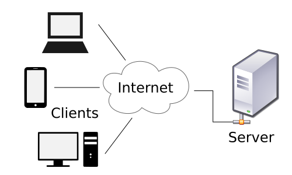
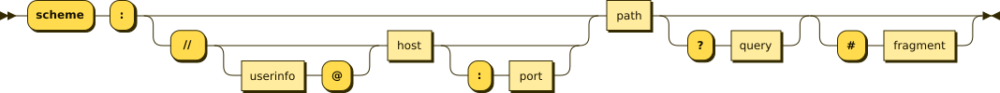
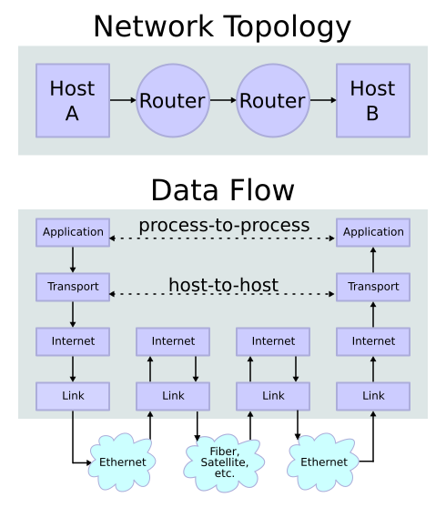
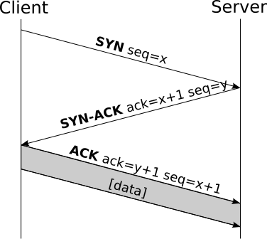
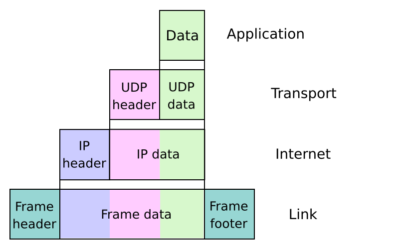
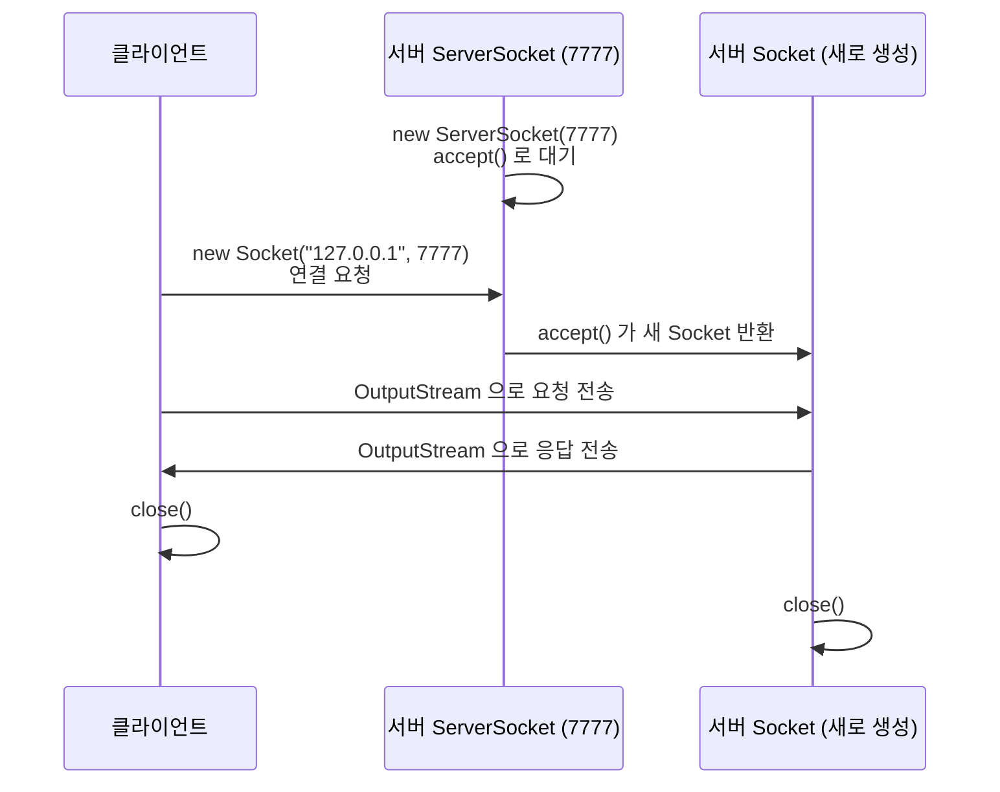

## 개요

**네트워킹(networking)** 은 두 대 이상의 컴퓨터를 연결해 **데이터를 주고받는 것**이다. 자바는 `java.net` 패키지로 네트워크 프로그래밍을 지원한다.

| 파트 | 절 | 주제 |
| --- | --- | --- |
| **1. 네트워크 기초** | 1 ~ 2 | 클라이언트/서버, IP 주소 |
| **2. 주소와 자원** | 3 ~ 5 | InetAddress, URL · URI, URLConnection (+ HttpClient) |
| **3. 소켓 프로그래밍** | 6 ~ 9 | 소켓, TCP · UDP, TCP 소켓 프로그래밍, UDP 소켓 프로그래밍 |

---

# Part 1. 네트워크 기초

## 1. 클라이언트/서버

| 역할 | 설명 | 예 |
| --- | --- | --- |
| **서버 (server)** | **서비스를 제공**하는 컴퓨터 (또는 프로그램) | 웹 서버, DB 서버, 파일 서버 |
| **클라이언트 (client)** | 서비스를 **요청해서 사용**하는 컴퓨터 (또는 프로그램) | 웹 브라우저, 모바일 앱 |



*여러 클라이언트가 인터넷을 통해 하나의 서버에 요청한다 (출처: [Wikimedia Commons](https://commons.wikimedia.org/wiki/File:Client-server-model.svg), David Vignoni (아이콘), LGPL)*

- 서버와 클라이언트는 **컴퓨터가 아니라 역할**로 나뉜다. 한 컴퓨터에 서버 프로그램과 클라이언트 프로그램이 함께 있을 수 있다.
- 우리가 만드는 스프링 애플리케이션은 브라우저 입장에서는 **서버**이고, DB·외부 API 입장에서는 **클라이언트**이다.

### 서버 기반 모델 vs P2P 모델

| 구분 | 서버 기반 (Client-Server) | P2P (Peer-to-Peer) |
| --- | --- | --- |
| 구조 | 서버 한 곳에 요청이 모인다 | 각 컴퓨터가 서버이자 클라이언트 |
| 장점 | 관리·보안이 쉽고, 데이터가 한 곳에 있다 | 서버 비용이 적고, 부하가 분산된다 |
| 단점 | 서버에 부하가 몰리고, 서버가 죽으면 서비스 중단 | 자원 관리·보안이 어렵다 |
| 예 | 웹 서비스, 메일, 게임 서버 | 토렌트, 블록체인, 일부 화상 통화 |

---

## 2. IP 주소 (IP Address)

네트워크에서 **컴퓨터(호스트)를 구별하는 주소**이다.

### IPv4


*IPv4 주소는 **32bit(4byte)** 이다. 8bit 씩 나눠 0 ~ 255 의 10진수 4개를 점(.)으로 이어 쓴다 (출처: [Wikimedia Commons](https://commons.wikimedia.org/wiki/File:Ipv4_address.svg), Public domain)*

### 네트워크 주소와 호스트 주소

IP 주소는 **네트워크 주소**(어느 네트워크인지)와 **호스트 주소**(그 네트워크의 어느 컴퓨터인지)로 나뉜다. 어디까지가 네트워크 주소인지는 **서브넷 마스크**가 알려 준다.

```text
IP 주소       192.168.10.100     11000000.10101000.00001010.01100100
서브넷 마스크  255.255.255.0      11111111.11111111.11111111.00000000
              ─────────────────  AND 연산
네트워크 주소  192.168.10.0       ← 마스크의 1 인 부분 (앞 24bit)
호스트 주소    0.0.0.100          ← 마스크의 0 인 부분 (뒤 8bit)

같은 네트워크의 호스트: 192.168.10.1 ~ 192.168.10.254 (0 은 네트워크, 255 는 브로드캐스트 주소)
CIDR 표기: 192.168.10.100/24  (앞 24bit 가 네트워크 주소)
```

| 주소 | 의미 |
| --- | --- |
| `127.0.0.1` (`localhost`) | **자기 자신** (루프백). 내 컴퓨터 안에서 서버·클라이언트를 테스트할 때 |
| `10.x.x.x`, `172.16 ~ 31.x.x`, `192.168.x.x` | **사설 IP**. 회사·집 내부망에서만 쓰고 인터넷에서는 공유기(NAT)가 공인 IP 로 바꿔 준다 |
| `0.0.0.0` | 서버에서 쓰면 "**모든 네트워크 인터페이스**에서 요청을 받는다" |

### IPv6

- IPv4 는 약 43억 개로 주소가 부족하다. **IPv6 는 128bit** 로 사실상 무한하다.
- 16bit 씩 8개를 16진수로 쓰고 콜론(:)으로 구분한다: `2001:0db8:0000:0000:0000:ff00:0042:8329` → `2001:db8::ff00:42:8329` (0 생략)

> 💡 **실무 꿀팁**: 서버를 띄웠는데 **다른 컴퓨터(또는 도커 컨테이너 밖)에서 접속이 안 되면**, 서버가 `127.0.0.1` 에만 바인딩된 경우가 많다. `0.0.0.0` 으로 바인딩해야 외부에서 접속할 수 있다 (스프링 부트 내장 톰캣은 기본이 모든 인터페이스다).

---

# Part 2. 주소와 자원

## 3. InetAddress

**IP 주소를 다루는 클래스**. 호스트 이름(도메인)으로 IP 를 찾거나, 그 반대를 할 수 있다 (DNS 조회).

| 메서드 | 설명 |
| --- | --- |
| `static InetAddress getByName(String host)` | 도메인 또는 IP 문자열로 InetAddress 생성 |
| `static InetAddress[] getAllByName(String host)` | 도메인의 **모든** IP (하나의 도메인에 여러 서버) |
| `static InetAddress getLocalHost()` | 내 컴퓨터의 주소 |
| `static InetAddress getByAddress(byte[] addr)` | byte 배열로 생성 (DNS 조회 안 함) |
| `String getHostAddress()` | IP 주소 문자열 `"142.250.196.110"` |
| `String getHostName()` | 호스트 이름 (필요하면 역방향 DNS 조회) |
| `byte[] getAddress()` | IP 주소를 byte 배열로 |
| `boolean isReachable(int timeout)` | 해당 주소에 도달할 수 있는지 확인 |

```java
InetAddress ip = InetAddress.getByName("www.google.com");
ip.getHostName();        // www.google.com
ip.getHostAddress();     // 142.250.196.110 (조회할 때마다 다를 수 있다)

for (InetAddress a : InetAddress.getAllByName("www.naver.com")) {
    System.out.println(a.getHostAddress());   // IP 여러 개 (부하 분산)
}

InetAddress.getLocalHost();                    // my-mac.local/192.168.0.5

InetAddress.getByName("no-such-host.example"); // UnknownHostException
```

> 💡 **실무 꿀팁: JVM 의 DNS 캐시**
> JVM 은 DNS 조회 결과를 **캐시**한다 (보안 관리자가 없으면 기본 약 30초, `networkaddress.cache.ttl` 로 조정). 클라우드에서 상대 서버의 IP 가 자주 바뀌는데(로드 밸런서, 장애 조치) 캐시를 너무 길게 잡으면 **바뀐 IP 로 연결하지 못한다.** 반대로 0 으로 두면 매번 DNS 를 조회해 느려진다.

---

## 4. URL 과 URI

### URI (Uniform Resource Identifier)

**자원을 식별하는 문자열**의 통칭. URL 과 URN 을 포함한다.



*URI 의 구조: scheme, (userinfo@)host(:port), path, (?query), (#fragment) (출처: [Wikimedia Commons](https://commons.wikimedia.org/wiki/File:URI_syntax_diagram.svg), Alhadis, CC BY-SA 4.0)*

```text
https://kim:pw@www.example.com:8080/members/list?page=2&size=10#top
└─┬─┘   └─┬──┘ └──────┬──────┘└┬─┘└─────┬──────┘└──────┬──────┘└┬┘
scheme  userinfo     host     port    path         query     fragment
(프로토콜)                    (생략하면 기본: http 80, https 443)
```

| 구성 | 설명 |
| --- | --- |
| scheme (프로토콜) | 통신 규칙: `http`, `https`, `ftp`, `file`, `jdbc` ... |
| host | 서버의 도메인 또는 IP |
| port | 서버의 포트 번호 (생략하면 프로토콜 기본 포트) |
| path | 서버 안에서 자원의 위치 |
| query | `?` 뒤의 `이름=값` 쌍, `&` 로 구분 |
| fragment (참조) | `#` 뒤. 문서 안의 위치. **서버로 전송되지 않는다** (브라우저가 사용) |

### URL vs URI

| 구분 | URL (Uniform Resource Locator) | URI |
| --- | --- | --- |
| 의미 | 자원의 **위치** (어디에 있는지) | 자원의 **식별자** (URL + URN) |
| 관계 | URI 의 한 종류 | 더 넓은 개념 |
| 예 | `https://example.com/a.png` | URL + `urn:isbn:9788994492049` (위치 없이 이름만) |

### 자바의 URL, URI 클래스

```java
URI uri = URI.create("https://www.example.com:8080/members/list?page=2#top");
uri.getScheme();     // https
uri.getHost();       // www.example.com
uri.getPort();       // 8080
uri.getPath();       // /members/list
uri.getQuery();      // page=2
uri.getFragment();   // top

URL url = uri.toURL();                         // Java 20+ 에서 URL 생성자는 deprecated → URI 를 거쳐 만든다
url.getDefaultPort();                          // 443 (https)
```

> 💡 **실무 꿀팁**
> - **`URL.equals()` / `hashCode()` 는 호스트의 IP 를 DNS 로 조회해서 비교**한다. 네트워크가 느리면 멈추고, 결과도 그때그때 다를 수 있다. URL 을 `HashMap` 키나 `Set` 에 넣지 말고 **`URI`** 를 쓴다.
> - 쿼리에 한글이나 특수문자를 넣을 때는 **인코딩**한다: `URLEncoder.encode("자바 스터디", StandardCharsets.UTF_8)` → `%EC%9E%90%EB%B0%94+...`. 스프링에서는 `UriComponentsBuilder` 가 처리해 준다.

---

## 5. URLConnection

**애플리케이션과 URL 사이의 통신 연결**을 나타내는 추상 클래스. HTTP 요청에는 자손인 **`HttpURLConnection`** 을 쓴다.

```java
URL url = URI.create("https://api.example.com/members/1").toURL();
HttpURLConnection conn = (HttpURLConnection) url.openConnection();
try {
    conn.setRequestMethod("GET");
    conn.setRequestProperty("Accept", "application/json");
    conn.setConnectTimeout(3_000);       // 연결 타임아웃 (ms)
    conn.setReadTimeout(5_000);          // 응답 읽기 타임아웃 (ms)

    int status = conn.getResponseCode(); // 200, 404 ...
    try (BufferedReader br = new BufferedReader(
            new InputStreamReader(conn.getInputStream(), StandardCharsets.UTF_8))) {
        String body = br.lines().collect(Collectors.joining("\n"));
    }
} finally {
    conn.disconnect();
}
```

| 메서드 | 설명 |
| --- | --- |
| `openConnection()` (URL) | 연결 객체 생성 (아직 연결하지 않음) |
| `setRequestMethod(String)` | GET, POST, PUT, DELETE ... |
| `setRequestProperty(key, value)` | 요청 헤더 |
| `setConnectTimeout(ms)` / `setReadTimeout(ms)` | 타임아웃 (기본값 **0 = 무한 대기**) |
| `setDoOutput(true)` + `getOutputStream()` | 요청 본문 쓰기 (POST) |
| `getResponseCode()` | 응답 상태 코드 |
| `getHeaderField(name)` | 응답 헤더 |
| `getInputStream()` / `getErrorStream()` | 응답 본문 (4xx, 5xx 면 getErrorStream) |

### Java 11+ HttpClient

`HttpURLConnection` 은 오래되고 불편하다. Java 11 부터 표준으로 **`java.net.http.HttpClient`** 를 제공한다 (HTTP/2, 비동기 지원).

```java
HttpClient client = HttpClient.newBuilder()
        .connectTimeout(Duration.ofSeconds(3))
        .build();                                         // 재사용한다 (매번 만들지 않는다)

HttpRequest request = HttpRequest.newBuilder(URI.create("https://api.example.com/members/1"))
        .header("Accept", "application/json")
        .timeout(Duration.ofSeconds(5))
        .GET()
        .build();

// 동기
HttpResponse<String> response = client.send(request, HttpResponse.BodyHandlers.ofString());
response.statusCode();
response.body();

// 비동기: CompletableFuture 반환 (→ [[13. 스레드]])
client.sendAsync(request, HttpResponse.BodyHandlers.ofString())
      .thenApply(HttpResponse::body)
      .thenAccept(System.out::println);
```

> 💡 **실무 꿀팁**
> - 스프링에서는 직접 쓰기보다 **`RestClient`**(Spring 6.1+), `WebClient`, OpenFeign 을 쓴다. 내부에서 이런 HTTP 클라이언트를 감싸서 쓴다.
> - **타임아웃을 반드시 설정한다.** `HttpURLConnection` 의 기본값은 **무한 대기**라서, 상대 서버가 응답하지 않으면 우리 서버의 스레드가 영원히 묶인다. 이런 스레드가 쌓이면 서버 전체가 멈춘다.

---

# Part 3. 소켓 프로그래밍

## 6. 소켓 프로그래밍

**소켓(socket)** 은 프로세스 간 통신에 쓰이는 **양쪽 끝단(endpoint)** 이다. 전화기에 비유하면, 통신하려면 양쪽 모두 전화기(소켓)가 있어야 한다.

- 소켓 = **IP 주소 + 포트 번호**.
- HTTP, DB 연결, Redis 연결 등 거의 모든 네트워크 통신이 결국 소켓 위에서 동작한다.

### 포트 (Port)

**한 컴퓨터 안에서 통신하는 프로그램(프로세스)을 구별**하는 번호. IP 가 "건물 주소"라면 포트는 "호수"이다.


*서버는 특정 포트에 묶여(bind) 있고, 클라이언트는 그 포트로 연결한다 (출처: Oracle, The Java Tutorials, What You May Already Know About Networking)*


*데이터(패킷)에는 포트 번호가 들어 있어서, TCP/UDP 가 이를 보고 알맞은 애플리케이션에 전달한다 (출처: Oracle, The Java Tutorials)*

| 범위 | 이름 | 예 |
| --- | --- | --- |
| 0 ~ 1023 | **잘 알려진 포트** (well-known) | HTTP 80, HTTPS 443, SSH 22, FTP 21, DNS 53 |
| 1024 ~ 49151 | 등록된 포트 | MySQL 3306, PostgreSQL 5432, Redis 6379, Kafka 9092, 톰캣 8080 |
| 49152 ~ 65535 | 동적 포트 | 클라이언트 소켓에 OS 가 임시로 할당 |

- 포트 번호는 **0 ~ 65535** (16bit). 같은 프로토콜에서 한 포트는 **한 프로그램만** 쓸 수 있다.

> 💡 **실무 꿀팁**: `java.net.BindException: Address already in use` 는 **이미 그 포트를 쓰는 프로그램이 있다**는 뜻이다. `lsof -i :8080` (macOS/Linux) 으로 어떤 프로세스인지 찾는다. 이전에 띄운 서버가 안 꺼졌거나, 같은 포트를 쓰는 다른 앱이 떠 있는 경우가 대부분이다.

---

## 7. TCP 와 UDP

### TCP/IP 계층


*TCP/IP 4계층: 애플리케이션(HTTP, FTP) → 전송(TCP, UDP) → 네트워크(IP) → 링크. 자바 프로그램은 **애플리케이션 계층**에서 동작하고, `java.net` 이 그 아래를 감춰 준다 (출처: Oracle, The Java Tutorials)*



*호스트 A 의 애플리케이션 데이터가 계층을 내려가 라우터를 거쳐 호스트 B 에서 다시 계층을 올라간다. 전송 계층(TCP/UDP)은 **호스트와 호스트**를, 애플리케이션 계층은 **프로세스와 프로세스**를 잇는다 (출처: [Wikimedia Commons](https://commons.wikimedia.org/wiki/File:IP_stack_connections.svg), Kbrose, CC BY-SA 3.0)*

### TCP vs UDP

| 항목 | **TCP** (Transmission Control Protocol) | **UDP** (User Datagram Protocol) |
| --- | --- | --- |
| 연결 방식 | **연결 지향** (먼저 연결을 맺는다) | **비연결** (그냥 보낸다) |
| 비유 | 전화 | 우편 (편지) |
| 신뢰성 | **보장**: 손실되면 재전송, 순서 보장 | 보장 X: 손실·중복·순서 바뀜 가능 |
| 흐름·혼잡 제어 | O | X |
| 속도 | 상대적으로 느림 (오버헤드) | **빠름** |
| 통신 형태 | 1:1 | 1:1, 1:N (브로드캐스트, 멀티캐스트) |
| 데이터 경계 | 없음 (바이트 스트림) | 있음 (패킷 단위) |
| 자바 클래스 | `Socket`, `ServerSocket` | `DatagramSocket`, `DatagramPacket` |
| 쓰임 | 웹(HTTP/1.1, HTTP/2), DB, 메일, 파일 전송 | DNS, 실시간 스트리밍, 화상 통화, 온라인 게임, HTTP/3(QUIC) |

### TCP 연결: 3-way handshake



*TCP 는 데이터를 보내기 전에 SYN → SYN-ACK → ACK 세 번의 신호로 연결을 맺는다. 그다음부터 데이터를 주고받는다 (출처: [Wikimedia Commons](https://commons.wikimedia.org/wiki/File:Tcp-handshake.svg), Snubcube, CC BY-SA 3.0)*

### UDP 데이터 캡슐화



*애플리케이션 데이터에 계층마다 헤더가 붙는다: UDP 헤더 → IP 헤더 → 프레임 헤더·푸터 (출처: [Wikimedia Commons](https://commons.wikimedia.org/wiki/File:UDP_encapsulation.svg), Cburnett · Kbrose, CC BY-SA 3.0)*

---

## 8. TCP 소켓 프로그래밍

### 서버 소켓과 소켓

| 클래스 | 역할 |
| --- | --- |
| **`ServerSocket`** | 서버에서 특정 포트에 묶여 **연결 요청을 기다리는** 소켓. 데이터를 주고받지는 않는다 |
| **`Socket`** | 실제로 **데이터를 주고받는** 소켓. 클라이언트가 만들고, 서버는 연결을 수락할 때 **새로** 만든다 |


*서버는 포트에서 연결 요청을 듣고(listen) 있고, 클라이언트가 그 포트로 연결을 요청한다 (출처: Oracle, The Java Tutorials, What Is a Socket?)*


*서버가 연결을 수락하면, 이 클라이언트와 통신할 **새 소켓**이 만들어진다. 원래 소켓은 계속 다른 연결 요청을 기다린다 (출처: Oracle, The Java Tutorials, What Is a Socket?)*

### 통신 과정



*TCP 소켓 통신의 순서. 공식 그림의 흐름을 메서드 단위로 정리했다.*

### 에코 서버 (받은 문자열을 그대로 돌려줌)

```java
public class EchoServer {
    public static void main(String[] args) throws IOException {
        try (ServerSocket serverSocket = new ServerSocket(7777)) {     // 1. 포트 7777 에 바인딩
            System.out.println("서버 대기 중...");
            while (true) {
                Socket socket = serverSocket.accept();                  // 2. 연결 요청이 올 때까지 블로킹
                handle(socket);                                         //    연결되면 통신용 Socket 반환
            }
        }
    }

    static void handle(Socket socket) {
        try (socket;
             BufferedReader in = new BufferedReader(
                     new InputStreamReader(socket.getInputStream(), StandardCharsets.UTF_8));
             PrintWriter out = new PrintWriter(
                     new OutputStreamWriter(socket.getOutputStream(), StandardCharsets.UTF_8), true)) {

            String line;
            while ((line = in.readLine()) != null) {                    // 3. 클라이언트가 보낸 줄 읽기
                out.println("echo: " + line);                           // 4. 그대로 돌려주기
            }
        } catch (IOException e) {
            System.err.println("연결 오류: " + e.getMessage());
        }
    }
}
```

### 클라이언트

```java
try (Socket socket = new Socket()) {
    socket.connect(new InetSocketAddress("127.0.0.1", 7777), 3_000);   // 연결 타임아웃 3초
    socket.setSoTimeout(5_000);                                          // 읽기 타임아웃 5초

    PrintWriter out = new PrintWriter(
            new OutputStreamWriter(socket.getOutputStream(), StandardCharsets.UTF_8), true);
    BufferedReader in = new BufferedReader(
            new InputStreamReader(socket.getInputStream(), StandardCharsets.UTF_8));

    out.println("hello");
    System.out.println(in.readLine());                                  // echo: hello
}
```

- 소켓은 입력 스트림과 출력 스트림을 **하나씩** 가진다. 한쪽의 출력 스트림이 상대의 입력 스트림과 연결된다 (→ [[15. 입출력]]).
- `socket.getInetAddress()` / `getPort()` 는 **상대방**, `getLocalAddress()` / `getLocalPort()` 는 **자신**의 주소와 포트.

### 여러 클라이언트를 동시에 처리하기

위 서버는 `handle()` 이 끝날 때까지 다음 클라이언트를 받지 못한다. **연결마다 스레드**로 처리한다.

```java
try (ServerSocket serverSocket = new ServerSocket(7777);
     ExecutorService executor = Executors.newVirtualThreadPerTaskExecutor()) {   // Java 21: 연결마다 가상 스레드

    while (true) {
        Socket socket = serverSocket.accept();
        executor.submit(() -> handle(socket));        // 다른 스레드에서 처리하고, main 은 바로 다음 accept()
    }
}
```

- 블로킹 I/O(`readLine()` 대기)가 대부분이라 **가상 스레드**와 잘 맞는다 (→ [[13. 스레드]]). 플랫폼 스레드라면 스레드 풀로 개수를 제한한다.

> 💡 **실무 꿀팁**
> - **타임아웃을 꼭 설정한다.** `new Socket(host, port)` 와 `readLine()` 은 기본적으로 **무한 대기**한다. `connect(addr, timeout)` 과 `setSoTimeout(ms)` 을 쓴다. 읽기 타임아웃이 지나면 `SocketTimeoutException`.
> - 소켓은 **반드시 닫는다** (try-with-resources). 닫지 않은 소켓은 파일 디스크립터를 차지해 결국 `Too many open files` 가 난다.
> - 연결을 맺는 비용(3-way handshake, TLS)이 크기 때문에 실무에서는 연결을 **재사용**한다: DB 커넥션 풀(HikariCP), HTTP Keep-Alive, Redis 커넥션 풀이 모두 이 목적이다.
> - 직접 소켓 서버를 만드는 일은 드물다. 고성능 서버가 필요하면 **Netty**(논블로킹 I/O) 같은 프레임워크를 쓴다. 스프링 WebFlux, Kafka, gRPC 도 내부에서 Netty 를 쓴다.

---

## 9. UDP 소켓 프로그래밍

UDP 는 **연결을 맺지 않는다.** `ServerSocket` 이 없고, 서버·클라이언트 모두 **`DatagramSocket`** 하나로 패킷을 보내고 받는다.

| 클래스 | 역할 |
| --- | --- |
| **`DatagramSocket`** | 패킷을 보내고(`send`) 받는(`receive`) 소켓 |
| **`DatagramPacket`** | 주고받는 **데이터 + 받는 쪽 주소·포트** (편지 봉투) |

### UDP 서버 (시간을 알려 줌)

```java
try (DatagramSocket socket = new DatagramSocket(7777)) {          // 포트 7777 에서 받기
    byte[] buf = new byte[1024];
    while (true) {
        DatagramPacket request = new DatagramPacket(buf, buf.length);
        socket.receive(request);                                    // 패킷이 올 때까지 블로킹

        byte[] reply = LocalTime.now().toString().getBytes(StandardCharsets.UTF_8);
        DatagramPacket response = new DatagramPacket(
                reply, reply.length,
                request.getAddress(), request.getPort());           // 보낸 쪽 주소·포트로 답장
        socket.send(response);
    }
}
```

### UDP 클라이언트

```java
try (DatagramSocket socket = new DatagramSocket()) {               // 포트는 OS 가 임의로 할당
    socket.setSoTimeout(3_000);                                     // 응답이 안 오면 3초 후 SocketTimeoutException

    byte[] msg = "time?".getBytes(StandardCharsets.UTF_8);
    socket.send(new DatagramPacket(msg, msg.length, InetAddress.getByName("127.0.0.1"), 7777));

    byte[] buf = new byte[1024];
    DatagramPacket response = new DatagramPacket(buf, buf.length);
    socket.receive(response);
    String time = new String(response.getData(), 0, response.getLength(), StandardCharsets.UTF_8);
}
```

| TCP 와 다른 점 | 설명 |
| --- | --- |
| 연결 없음 | `accept()`, `connect()` 없이 바로 `send()` |
| 패킷마다 주소 | 패킷 하나하나에 **받는 사람의 주소와 포트**를 적는다 |
| 데이터 경계 유지 | 한 번 `send()` 한 것이 한 번의 `receive()` 로 그대로 온다 |
| 손실 가능 | 패킷이 사라져도 알려 주지 않는다 → 응답이 안 오면 **타임아웃 후 재전송**을 직접 구현 |
| 크기 제한 | 패킷 하나의 데이터는 이론상 최대 약 64KB, 실제로는 약 **1,400 byte 이하**가 안전 (그보다 크면 쪼개져 손실 위험 증가) |

> 💡 **실무 꿀팁**: 백엔드에서 UDP 를 직접 다룰 일은 드물지만, 생각보다 가까이 있다. **DNS 조회**, 서버 지표를 보내는 **StatsD**, 로그 전송(**syslog**), 그리고 **HTTP/3** 가 UDP(QUIC) 위에서 동작한다. "조금 잃어도 빠른 게 중요한" 데이터에 쓴다.

---

# 핵심 정리

- 서버 = 서비스 제공, 클라이언트 = 요청. 컴퓨터가 아니라 **역할**로 나뉜다.
- IPv4 = 32bit, 서브넷 마스크로 **네트워크 주소 / 호스트 주소** 구분. `127.0.0.1` 은 자기 자신, `0.0.0.0` 바인딩은 모든 인터페이스.
- `InetAddress`: 도메인 ↔ IP (DNS). JVM 은 DNS 결과를 **캐시**한다.
- URI = 식별자, URL = 위치 (URI 의 한 종류). `URL.equals()` 는 DNS 조회 → **URI 를 쓴다**. 쿼리는 `URLEncoder` 로 인코딩.
- `HttpURLConnection` 은 레거시, **Java 11 `HttpClient`**. 실무는 RestClient/WebClient. **타임아웃 필수** (기본 무한 대기).
- 소켓 = IP + **포트**. 포트 0 ~ 65535, 0 ~ 1023 은 잘 알려진 포트.
- **TCP**: 연결 지향, 신뢰성·순서 보장, 3-way handshake, `ServerSocket` + `Socket`. **UDP**: 비연결, 빠름, 손실 가능, `DatagramSocket` + `DatagramPacket`.
- TCP 서버: `accept()` 가 연결마다 **새 Socket** 반환 → 연결마다 스레드(가상 스레드)로 처리.
- 소켓은 **타임아웃**(`connect(addr, ms)`, `setSoTimeout`)과 **close** 를 반드시. 연결 비용 때문에 실무는 **커넥션 풀**로 재사용.

---

## 참고 자료

### Oracle

- The Java Tutorials (JDK 8 기준): [Overview of Networking](https://docs.oracle.com/javase/tutorial/networking/overview/networking.html) · [Working with URLs](https://docs.oracle.com/javase/tutorial/networking/urls/index.html) · [Reading from and Writing to a URLConnection](https://docs.oracle.com/javase/tutorial/networking/urls/readingWriting.html) · [All About Sockets](https://docs.oracle.com/javase/tutorial/networking/sockets/index.html) · [What Is a Socket?](https://docs.oracle.com/javase/tutorial/networking/sockets/definition.html) · [Writing the Server Side of a Socket](https://docs.oracle.com/javase/tutorial/networking/sockets/clientServer.html) · [All About Datagrams](https://docs.oracle.com/javase/tutorial/networking/datagrams/index.html)
- API (Java 21): [java.net](https://docs.oracle.com/en/java/javase/21/docs/api/java.base/java/net/package-summary.html) · [InetAddress](https://docs.oracle.com/en/java/javase/21/docs/api/java.base/java/net/InetAddress.html) · [URI](https://docs.oracle.com/en/java/javase/21/docs/api/java.base/java/net/URI.html) · [URL](https://docs.oracle.com/en/java/javase/21/docs/api/java.base/java/net/URL.html) · [Socket](https://docs.oracle.com/en/java/javase/21/docs/api/java.base/java/net/Socket.html) · [ServerSocket](https://docs.oracle.com/en/java/javase/21/docs/api/java.base/java/net/ServerSocket.html) · [DatagramSocket](https://docs.oracle.com/en/java/javase/21/docs/api/java.base/java/net/DatagramSocket.html) · [java.net.http.HttpClient](https://docs.oracle.com/en/java/javase/21/docs/api/java.net.http/java/net/http/HttpClient.html)

### 그림 출처 (Wikimedia Commons)

> 자유 라이선스 그림을 원본 그대로 `images/` 폴더에 저장해 쓴다 (Wikimedia 서버가 GitHub 의 이미지 프록시 요청을 막기 때문).

- [Client-server model](https://commons.wikimedia.org/wiki/File:Client-server-model.svg) · [IPv4 address](https://commons.wikimedia.org/wiki/File:Ipv4_address.svg) · [URI syntax diagram](https://commons.wikimedia.org/wiki/File:URI_syntax_diagram.svg) · [IP stack connections](https://commons.wikimedia.org/wiki/File:IP_stack_connections.svg) · [TCP handshake](https://commons.wikimedia.org/wiki/File:Tcp-handshake.svg) · [UDP encapsulation](https://commons.wikimedia.org/wiki/File:UDP_encapsulation.svg)
