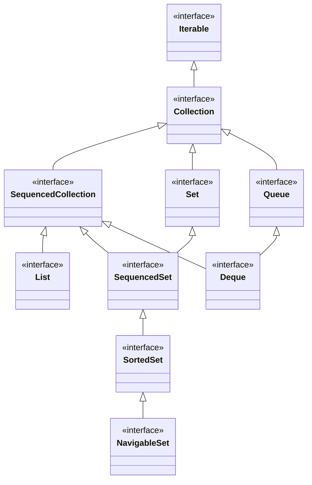
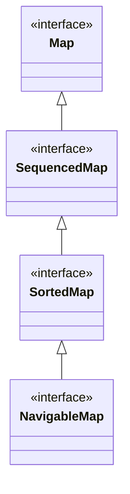
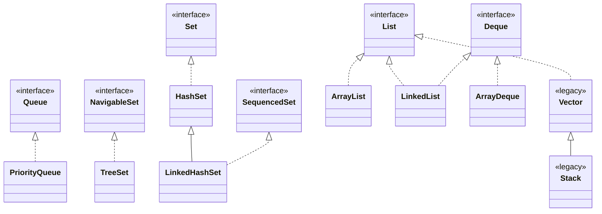
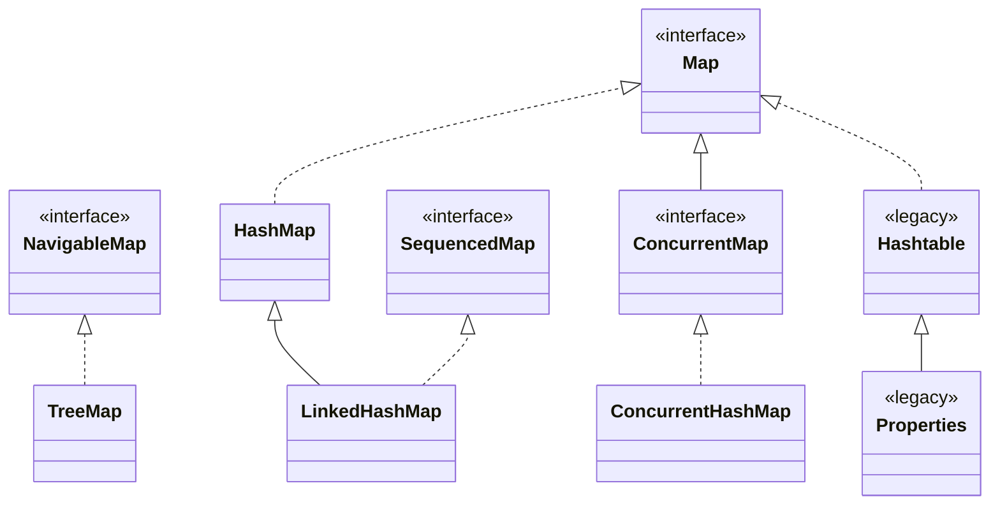
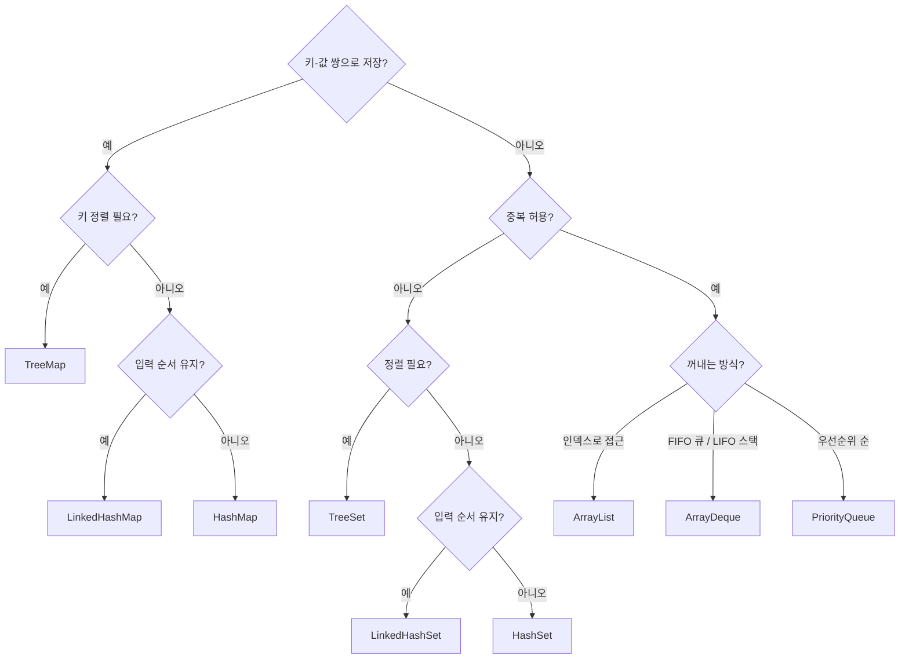

## 개요

**컬렉션 프레임워크(Collections Framework)**는 **여러 데이터(객체)를 저장하고 다루는 클래스들의 표준화된 설계**이다.

- 데이터 그룹을 크게 **List, Set, Map** 세 가지로 나누고, 각각을 **인터페이스**로 정의했다.
- 그 인터페이스를 구현한 클래스(`ArrayList`, `HashSet`, `HashMap` ...)를 골라 쓴다.
- Java 1.2 에서 도입되었다. 그 전부터 있던 `Vector`, `Hashtable`, `Stack`, `Properties` 는 **레거시**로 남아 있다.

| 장점 | 설명 |
| --- | --- |
| 일관된 사용법 | 구현이 달라도 같은 인터페이스(`add`, `remove`, `size` ...)로 다룬다 |
| 재사용 | 자료구조와 알고리즘(정렬, 검색)을 직접 만들 필요가 없다 |
| 교체 쉬움 | 인터페이스 타입으로 쓰면 구현 클래스를 바꿔도 코드를 거의 안 고친다 |

> 이 노트의 계층 구조는 **Java 21** 기준이다. Java 21 에서 `SequencedCollection`, `SequencedSet`, `SequencedMap` 인터페이스가 추가되었다.

---

# 1. 계층 구조

## 핵심 인터페이스 (공식 튜토리얼 그림)


*컬렉션 프레임워크의 핵심 인터페이스. Collection 과 Map 은 **서로 다른 트리**이다 (출처: Oracle, The Java Tutorials, Interfaces)*

> 이 그림은 단순화한 것이다. 실제로 **Deque 는 Queue 를 상속**한다 (아래 Java 21 계층도 참고).

## Java 21 의 Sequenced Collections


*Java 21 에서 추가된 초록색 인터페이스: SequencedCollection, SequencedSet, SequencedMap (출처: OpenJDK, JEP 431: Sequenced Collections)*

- **순서가 있는** 컬렉션에 공통 메서드(`getFirst()`, `getLast()`, `addFirst()`, `addLast()`, `removeFirst()`, `removeLast()`, `reversed()`)를 제공하는 인터페이스이다.
- 전에는 첫 요소를 꺼내는 방법이 컬렉션마다 달랐다: `list.get(0)`, `deque.getFirst()`, `sortedSet.first()`, `linkedHashSet.iterator().next()` → 이제 모두 **`getFirst()`**.

## 인터페이스 전체 계층도 (Java 21)





- **Map 은 Collection 을 상속하지 않는다.** 키-값 쌍이라 구조가 다르기 때문이다.
- `Iterable` 을 상속한 Collection 계열만 **for-each** 로 바로 돌 수 있다. Map 은 `entrySet()`, `keySet()`, `values()` 로 바꿔서 돈다.

## 구현 클래스 계층도





| 화살표 | 의미 |
| --- | --- |
| 실선 `──▷` | 상속 (`extends`) |
| 점선 `┄┄▷` | 구현 (`implements`) |
| `<<legacy>>` | Java 1.2 이전부터 있던 클래스. 새 코드에서는 대체 클래스를 쓴다 |

---

# 2. 핵심 인터페이스

## List · Set · Map 비교

| 인터페이스 | 순서 | 중복 | 대표 구현 | 비유 |
| --- | --- | --- | --- | --- |
| **List** | **O** (인덱스) | **O** | ArrayList, LinkedList | 대기자 명단 |
| **Set** | X (구현에 따라 다름) | **X** | HashSet, TreeSet | 양의 정수 집합, 소수 집합 |
| **Map** | X (구현에 따라 다름) | 키 **X**, 값 **O** | HashMap, TreeMap | 아이디-비밀번호, 우편번호 |

## Collection 인터페이스의 주요 메서드

List 와 Set 의 조상이라 **둘 다 쓸 수 있는** 메서드들이다.

| 메서드 | 설명 |
| --- | --- |
| `add(E)` / `addAll(Collection)` | 추가 |
| `remove(Object)` / `removeAll(Collection)` | 삭제 |
| `removeIf(Predicate)` | 조건에 맞는 요소 삭제 (Java 8+) |
| `retainAll(Collection)` | 교집합만 남기고 삭제 |
| `contains(Object)` / `containsAll(Collection)` | 포함 여부 (**equals** 로 비교) |
| `size()` / `isEmpty()` / `clear()` | 개수 / 비었는지 / 전부 삭제 |
| `iterator()` | Iterator 반환 |
| `toArray()` | 배열로 변환 |
| `stream()` | 스트림 반환 (Java 8+) |

## List 인터페이스

**순서가 있고 중복을 허용**한다. 인덱스로 접근한다.

| 메서드 | 설명 |
| --- | --- |
| `get(int)` / `set(int, E)` | 인덱스로 읽기 / 바꾸기 |
| `add(int, E)` / `remove(int)` | 인덱스 위치에 추가 / 삭제 |
| `indexOf(Object)` / `lastIndexOf(Object)` | 위치 찾기 (없으면 -1) |
| `subList(from, to)` | 부분 리스트 (**원본과 연결된 뷰**) |
| `sort(Comparator)` | 정렬 (Java 8+) |
| `getFirst()` / `getLast()` / `reversed()` | 첫·마지막 요소, 역순 뷰 (Java 21+) |

> `remove(int)` 와 `remove(Object)` 주의: `List<Integer>` 에서 `list.remove(1)` 은 **인덱스 1** 을 지운다. 값 1 을 지우려면 `list.remove(Integer.valueOf(1))`.

## Set 인터페이스

**중복을 허용하지 않는다.** 같은 요소인지는 **`equals()` 와 `hashCode()`** 로 판단한다. (→ [[7. java.lang 패키지와 유용한 클래스]] Object)

- Set 자체의 추가 메서드는 거의 없고 Collection 메서드를 쓴다.
- 집합 연산: `addAll` = 합집합, `retainAll` = 교집합, `removeAll` = 차집합.

## Map 인터페이스

**키(key)와 값(value)의 쌍**으로 저장한다. 키는 중복 불가, 값은 중복 가능. 같은 키로 넣으면 **값이 덮어써진다.**

| 메서드 | 설명 |
| --- | --- |
| `put(K, V)` | 저장 (기존 키면 덮어쓰고 이전 값 반환) |
| `get(K)` | 값 읽기 (없으면 **null**) |
| `getOrDefault(K, 기본값)` | 없으면 기본값 (Java 8+) |
| `putIfAbsent(K, V)` | 키가 없을 때만 저장 |
| `containsKey(K)` / `containsValue(V)` | 포함 여부 |
| `remove(K)` | 삭제 |
| `keySet()` / `values()` / `entrySet()` | 키 Set / 값 Collection / 키-값 쌍 Set |
| `computeIfAbsent(K, 함수)` | 없으면 함수로 값을 만들어 저장하고 반환 |
| `merge(K, V, 함수)` | 없으면 V 저장, 있으면 기존 값과 함수로 합침 |

### Map.Entry

Map 안의 **키-값 쌍 하나**를 나타내는 내부 인터페이스. `getKey()`, `getValue()`, `setValue()`.

```java
Map<String, Integer> scores = new HashMap<>();
scores.put("kim", 90);
scores.put("lee", 80);

for (Map.Entry<String, Integer> e : scores.entrySet()) {   // 키와 값을 함께 돌 때 가장 효율적
    System.out.println(e.getKey() + " : " + e.getValue());
}

scores.forEach((name, score) -> System.out.println(name + " : " + score));   // Java 8+
```

---

# 3. ArrayList 와 Vector

## ArrayList

**배열 기반**의 List. 가장 많이 쓰는 컬렉션이다.

```text
elementData (내부 배열, capacity = 10)
┌───┬───┬───┬───┬───┬───┬───┬───┬───┬───┐
│ A │ B │ C │ D │   │   │   │   │   │   │
└───┴───┴───┴───┴───┴───┴───┴───┴───┴───┘
 size = 4
```

- 객체를 **Object 배열**에 순서대로 저장한다.
- 공간이 부족하면 **약 1.5배 큰 새 배열**을 만들어 **복사**한다 (비용이 큼).
- 기본 생성자는 빈 배열로 시작했다가 처음 추가할 때 capacity 10 을 잡는다.

### 중간 삽입·삭제가 느린 이유

```text
remove(1): B 를 지우면 뒤의 요소를 한 칸씩 앞으로 복사
┌───┬───┬───┬───┐        ┌───┬───┬───┬───┐
│ A │ B │ C │ D │   →    │ A │ C │ D │   │
└───┴───┴───┴───┘        └───┴───┴───┴───┘
       ▲ 삭제                  ◀── ◀── 이동
```

- 맨 끝 추가·삭제는 빠르지만, **중간 삽입·삭제는 뒤의 요소를 모두 옮겨야** 해서 느리다.
- 인덱스로 읽기(`get(i)`)는 배열이라 **매우 빠르다** (O(1)).

### 실무 포인트

```java
// 1. 인터페이스 타입으로 선언 → 나중에 구현을 바꾸기 쉽다
List<String> list = new ArrayList<>();

// 2. 크기를 알면 처음부터 capacity 지정 → 배열 복사 방지
List<Order> orders = new ArrayList<>(10_000);

// 3. 변경 불가 리스트
List<String> fixed  = List.of("a", "b");          // Java 9+: 추가·삭제·수정 불가, null 불가
List<String> asList = Arrays.asList("a", "b");    // 크기 고정: set 은 되지만 add/remove 는 UnsupportedOperationException
List<String> copy   = List.copyOf(list);          // Java 10+: 변경 불가 복사본
```

## Vector

- ArrayList 와 구조가 같지만 **모든 메서드가 동기화(synchronized)** 되어 있다.
- 공간이 부족하면 **2배**로 늘린다.
- Java 1.0 부터 있던 **레거시**. 동기화가 필요 없으면 느리기만 하므로 **쓰지 않는다**.
- 멀티쓰레드가 필요하면 `Collections.synchronizedList()` 나 `CopyOnWriteArrayList` 를 쓴다.

---

# 4. LinkedList

**노드(node)를 연결**한 List. 각 노드가 데이터와 **이전·다음 노드의 주소**를 가진다 (이중 연결 리스트).

```text
first                                                  last
  │                                                      │
  ▼                                                      ▼
┌──────┬───┬──────┐   ┌──────┬───┬──────┐   ┌──────┬───┬──────┐
│ null │ A │ next ├──▶│ prev │ B │ next ├──▶│ prev │ C │ null │
│      │   │      │◀──┤      │   │      │◀──┤      │   │      │
└──────┴───┴──────┘   └──────┴───┴──────┘   └──────┴───┴──────┘

삽입: 노드 하나를 만들고 앞뒤 노드의 주소만 바꾸면 끝 (요소 이동 없음)
```

- 배열처럼 메모리에 연속해 있지 않다. **i 번째 요소를 찾으려면 처음(또는 끝)부터 따라가야** 한다.
- `List` 와 `Deque` 를 **둘 다 구현**해서 큐·스택으로도 쓸 수 있다.

## ArrayList vs LinkedList

| 작업 | ArrayList | LinkedList |
| --- | --- | --- |
| 인덱스로 읽기 `get(i)` | **O(1)** 빠름 | O(n) 느림 |
| 끝에 추가 | O(1) (가끔 배열 복사) | O(1) |
| 중간 삽입·삭제 (위치를 찾은 뒤) | O(n) 요소 이동 | **O(1)** 주소만 변경 |
| 중간 삽입·삭제 (위치 찾기 포함) | O(n) | O(n) 탐색 비용 |
| 메모리 | 적음 | 노드마다 prev/next 주소 추가 |

> 이론상 LinkedList 가 중간 삽입에 유리하지만, 위치를 찾는 데 O(n) 이 들고 메모리가 흩어져 CPU 캐시 효율도 나쁘다. **실무에서는 거의 항상 ArrayList**, 큐·스택은 **ArrayDeque** 를 쓴다.

---

# 5. Stack 과 Queue

| 자료구조 | 방식 | 넣기 | 꺼내기 | 예 |
| --- | --- | --- | --- | --- |
| **Stack** | **LIFO** (Last In First Out) | push | pop | 실행 취소(undo), 괄호 검사, 뒤로 가기, 호출 스택 |
| **Queue** | **FIFO** (First In First Out) | offer | poll | 작업 대기열, 프린터 출력, BFS |

```text
Stack (LIFO)                       Queue (FIFO)
   push ↓  ↑ pop                   offer → ┌───┬───┬───┐ → poll
       ┌───┐                               │ 3 │ 2 │ 1 │
       │ 3 │  ← top                        └───┴───┴───┘
       │ 2 │                               (1 이 먼저 나감)
       │ 1 │
       └───┘
```

## Queue · Deque 메서드: 예외 vs 특별한 값

| 동작 | 실패 시 **예외** | 실패 시 **null/false** (권장) |
| --- | --- | --- |
| 넣기 | `add(e)` | `offer(e)` |
| 꺼내기 (삭제) | `remove()` | `poll()` |
| 보기 (삭제 X) | `element()` | `peek()` |

| Deque 동작 | 앞쪽 | 뒤쪽 |
| --- | --- | --- |
| 넣기 | `offerFirst` / `push` | `offerLast` / `offer` |
| 꺼내기 | `pollFirst` / `pop` / `poll` | `pollLast` |
| 보기 | `peekFirst` / `peek` | `peekLast` |

## 실무 포인트: 무엇으로 만들까

```java
// Stack 클래스는 레거시 (Vector 를 상속 → 불필요한 동기화, 중간 접근 가능)
Stack<Integer> old = new Stack<>();          // 비권장

// 스택과 큐 모두 ArrayDeque 권장
Deque<Integer> stack = new ArrayDeque<>();
stack.push(1); stack.push(2);
stack.pop();                                 // 2

Queue<Integer> queue = new ArrayDeque<>();
queue.offer(1); queue.offer(2);
queue.poll();                                // 1
```

- `ArrayDeque` 는 **null 을 넣을 수 없다** (`poll()` 의 null 반환과 구별하기 위해).

## PriorityQueue

**우선순위가 높은(작은) 요소부터** 꺼내는 큐. 내부는 **힙(heap)** 구조이다.

```java
PriorityQueue<Integer> pq = new PriorityQueue<>();           // 작은 값 먼저 (최소 힙)
pq.offer(3); pq.offer(1); pq.offer(2);
pq.poll();   // 1
pq.poll();   // 2

PriorityQueue<Integer> maxPq = new PriorityQueue<>(Comparator.reverseOrder());   // 큰 값 먼저

// 객체는 Comparable 이거나 Comparator 를 넘겨야 한다
PriorityQueue<Task> tasks = new PriorityQueue<>(Comparator.comparingInt(Task::priority));
```

- 넣기·꺼내기 O(log n). `print(pq)` 하면 **정렬된 순서로 보이지 않는다** (힙 배열 순서). poll 할 때만 순서가 보장된다.
- 쓰임: 다익스트라, 작업 스케줄링, 상위 K 개 구하기.

> 멀티쓰레드 생산자-소비자 패턴에는 `BlockingQueue`(`LinkedBlockingQueue`, `ArrayBlockingQueue`) 를 쓴다. (→ 쓰레드)

---

# 6. Iterator, ListIterator, Enumeration

컬렉션에 저장된 요소를 **하나씩 꺼내는 방법을 표준화**한 인터페이스.

## Iterator

```java
public interface Iterator<E> {
    boolean hasNext();     // 다음 요소가 있는가
    E next();              // 다음 요소 반환
    default void remove(); // next() 로 읽은 요소 삭제 (선택 구현)
}
```

```java
List<String> list = new ArrayList<>(List.of("a", "b", "c"));
Iterator<String> it = list.iterator();
while (it.hasNext()) {
    String s = it.next();
    System.out.println(s);
}
```

- 컬렉션 종류가 달라도 **같은 방식**으로 순회할 수 있다. for-each 문도 내부적으로 Iterator 를 쓴다.
- Iterator 는 **일회용**이다. 다시 돌려면 `iterator()` 로 새로 얻는다.

### 함정: for-each 안에서 삭제하면 ConcurrentModificationException

```java
for (String s : list) {
    if (s.equals("b")) list.remove(s);     // ConcurrentModificationException
}
```

- 순회 중에 컬렉션 구조가 바뀌면 Iterator 가 **즉시 예외**를 던진다 (**fail-fast**).

```java
// 해결 1: Iterator 의 remove()
Iterator<String> it = list.iterator();
while (it.hasNext()) {
    if (it.next().equals("b")) it.remove();
}

// 해결 2: removeIf (Java 8+, 권장)
list.removeIf(s -> s.equals("b"));
```

## ListIterator

Iterator 를 확장해 **양방향 이동**과 **추가·변경**이 가능하다. List 에서만 쓸 수 있다.


*요소가 4개인 리스트의 커서 위치 0~4. 커서는 요소와 요소 **사이**에 있다 (출처: Oracle, The Java Tutorials, The List Interface)*

| 메서드 | 설명 |
| --- | --- |
| `hasNext()` / `next()` | 다음 방향 |
| `hasPrevious()` / `previous()` | **이전 방향** |
| `nextIndex()` / `previousIndex()` | 커서 위치 |
| `add(E)` / `set(E)` / `remove()` | 추가 / 마지막으로 읽은 요소 변경 / 삭제 |

```java
ListIterator<String> it = list.listIterator(list.size());   // 끝에서 시작
while (it.hasPrevious()) {
    System.out.println(it.previous());                       // 역순 출력
}
```

## Enumeration

- Iterator 의 **구버전**(Java 1.0). `hasMoreElements()`, `nextElement()`.
- Vector, Hashtable 같은 레거시 API 에서만 볼 수 있다. 새 코드에서는 Iterator 를 쓴다.

---

# 7. Arrays

**배열을 다루는** static 메서드 모음.

| 메서드 | 설명 |
| --- | --- |
| `toString(arr)` / `deepToString(arr2d)` | 배열 내용 문자열로 (2차원은 deep) |
| `copyOf(arr, len)` / `copyOfRange(arr, from, to)` | 복사 (새 배열) |
| `fill(arr, val)` / `setAll(arr, i -> ...)` | 채우기 |
| `sort(arr)` / `sort(arr, comparator)` | 정렬 |
| `binarySearch(arr, key)` | 이진 검색 (**정렬된 배열**에서만 올바른 결과) |
| `equals(a, b)` / `deepEquals(a2d, b2d)` | 내용 비교 |
| `asList(...)` | 배열을 List 로 (**크기 고정**) |
| `stream(arr)` | 스트림으로 |

```java
int[] arr = {3, 1, 2};
Arrays.sort(arr);                       // [1, 2, 3]
Arrays.binarySearch(arr, 2);            // 1 (인덱스)

int[][] arr2 = {{1, 2}, {3, 4}};
Arrays.toString(arr2);                  // [[I@..., [I@...]  ← 2차원은 deep 필요
Arrays.deepToString(arr2);              // [[1, 2], [3, 4]]
```

### 함정: Arrays.asList()

```java
List<String> list = Arrays.asList("a", "b");
list.add("c");                          // UnsupportedOperationException (크기 고정)

String[] arr = {"a", "b"};
List<String> view = Arrays.asList(arr);
arr[0] = "z";
view.get(0);                            // "z" (원본 배열과 연결된 뷰)

List<String> modifiable = new ArrayList<>(Arrays.asList(arr));   // 자유롭게 바꾸려면 새로 만든다
```

---

# 8. Comparator 와 Comparable

객체를 **정렬하는 기준**을 정한다.

| 구분 | Comparable | Comparator |
| --- | --- | --- |
| 패키지 | `java.lang` | `java.util` |
| 메서드 | `int compareTo(T o)` | `int compare(T o1, T o2)` |
| 의미 | **기본(자연) 정렬 기준**. 클래스 안에 구현 | **다른 기준**으로 정렬할 때. 밖에서 따로 만든다 |
| 예 | String(사전순), Integer(오름차순) | 내림차순, 길이순, 여러 필드 기준 |

### 반환값 규칙

| 반환값 | 의미 |
| --- | --- |
| 음수 | this(o1) 가 **앞** |
| 0 | 같음 |
| 양수 | this(o1) 가 **뒤** |

```java
// Comparable: 클래스의 기본 정렬 기준
class Student implements Comparable<Student> {
    String name;
    int score;

    @Override
    public int compareTo(Student o) {
        return Integer.compare(this.score, o.score);    // 점수 오름차순
    }
}

Collections.sort(students);                              // compareTo 기준

// Comparator: 다른 기준이 필요할 때
students.sort(Comparator.comparing((Student s) -> s.name));         // 이름순
students.sort(Comparator.comparingInt((Student s) -> s.score)
                        .reversed()                                   // 점수 내림차순
                        .thenComparing(s -> s.name));                 // 같으면 이름순

Arrays.sort(strArr, String.CASE_INSENSITIVE_ORDER);                  // 대소문자 무시
list.sort(Comparator.nullsLast(Comparator.naturalOrder()));          // null 은 뒤로
```

### 함정: 뺄셈으로 비교하지 않는다

```java
return this.score - o.score;                    // 오버플로우 위험 (큰 양수 - 큰 음수)
return Integer.compare(this.score, o.score);    // 안전
```

> `compareTo` 가 0 을 반환하는 것과 `equals` 가 true 인 것을 **일치**시키는 것이 좋다. TreeSet, TreeMap 은 `equals` 대신 **compareTo 가 0 이면 같은 요소**로 본다.

---

# 9. HashSet

**해시(hash)** 기반 Set. 내부적으로 **HashMap** 을 쓴다 (요소를 키로 저장).

- **순서 없음**, **중복 없음**, null 1개 허용.
- 추가·삭제·검색이 평균 **O(1)** 로 매우 빠르다.

### 중복 판단 과정

```text
add(obj)
  1. obj.hashCode() 로 저장할 버킷 위치 계산
  2. 그 버킷에 이미 있는 요소들과 obj.equals() 비교
  3. true 인 것이 있으면 중복 → 추가하지 않고 false 반환
```

> **equals 와 hashCode 를 둘 다 오버라이딩**해야 같은 내용의 객체를 중복으로 인식한다. (→ [[7. java.lang 패키지와 유용한 클래스]])

### LinkedHashSet

- HashSet + **입력 순서 유지** (내부에 연결 리스트를 추가로 둔다).
- Java 21 부터 `SequencedSet` 이라 `getFirst()`, `getLast()`, `reversed()` 사용 가능.

```java
Set<String> set = new HashSet<>(List.of("b", "a", "c"));         // 순서 보장 X
Set<String> linked = new LinkedHashSet<>(List.of("b", "a", "c")); // b, a, c 순서 유지

// 리스트 중복 제거 + 순서 유지
List<String> unique = new ArrayList<>(new LinkedHashSet<>(list));
```

---

# 10. TreeSet

**이진 검색 트리**(레드-블랙 트리) 기반 Set. 요소를 **정렬된 상태로** 저장한다.

```text
            7
          /   \
         4     9
        / \     \
       1   5     10

왼쪽 자식 < 부모 < 오른쪽 자식
→ 중위 순회(왼쪽 → 부모 → 오른쪽)하면 정렬된 순서: 1 4 5 7 9 10
```

- 중복 없음, **정렬됨**, 추가·삭제·검색 **O(log n)**. HashSet 보다는 느리다.
- 요소는 **Comparable 을 구현**하거나 생성자에 **Comparator** 를 넘겨야 한다. 아니면 `ClassCastException`.
- null 을 넣을 수 없다 (비교할 수 없으므로).

### NavigableSet 의 범위 검색 메서드

```java
TreeSet<Integer> set = new TreeSet<>(List.of(10, 20, 30, 40, 50));

set.first();            // 10
set.last();             // 50
set.floor(35);          // 30  (35 이하 중 가장 큰 값)
set.ceiling(35);        // 40  (35 이상 중 가장 작은 값)
set.lower(30);          // 20  (30 미만)
set.higher(30);         // 40  (30 초과)
set.headSet(30);        // [10, 20]       (30 미만)
set.tailSet(30);        // [30, 40, 50]   (30 이상)
set.subSet(20, 40);     // [20, 30]       (20 이상 40 미만)
set.descendingSet();    // [50, 40, 30, 20, 10]
```

- 쓰임: 점수 구간 검색, 가장 가까운 값 찾기, 랭킹.

---

# 11. HashMap 과 Hashtable

## HashMap

**해싱(hashing)**으로 키-값 쌍을 저장하는 Map. 가장 많이 쓰는 Map 이다.

```text
table (버킷 배열)
 index
 ┌───┐
 │ 0 │ → null
 ├───┤
 │ 1 │ → [ "kim" : 90 ] → [ "park" : 70 ]      ← 해시 충돌: 같은 버킷에 연결 리스트로
 ├───┤
 │ 2 │ → [ "lee" : 80 ]
 ├───┤
 │ 3 │ → null
 └───┘

put("kim", 90)
  1. "kim".hashCode() 로 버킷 index 계산
  2. 그 버킷에서 equals() 로 같은 키가 있는지 확인
  3. 있으면 값 덮어쓰기, 없으면 노드 추가
```

| 특징 | 내용 |
| --- | --- |
| 순서 | 보장 X |
| null | 키 1개, 값 여러 개 허용 |
| 성능 | 평균 **O(1)** |
| 확장 | 저장 개수가 capacity × **0.75**(load factor)를 넘으면 버킷 배열을 **2배**로 늘리고 재배치 |
| 충돌 처리 | 같은 버킷에 연결 리스트. 한 버킷에 **8개 이상**이 모이면 **레드-블랙 트리**로 바꿔 O(log n) 유지 (Java 8+) |

### 실무에서 자주 쓰는 패턴

```java
// 1. 개수 세기
Map<String, Integer> count = new HashMap<>();
for (String word : words) {
    count.merge(word, 1, Integer::sum);          // 없으면 1, 있으면 +1
}

// 2. 그룹 묶기
Map<String, List<Order>> byMember = new HashMap<>();
for (Order o : orders) {
    byMember.computeIfAbsent(o.memberId(), k -> new ArrayList<>()).add(o);
}

// 3. 없을 때 기본값
int stock = stockMap.getOrDefault("apple", 0);   // null 언박싱 NPE 방지
```

### 함정: 키로 쓰는 객체

- 키 객체는 **equals 와 hashCode 를 올바르게** 구현해야 한다.
- 키로 넣은 뒤 **키 객체의 필드를 바꾸면** hashCode 가 달라져 **다시 찾을 수 없다.** 키는 String, Integer, record 같은 **불변 객체**를 쓴다.

### LinkedHashMap

- HashMap + **입력 순서 유지**. Java 21 부터 `SequencedMap`.
- 생성자에 `accessOrder = true` 를 주면 **접근 순서**로 정렬된다 → `removeEldestEntry()` 를 오버라이딩해 간단한 **LRU 캐시**를 만들 수 있다.

## Hashtable

- HashMap 의 **구버전**. 모든 메서드가 **동기화**되어 있고, 키와 값에 **null 불가**.
- **레거시**. 멀티쓰레드에서는 **`ConcurrentHashMap`** 을 쓴다 (전체가 아니라 필요한 부분만 잠가서 훨씬 빠르다).

| 구분 | HashMap | Hashtable | ConcurrentHashMap |
| --- | --- | --- | --- |
| 동기화 | X | O (메서드 전체) | O (부분 잠금, CAS) |
| null 키/값 | O | X | X |
| 사용 | 단일 쓰레드 | 쓰지 않음 | **멀티쓰레드** |

---

# 12. TreeMap

**이진 검색 트리** 기반 Map. **키를 기준으로 정렬**된 상태로 저장한다.

- TreeSet 과 구조가 같다 (TreeSet 이 내부적으로 TreeMap 을 쓴다).
- 검색·추가 **O(log n)**. 정렬이 필요 없으면 HashMap 이 더 빠르다.
- 키는 Comparable 이거나 Comparator 가 필요하다. null 키 불가.

```java
TreeMap<Integer, String> grade = new TreeMap<>();
grade.put(90, "A");
grade.put(80, "B");
grade.put(70, "C");
grade.put(0,  "F");

grade.floorEntry(85).getValue();      // "B"  (85 이하 중 가장 큰 키 80)
grade.firstKey();                      // 0
grade.lastEntry();                     // 90=A
grade.headMap(80);                     // {0=F, 70=C}        (80 미만)
grade.tailMap(80);                     // {80=B, 90=A}       (80 이상)
grade.descendingMap();                 // {90=A, 80=B, 70=C, 0=F}
```

- 쓰임: 점수 → 등급 변환, 시간대별 요금표, 범위 검색.

---

# 13. Properties

- `Hashtable<Object, Object>` 를 상속한 클래스. **키와 값을 String** 으로 다룬다.
- **설정 파일**(`.properties`)을 읽고 쓰는 데 쓴다.

```properties
# config.properties
db.url=jdbc:mysql://localhost:3306/shop
db.user=admin
```

```java
Properties prop = new Properties();
try (FileInputStream in = new FileInputStream("config.properties")) {
    prop.load(in);                                   // 파일에서 읽기
}
String url  = prop.getProperty("db.url");
String pool = prop.getProperty("db.pool", "10");     // 없으면 기본값

prop.setProperty("db.user", "root");
prop.store(new FileOutputStream("config.properties"), "comment");   // 파일에 저장

Properties sys = System.getProperties();             // JVM 시스템 속성 (java.version, os.name ...)
```

- 스프링의 `application.properties` 도 같은 형식이다 (스프링은 자체 방식으로 읽는다).

---

# 14. Collections

**컬렉션을 다루는** static 메서드 모음. (Arrays 의 컬렉션 버전)

| 메서드 | 설명 |
| --- | --- |
| `sort(list)` / `sort(list, comparator)` | 정렬 |
| `reverse(list)` / `shuffle(list)` | 뒤집기 / 섞기 |
| `max(coll)` / `min(coll)` | 최대 / 최소 |
| `frequency(coll, obj)` | 개수 세기 |
| `binarySearch(list, key)` | 이진 검색 (정렬된 리스트) |
| `swap(list, i, j)` / `fill(list, obj)` / `nCopies(n, obj)` | 교환 / 채우기 / 같은 값 n 개 |
| `addAll(coll, a, b, c)` | 여러 요소 한 번에 추가 |
| `emptyList()` / `singletonList(obj)` | 빈 / 요소 1개짜리 불변 리스트 |
| `unmodifiableList(list)` | **읽기 전용 뷰** |
| `synchronizedList(list)` | 동기화된 리스트 |

## 불변 컬렉션 정리

| 방법 | 원본이 바뀌면 | null | 비고 |
| --- | --- | --- | --- |
| `Collections.unmodifiableList(list)` | **같이 바뀐다** (뷰) | 허용 | 읽기 전용 **뷰** |
| `List.copyOf(list)` (Java 10+) | 안 바뀐다 (복사본) | 불가 | 진짜 불변 |
| `List.of(...)` (Java 9+) | - | 불가 | 진짜 불변 |
| `stream().toList()` (Java 16+) | 안 바뀐다 | 허용 | 불변 리스트 |

### 실무 포인트: 내부 컬렉션을 그대로 내보내지 않는다

```java
class Order {
    private final List<OrderItem> items = new ArrayList<>();

    public List<OrderItem> getItems() {
        return items;                                   // 밖에서 add/remove 가능 → 캡슐화 깨짐
    }

    public List<OrderItem> getItems() {
        return Collections.unmodifiableList(items);     // 읽기만 허용
    }

    public void addItem(OrderItem item) {               // 변경은 메서드로만
        items.add(item);
    }
}
```

- 메서드가 컬렉션을 반환할 때 결과가 없으면 **null 대신 빈 컬렉션**(`List.of()`, `Collections.emptyList()`)을 반환한다. 호출하는 쪽에서 null 체크가 필요 없다.

---

# 15. 컬렉션 선택 가이드



> 멀티쓰레드에서 공유하면: Map → `ConcurrentHashMap`, List(읽기가 대부분) → `CopyOnWriteArrayList`, 큐 → `BlockingQueue` 구현체.

## 구현 클래스 한눈에 비교

| 클래스 | 순서 | 중복 | null | 동기화 | 주요 연산 |
| --- | --- | --- | --- | --- | --- |
| **ArrayList** | 인덱스 | O | O | X | get O(1), 중간 삽입 O(n) |
| LinkedList | 인덱스 | O | O | X | get O(n), 양 끝 O(1) |
| Vector *(legacy)* | 인덱스 | O | O | **O** | ArrayList 와 같음 |
| **ArrayDeque** | 양 끝 | O | **X** | X | 양 끝 O(1) |
| PriorityQueue | 우선순위 | O | X | X | offer/poll O(log n) |
| **HashSet** | X | X | O (1개) | X | O(1) |
| LinkedHashSet | 입력 순서 | X | O (1개) | X | O(1) |
| TreeSet | **정렬** | X | X | X | O(log n) |
| **HashMap** | X | 키 X | O | X | O(1) |
| LinkedHashMap | 입력/접근 순서 | 키 X | O | X | O(1) |
| TreeMap | **키 정렬** | 키 X | 키 X | X | O(log n) |
| Hashtable *(legacy)* | X | 키 X | X | **O** | O(1) |
| ConcurrentHashMap | X | 키 X | X | **O** | O(1) |

---

# 핵심 정리

- 컬렉션 프레임워크 = **List(순서 O, 중복 O)**, **Set(중복 X)**, **Map(키-값, 키 중복 X)**. **Map 은 Collection 의 자손이 아니다.**
- Java 21: **SequencedCollection / SequencedSet / SequencedMap** → `getFirst()`, `getLast()`, `reversed()`.
- 변수는 **인터페이스 타입**으로 선언: `List<String> list = new ArrayList<>();`
- 기본 선택: **ArrayList, HashMap, HashSet, ArrayDeque**. 정렬이 필요하면 Tree~, 입력 순서가 필요하면 LinkedHash~.
- **레거시**(Vector, Stack, Hashtable, Enumeration)는 쓰지 않는다. 동시성은 ConcurrentHashMap 등.
- 순회 중 삭제는 **Iterator.remove()** 또는 **removeIf()**. for-each 안에서 remove 하면 ConcurrentModificationException.
- HashSet/HashMap 은 **hashCode → equals** 순서로 같은지 판단 → 둘 다 오버라이딩. Map 의 키는 **불변 객체**.
- TreeSet/TreeMap 은 **Comparable 또는 Comparator** 필요, 같은지 판단도 **compareTo == 0**. 비교는 뺄셈 대신 `Integer.compare`.
- `Arrays.asList()` 는 크기 고정 뷰, `List.of()` 는 불변 + null 불가, `unmodifiableList()` 는 원본과 연결된 읽기 전용 뷰.
- 내부 컬렉션은 그대로 반환하지 말고 **불변 뷰**로, 결과가 없으면 **빈 컬렉션** 반환.

---

## 참고 자료

### The Java Tutorials: Collections (Oracle, JDK 8 기준)

- [Introduction to Collections](https://docs.oracle.com/javase/tutorial/collections/intro/index.html)
- 인터페이스: [Interfaces](https://docs.oracle.com/javase/tutorial/collections/interfaces/index.html) · [Collection](https://docs.oracle.com/javase/tutorial/collections/interfaces/collection.html) · [Set](https://docs.oracle.com/javase/tutorial/collections/interfaces/set.html) · [List](https://docs.oracle.com/javase/tutorial/collections/interfaces/list.html) · [Queue](https://docs.oracle.com/javase/tutorial/collections/interfaces/queue.html) · [Deque](https://docs.oracle.com/javase/tutorial/collections/interfaces/deque.html) · [Map](https://docs.oracle.com/javase/tutorial/collections/interfaces/map.html) · [Object Ordering](https://docs.oracle.com/javase/tutorial/collections/interfaces/order.html) (Comparable, Comparator) · [SortedSet](https://docs.oracle.com/javase/tutorial/collections/interfaces/sorted-set.html) · [SortedMap](https://docs.oracle.com/javase/tutorial/collections/interfaces/sorted-map.html)
- 구현: [Implementations](https://docs.oracle.com/javase/tutorial/collections/implementations/index.html) · [Set](https://docs.oracle.com/javase/tutorial/collections/implementations/set.html) · [List](https://docs.oracle.com/javase/tutorial/collections/implementations/list.html) · [Map](https://docs.oracle.com/javase/tutorial/collections/implementations/map.html) · [Queue](https://docs.oracle.com/javase/tutorial/collections/implementations/queue.html) · [Deque](https://docs.oracle.com/javase/tutorial/collections/implementations/deque.html)
- [Algorithms](https://docs.oracle.com/javase/tutorial/collections/algorithms/index.html) (Collections 의 정렬, 검색 등)

### Java 21

- [JEP 431: Sequenced Collections](https://openjdk.org/jeps/431)
- API: [Collection](https://docs.oracle.com/en/java/javase/21/docs/api/java.base/java/util/Collection.html) · [SequencedCollection](https://docs.oracle.com/en/java/javase/21/docs/api/java.base/java/util/SequencedCollection.html) · [List](https://docs.oracle.com/en/java/javase/21/docs/api/java.base/java/util/List.html) · [Map](https://docs.oracle.com/en/java/javase/21/docs/api/java.base/java/util/Map.html) · [HashMap](https://docs.oracle.com/en/java/javase/21/docs/api/java.base/java/util/HashMap.html) · [TreeMap](https://docs.oracle.com/en/java/javase/21/docs/api/java.base/java/util/TreeMap.html) · [ArrayDeque](https://docs.oracle.com/en/java/javase/21/docs/api/java.base/java/util/ArrayDeque.html) · [Collections](https://docs.oracle.com/en/java/javase/21/docs/api/java.base/java/util/Collections.html)
