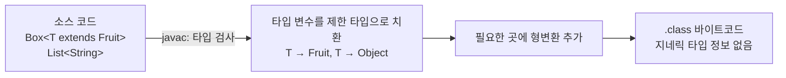

## 개요

**지네릭스(Generics)**는 클래스나 메서드에서 사용할 **타입을 밖에서 지정**하게 해서, **컴파일 시점에 타입을 검사**하는 기능이다. (Java 5+)

| 주제 | 핵심 |
| --- | --- |
| 지네릭 클래스 | `class Box<T>` 처럼 타입을 매개변수로 받는다 |
| 제한된 지네릭 | `<T extends Fruit>` 로 들어올 수 있는 타입을 제한한다 |
| 와일드카드 | `<? extends T>`, `<? super T>` 로 여러 지네릭 타입을 받는다 |
| 지네릭 메서드 | 메서드 단위로 타입 변수를 선언한다 |
| 타입 제거 | 컴파일 후에는 지네릭 타입 정보가 **사라진다** |

> 컬렉션 프레임워크는 지네릭스로 만들어져 있다. (→ [[8. 컬렉션 프레임워크]])

---

# 1. 지네릭스란?

## 지네릭스가 없을 때

```java
ArrayList list = new ArrayList();      // 무엇이든 넣을 수 있다 (Object)
list.add("hello");
list.add(10);                          // 실수로 Integer 를 넣어도 컴파일 OK

String s = (String) list.get(1);       // 실행 중 ClassCastException
```

- 모든 것을 `Object` 로 저장하니 **꺼낼 때마다 형변환**이 필요하고, 잘못된 타입이 들어가도 **실행해 봐야** 안다.

## 지네릭스를 쓰면

```java
ArrayList<String> list = new ArrayList<>();
list.add("hello");
list.add(10);                          // 컴파일 에러: String 만 넣을 수 있다

String s = list.get(0);                // 형변환 필요 없음
```

| 장점 | 설명 |
| --- | --- |
| **타입 안정성** | 의도하지 않은 타입이 들어오는 것을 **컴파일 시점**에 막는다 (런타임 에러 → 컴파일 에러) |
| **형변환 생략** | 꺼낼 때 형변환을 하지 않아도 되어 코드가 간결해진다 |

> 💡 **실무 꿀팁**: 버그는 **빨리 발견할수록 싸다.** 실행 중 `ClassCastException` 보다 컴파일 에러가 훨씬 낫다. 지네릭스의 가치는 여기에 있다.

---

# 2. 지네릭 클래스의 선언

```java
// 지네릭스 이전
class Box {
    Object item;
    void setItem(Object item) { this.item = item; }
    Object getItem() { return item; }
}

// 지네릭 클래스
class Box<T> {                          // T: 타입 변수 (Type variable)
    T item;
    void setItem(T item) { this.item = item; }
    T getItem() { return item; }
}

Box<String> b = new Box<>();           // T 자리에 String 대입
b.setItem("ABC");
String item = b.getItem();             // 형변환 불필요
```

## 용어

```text
class Box<T> { }

Box<T>       지네릭 클래스         'T 의 Box' 라고 읽는다
T            타입 변수 (타입 매개변수)
Box          원시 타입 (raw type)

Box<String>  지네릭 타입 호출 (매개변수화된 타입)
String       대입된 타입 (타입 인자)
```

### 타입 변수 이름 관례

| 이름 | 의미 | 예 |
| --- | --- | --- |
| `T` | Type | `Box<T>` |
| `E` | Element | `List<E>` |
| `K`, `V` | Key, Value | `Map<K, V>` |
| `N` | Number | |
| `R` | Result (반환 타입) | `Function<T, R>` |

## 지네릭스의 제약

```java
class Box<T> {
    static T item;                 // 에러: static 멤버는 타입 변수를 쓸 수 없다
    static int compare(T t1, T t2) // 에러

    T[] itemArr;                   // OK: 타입 변수로 참조 변수 선언은 가능
    T[] toArray() {
        T[] tmp = new T[itemArr.length];   // 에러: 지네릭 배열 생성 불가
        T obj   = new T();                 // 에러: 타입 변수로 객체 생성 불가
        if (obj instanceof T) { }          // 에러: instanceof 에 타입 변수 불가
        return tmp;
    }
}

Box<int> b;                        // 에러: 기본형은 쓸 수 없다 → Box<Integer>
```

| 제약 | 이유 |
| --- | --- |
| static 멤버에 T 불가 | T 는 **인스턴스마다** 다를 수 있는데, static 은 모든 인스턴스가 공유한다 |
| `new T()`, `new T[]` 불가 | 컴파일 시점에 T 가 어떤 타입인지 **알 수 없다** (타입 제거) |
| 기본형 불가 | 타입 변수는 **참조형**만 받는다. 래퍼 클래스를 쓴다 |

---

# 3. 지네릭 클래스의 객체 생성과 사용

```java
class Fruit { }
class Apple extends Fruit { }
class Grape extends Fruit { }
class Toy { }

class Box<T> {
    List<T> list = new ArrayList<>();
    void add(T item) { list.add(item); }
    T get(int i) { return list.get(i); }
}
```

## 규칙 1: 참조 변수와 생성자의 대입된 타입이 같아야 한다

```java
Box<Apple> appleBox = new Box<Apple>();   // OK
Box<Apple> appleBox = new Box<>();        // OK: 다이아몬드 연산자 (Java 7+), 오른쪽 타입 생략
Box<Fruit> fruitBox = new Box<Apple>();   // 에러: Apple 이 Fruit 의 자손이어도 안 된다
```


*Integer 는 Number 의 자손이지만, **`Box<Integer>` 는 `Box<Number>` 의 자손이 아니다.** 둘의 공통 조상은 Object 이다 (출처: Oracle, The Java Tutorials, Generics, Inheritance, and Subtypes)*

> 이유: `Box<Fruit> box = new Box<Apple>();` 이 허용되면 `box.add(new Grape())` 로 Apple 상자에 포도가 들어갈 수 있다.

## 규칙 2: 지네릭 클래스끼리 상속 관계면 OK (대입된 타입이 같을 때)

```java
class FruitBox<T> extends Box<T> { }

Box<Apple> box = new FruitBox<Apple>();   // OK: 다형성
```


*대입된 타입(String)이 같으면 지네릭 클래스 사이의 상속 관계가 그대로 유지된다 (출처: Oracle, The Java Tutorials)*


*`interface PayloadList<E, P> extends List<E>` 이면 P 가 무엇이든 `PayloadList<String, ...>` 는 모두 `List<String>` 의 자손 (출처: Oracle, The Java Tutorials)*

## 규칙 3: 대입된 타입의 자손은 넣을 수 있다

```java
Box<Fruit> fruitBox = new Box<>();
fruitBox.add(new Fruit());   // OK
fruitBox.add(new Apple());   // OK: void add(Fruit item) 에 Apple 전달 (다형성)
fruitBox.add(new Toy());     // 에러
```

> 💡 **실무 꿀팁**: `var list = new ArrayList<>();` 처럼 `var` 와 다이아몬드를 같이 쓰면 **`ArrayList<Object>`** 로 추론된다. `var` 를 쓸 때는 오른쪽에 타입을 적는다: `var list = new ArrayList<String>();`

---

# 4. 제한된 지네릭 클래스

`extends` 로 타입 변수에 들어올 수 있는 타입을 **제한**한다.

```java
class FruitBox<T extends Fruit> {        // Fruit 와 그 자손만
    List<T> list = new ArrayList<>();
}

FruitBox<Apple> appleBox = new FruitBox<>();   // OK
FruitBox<Toy>   toyBox   = new FruitBox<>();   // 에러: Toy 는 Fruit 의 자손이 아니다
```

- 인터페이스로 제한할 때도 `implements` 가 아니라 **`extends`** 를 쓴다.
- 여러 조건은 **`&`** 로 연결한다. 클래스가 있으면 **클래스를 맨 앞**에 쓴다.

```java
interface Eatable { }
class FruitBox<T extends Fruit & Eatable> { }   // Fruit 의 자손이면서 Eatable 을 구현
```

- 제한을 걸면 T 를 **조상 타입으로 다룰 수 있다.** T 의 메서드를 호출할 수 있게 된다.

```java
class Juicer<T extends Fruit> {
    String juice(T fruit) {
        return fruit.getName() + " 주스";     // Fruit 의 메서드 사용 가능
    }
}
```

---

# 5. 와일드카드

## 왜 필요한가

```java
static Juice makeJuice(FruitBox<Fruit> box) { ... }

makeJuice(new FruitBox<Fruit>());    // OK
makeJuice(new FruitBox<Apple>());    // 에러: FruitBox<Apple> 은 FruitBox<Fruit> 가 아니다

// 오버로딩으로 해결? → 에러
static Juice makeJuice(FruitBox<Fruit> box) { ... }
static Juice makeJuice(FruitBox<Apple> box) { ... }   // 컴파일 후 둘 다 FruitBox 가 되어 중복 정의
```

- 지네릭 타입이 다른 것만으로는 **오버로딩이 성립하지 않는다** (타입 제거 때문). 그래서 **와일드카드 `?`** 를 쓴다.

```java
static Juice makeJuice(FruitBox<? extends Fruit> box) { ... }   // Fruit 와 그 자손의 FruitBox 모두 OK
```

## 와일드카드 종류

| 표기 | 의미 | 받을 수 있는 것 |
| --- | --- | --- |
| `<? extends T>` | **상한 제한**: T 와 그 **자손** | `List<? extends Number>` ← `List<Integer>`, `List<Double>` |
| `<? super T>` | **하한 제한**: T 와 그 **조상** | `List<? super Integer>` ← `List<Integer>`, `List<Number>`, `List<Object>` |
| `<?>` | **제한 없음**: 모든 타입 (`<? extends Object>`) | 모든 `List<...>` |


*`List<Number>` 와 `List<Integer>` 의 공통 조상은 `List<?>` (출처: Oracle, The Java Tutorials, Wildcards and Subtyping)*


*와일드카드를 쓴 지네릭 타입들의 상속 관계 (출처: Oracle, The Java Tutorials, Wildcards and Subtyping)*

## 읽기 · 쓰기 제약

```java
void read(List<? extends Number> list) {
    Number n = list.get(0);        // OK: 무엇이 들어 있든 Number 의 자손이다
    list.add(10);                  // 에러: List<Double> 일 수도 있어서 넣을 수 없다 (null 만 가능)
}

void write(List<? super Integer> list) {
    list.add(10);                  // OK: Integer 는 어떤 조상 리스트에도 들어간다
    Object o = list.get(0);        // 꺼내면 Object 로만 받을 수 있다
}
```

## PECS: Producer-Extends, Consumer-Super

| 매개변수의 역할 | 와일드카드 | 기억법 |
| --- | --- | --- |
| 값을 **꺼내서 쓰기만** (생산자, Producer) | `<? extends T>` | 꺼낼 때 T 로 받는다 |
| 값을 **넣기만** (소비자, Consumer) | `<? super T>` | T 를 넣을 수 있다 |
| 둘 다 | 와일드카드 없이 `<T>` | |

```java
// java.util.Collections 의 실제 선언
public static <T> void copy(List<? super T> dest, List<? extends T> src)
//                               ↑ 넣는 쪽 (Consumer)    ↑ 꺼내는 쪽 (Producer)
```

> 💡 **실무 꿀팁**: 와일드카드는 **메서드 매개변수**에만 쓴다. **반환 타입**에 쓰면 그 메서드를 쓰는 쪽 코드가 전부 와일드카드를 다뤄야 해서 불편해진다.

---

# 6. 지네릭 메서드

메서드 선언부에 **타입 변수를 직접 선언**한 메서드. 반환 타입 **바로 앞**에 `<T>` 를 쓴다.

```java
static <T> void sort(List<T> list, Comparator<? super T> c)   // Collections.sort 의 선언
```

- 메서드의 타입 변수는 **클래스의 타입 변수와 별개**이다. 이름이 같아도 다른 것이다.
- 그래서 **static 메서드에도** 쓸 수 있다. (클래스의 T 는 static 에서 못 쓰지만, 메서드에 선언한 T 는 그 메서드 안에서만 쓰는 지역 변수 같은 것)

```java
class FruitBox<T> {
    static <T> void sort(List<T> list) { }   // 이 T 는 클래스의 T 와 무관
}
```

## 와일드카드 → 지네릭 메서드로 바꾸기

```java
static Juice makeJuice(FruitBox<? extends Fruit> box) { ... }

static <T extends Fruit> Juice makeJuice(FruitBox<T> box) { ... }   // 같은 의미
```

```java
// 호출할 때 타입은 보통 컴파일러가 추론한다
Juicer.makeJuice(appleBox);

// 명시하려면 클래스 이름(또는 this)과 함께 써야 한다
Juicer.<Apple>makeJuice(appleBox);
<Apple>makeJuice(appleBox);          // 에러: 클래스 이름 생략 불가
```

## 복잡한 선언 읽기

```java
public static <T extends Comparable<? super T>> void sort(List<T> list)
```

```text
1. List<T>                  : 타입 T 를 요소로 하는 List 를 받는다
2. T extends Comparable<..> : T 는 Comparable 을 구현해야 한다 (정렬하려면 비교할 수 있어야 하니까)
3. Comparable<? super T>    : T 또는 T 의 조상끼리 비교할 수 있으면 된다
                              (Apple 이 Fruit 끼리 비교하는 compareTo 를 물려받았어도 OK)
```

> 💡 **실무 꿀팁**: 공통 유틸 메서드는 지네릭 메서드로 만든다.
> ```java
> public static <T> T firstOrNull(List<T> list) {
>     return list.isEmpty() ? null : list.get(0);
> }
> ```

---

# 7. 지네릭 타입의 형변환

```java
Box box = null;
Box<Object> objBox = null;

box = (Box) objBox;              // OK: 지네릭 → 원시 타입 (경고)
objBox = (Box<Object>) box;      // OK: 원시 타입 → 지네릭 (경고: unchecked)

Box<String> strBox = null;
objBox = (Box<Object>) strBox;   // 에러: 대입된 타입이 다르면 형변환 불가
strBox = (Box<String>) objBox;   // 에러
```

```java
// 와일드카드가 있으면 가능
Box<? extends Object> wBox = new Box<String>();   // OK

FruitBox<? extends Fruit> box = new FruitBox<Apple>();
FruitBox<Apple> appleBox = (FruitBox<Apple>) box;  // OK (경고: unchecked)
```

| 형변환 | 가능 여부 |
| --- | --- |
| 지네릭 ↔ 원시 타입 | O (경고) |
| `Box<Object>` ↔ `Box<String>` | **X** |
| `Box<String>` → `Box<? extends Object>` | O |
| `Box<? extends Object>` → `Box<String>` | O (unchecked 경고) |

> 💡 **실무 꿀팁**: **원시 타입(raw type)은 쓰지 않는다.** `List list = new ArrayList();` 는 지네릭스 이전 코드와의 호환 때문에 남아 있을 뿐이다. IDE 의 `rawtypes`, `unchecked` 경고를 무시하지 않는다.

---

# 8. 지네릭 타입의 제거 (Type Erasure)

컴파일러는 지네릭 타입으로 **타입 검사와 형변환 코드 추가**를 한 뒤, **지네릭 타입 정보를 지운다.** 그래서 `.class` 파일에는 지네릭 타입이 없다.

- 이유: 지네릭스(Java 5) 이전에 만든 코드와 **호환**하기 위해서.



## 제거 과정

```java
// 1. 컴파일 전
class Box<T extends Fruit> {
    List<T> list = new ArrayList<>();
    T get(int i) { return list.get(i); }
}

// 2. 타입 변수를 제한 타입으로 바꾼다 (제한이 없으면 Object)
class Box {
    List list = new ArrayList();
    Fruit get(int i) {
        return (Fruit) list.get(i);     // 3. 타입이 안 맞으면 형변환 추가
    }
}
```

- 와일드카드도 제한 타입으로 바뀐다: `FruitBox<? extends Fruit>` → `FruitBox`, 꺼낼 때 `(Fruit)` 형변환.

## 타입 제거 때문에 생기는 일

| 현상 | 예 |
| --- | --- |
| 실행 중 지네릭 타입을 알 수 없다 | `list instanceof List<String>` 불가, `List<String>.class` 불가 |
| 지네릭 타입만 다른 오버로딩 불가 | `m(List<String>)`, `m(List<Integer>)` 는 둘 다 `m(List)` |
| `new T()`, `new T[]` 불가 | 실행 중 T 가 무엇인지 모른다 |

```java
List<String>  a = new ArrayList<>();
List<Integer> b = new ArrayList<>();
a.getClass() == b.getClass();   // true: 둘 다 ArrayList
```

> 💡 **실무 꿀팁: 슈퍼 타입 토큰**
> JSON 을 `List<Member>` 로 바꿀 때, `List<Member>.class` 를 쓸 수 없어서 문제가 된다. 라이브러리는 **익명 클래스의 상속 정보**(이건 지워지지 않는다)에 타입을 담는 방법을 쓴다.
> ```java
> // Jackson
> List<Member> members = objectMapper.readValue(json, new TypeReference<List<Member>>() {});
>
> // Spring RestTemplate / WebClient
> ResponseEntity<List<Member>> res = restTemplate.exchange(
>         url, HttpMethod.GET, null, new ParameterizedTypeReference<List<Member>>() {});
> ```
> 끝의 `{}` 가 익명 클래스를 만드는 부분이다.

---

# 실무에서 지네릭스를 만나는 곳

```java
// 1. Spring Data JPA: 엔티티 타입과 ID 타입을 지네릭으로 받는다
public interface MemberRepository extends JpaRepository<Member, Long> { }

// 2. API 응답 공통 포맷
public record ApiResponse<T>(boolean success, T data, String message) {
    public static <T> ApiResponse<T> ok(T data) {
        return new ApiResponse<>(true, data, null);
    }
}

@GetMapping("/members/{id}")
public ApiResponse<MemberDto> find(@PathVariable Long id) {
    return ApiResponse.ok(memberService.find(id));
}

// 3. Spring 의 ResponseEntity<T>, Optional<T>, 함수형 인터페이스 Function<T, R> ...
```

> 💡 **실무 꿀팁**: 지네릭 가변인자(`T... args`)는 내부적으로 지네릭 배열이 만들어져 **힙 오염** 경고가 난다. 안전하게 구현한 메서드에는 `@SafeVarargs` 를 붙인다. (`List.of(E... elements)` 가 그렇게 되어 있다)

---

# 핵심 정리

- 지네릭스 = **컴파일 시점 타입 검사** + **형변환 생략**. 기본형은 못 쓰고 래퍼 클래스 사용.
- `Box<T>`: T 는 타입 변수, `Box` 는 원시 타입. **원시 타입은 쓰지 않는다.**
- static 멤버, `new T()`, `new T[]`, `instanceof T` 는 불가.
- `Box<Apple>` 은 `Box<Fruit>` 의 자손이 **아니다.** 대입된 타입이 같으면 지네릭 클래스 사이의 상속은 유지 (`ArrayList<String>` → `List<String>`).
- `<T extends A & B>`: 클래스를 먼저, 인터페이스도 `extends`.
- 와일드카드: `? extends T`(꺼내기), `? super T`(넣기), `?`(모두). **PECS**. 반환 타입에는 쓰지 않는다.
- 지네릭 메서드는 반환 타입 앞에 `<T>`, 클래스의 T 와 별개, static 에도 가능.
- **타입 제거**: 컴파일 후 T 는 제한 타입(없으면 Object)으로 바뀌고 형변환이 추가된다. 실행 중 지네릭 타입 정보 없음 → `TypeReference`, `ParameterizedTypeReference` 로 해결.

---

## 참고 자료

### The Java Tutorials: Generics (Oracle, JDK 8 기준)

- [Why Use Generics?](https://docs.oracle.com/javase/tutorial/java/generics/why.html) · [Generic Types](https://docs.oracle.com/javase/tutorial/java/generics/types.html) · [Raw Types](https://docs.oracle.com/javase/tutorial/java/generics/rawTypes.html) · [Generic Methods](https://docs.oracle.com/javase/tutorial/java/generics/methods.html) · [Bounded Type Parameters](https://docs.oracle.com/javase/tutorial/java/generics/bounded.html)
- [Generics, Inheritance, and Subtypes](https://docs.oracle.com/javase/tutorial/java/generics/inheritance.html)
- 와일드카드: [Wildcards](https://docs.oracle.com/javase/tutorial/java/generics/wildcards.html) · [Upper Bounded](https://docs.oracle.com/javase/tutorial/java/generics/upperBounded.html) · [Lower Bounded](https://docs.oracle.com/javase/tutorial/java/generics/lowerBounded.html) · [Wildcards and Subtyping](https://docs.oracle.com/javase/tutorial/java/generics/subtyping.html) · [Guidelines for Wildcard Use](https://docs.oracle.com/javase/tutorial/java/generics/wildcardGuidelines.html)
- [Type Erasure](https://docs.oracle.com/javase/tutorial/java/generics/erasure.html) · [Restrictions on Generics](https://docs.oracle.com/javase/tutorial/java/generics/restrictions.html)
