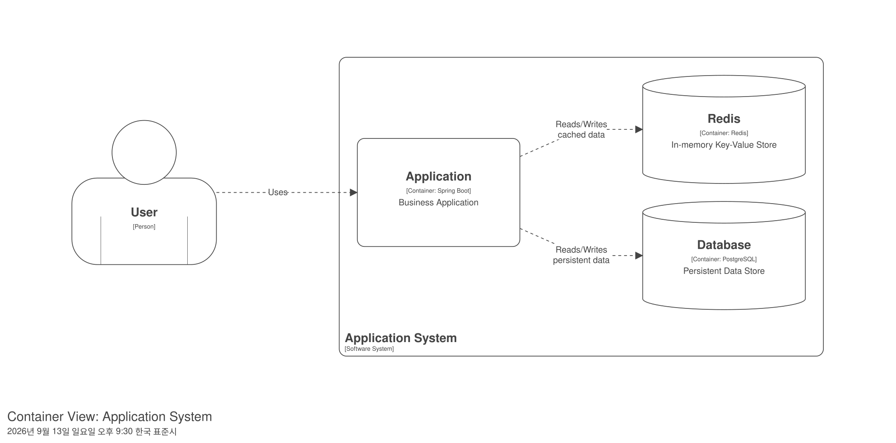

## 개요

**Redis(Remote Dictionary Server)**는 **Key-Value 형태로 데이터를 저장하는 인메모리 데이터 저장소**이다.

데이터를 주로 메모리(RAM)에 저장하기 때문에 디스크 기반 데이터베이스보다 빠른 읽기/쓰기 성능을 제공한다.

캐시, 세션 저장소, 실시간 데이터 처리, 분산 락, 메시지 처리 등에 많이 사용된다.



---

## 특징

### 1. 높은 성능 / 실시간 응답

- **인메모리(In-Memory) 데이터베이스**
    
- 데이터를 주로 RAM에서 읽고 쓰기 때문에 매우 빠른 응답 속도를 제공한다.
    
- 캐시나 실시간 데이터처럼 빠른 응답이 필요한 환경에 적합하다.
    

---

### 2. 단순한 데이터 모델

Redis의 기본적인 데이터 저장 방식은 **Key-Value 구조**이다.

```text
Key -> Value

user:1:name -> "Kim"
user:1:age  -> 25
```

관계형 데이터베이스처럼 테이블과 행을 중심으로 데이터를 다루지 않기 때문에 애플리케이션 객체와 데이터 저장 구조 사이의 **임피던스 불일치(Impedance Mismatch)**를 줄일 수 있다.

또한 다양한 언어에서 사용할 수 있도록 많은 오픈소스 클라이언트 라이브러리가 제공된다.

---

### 3. 다양한 자료구조 지원

단순한 문자열뿐 아니라 다양한 자료구조를 지원한다.

- String
    
- List
    
- Set
    
- Sorted Set
    
- Hash
    
- Bitmap
    
- HyperLogLog
    
- Stream
    
- Geospatial
    

예를 들어 사용자 정보를 저장한다면 다음과 같이 Hash를 사용할 수 있다.

```text
user:1
 ├─ name: Kim
 ├─ age: 25
 └─ email: user@example.com
```

---

### 4. 싱글 스레드 기반 명령 처리

Redis의 핵심 명령 처리는 기본적으로 **싱글 스레드 이벤트 루프**를 중심으로 동작한다.

```text
Client
   ↓
Event Loop
   ↓
Command 처리
   ↓
Memory
```

하나의 스레드에서 명령을 순차적으로 처리하기 때문에 공유 데이터에 대한 복잡한 락 처리가 상대적으로 적다.

다만 현대 Redis는 완전히 하나의 스레드만 사용하는 것은 아니다.

메인 명령 처리 외에 다음과 같은 작업에서는 별도의 스레드나 백그라운드 프로세스를 활용할 수 있다.

- 네트워크 I/O
    
- 비동기 메모리 해제
    
- AOF 처리
    
- RDB 생성
    
- 복제 관련 작업
    

따라서 **"Redis = 완전한 싱글 스레드 프로그램"**이라기보다는 **"주요 명령 실행이 싱글 스레드 중심"**이라고 이해하는 것이 정확하다.

---

## 고가용성(HA)

Redis는 복제와 Sentinel 등을 이용해 고가용성 구성을 만들 수 있다.

### Replication

Primary의 데이터를 Replica 서버로 복제할 수 있다.

Primary 서버에 장애가 발생하더라도 Replica가 데이터를 가지고 있기 때문에 장애 대응이 가능하다.

---

### Sentinel

**Redis Sentinel**은 Redis 인스턴스의 상태를 감시하고 장애 발생 시 자동 Failover를 수행한다.

```text
          Sentinel
             ↓
          Primary
         /       \
    Replica     Replica
```

주요 역할:

- Redis 서버 상태 모니터링
    
- Primary 장애 감지
    
- Replica 중 하나를 새로운 Primary로 승격
    
- 클라이언트에 새로운 Primary 정보 제공
    

즉,

```text
장애 발생
   ↓
Sentinel 장애 감지
   ↓
Replica 선택
   ↓
새로운 Primary로 승격
   ↓
서비스 복구
```

---

## 확장성

Redis는 데이터 규모가 증가할 경우 **Redis Cluster**를 이용하여 여러 서버에 데이터를 분산할 수 있다.

Redis Cluster에서는 전체 Key 공간을 **16384개의 Hash Slot**으로 나눈 뒤 여러 노드가 이를 나누어 담당한다.

```text
Key
 ↓
Hash Slot 계산
 ↓
해당 Slot을 가진 Redis Node
```

예:

```text
Node A
Slot 0 ~ 5000

Node B
Slot 5001 ~ 10000

Node C
Slot 10001 ~ 16383
```

이를 통해 여러 서버로 데이터를 분산하여 수평 확장이 가능하다.

---

## 데이터 영속성(Persistence)

Redis는 인메모리 데이터 저장소이지만 데이터를 디스크에 저장할 수도 있다.

대표적인 방식은 **RDB**와 **AOF**이다.

### RDB

특정 시점의 메모리 데이터를 Snapshot 형태로 저장한다.

```text
Memory
   ↓
Snapshot
   ↓
dump.rdb
```

특징:

- 파일 크기가 비교적 작음
    
- 백업에 적합
    
- 복구 속도가 빠름
    
- Snapshot 사이의 데이터는 유실될 수 있음
    

---

### AOF

Redis에서 수행된 데이터 변경 명령을 로그 형태로 기록한다.

```text
SET user:1 Kim
INCR login_count
DEL cache:1
```

이를 `appendonly.aof` 파일에 기록한다.

특징:

- RDB보다 데이터 손실 가능성이 낮음
    
- 명령 로그를 계속 기록
    
- 파일 크기가 커질 수 있음
    
- AOF Rewrite를 통해 파일을 최적화할 수 있음
    

---

### RDB vs AOF

|항목|RDB|AOF|
|---|---|---|
|저장 방식|Snapshot|명령 로그|
|파일 크기|상대적으로 작음|상대적으로 큼|
|복구 속도|빠름|상대적으로 느림|
|데이터 안정성|상대적으로 낮음|상대적으로 높음|
|용도|백업|데이터 영속성|

두 방식을 함께 사용할 수도 있다.

---

## 클라우드 환경

Redis는 Docker, Kubernetes 환경에서 쉽게 배포할 수 있으며 다양한 클라우드에서 Managed Redis 서비스를 제공한다.

예:

- AWS ElastiCache
    
- Google Cloud Memorystore
    
- Azure Managed Redis
    
- Redis Cloud
    

따라서 특정 클라우드에 종속되지 않고 다양한 환경에서 사용할 수 있다.

---

## 주요 사용 사례

Redis는 일반적인 영구 데이터베이스를 완전히 대체하기보다는 빠른 데이터 접근이 필요한 곳에서 많이 사용한다.

**Cache**

대표적인 사용 사례:

- Cache
    
- Session 저장소
    
- 로그인 / 인증 정보
    
- Refresh Token
    
- Ranking
    
- 실시간 카운터
    
- Rate Limiting
    
- 분산 Lock
    
- Queue
    
- Pub/Sub
    
- 실시간 이벤트 처리
    

---

## 핵심 정리

> Redis는 **Key-Value 기반의 인메모리 데이터 저장소**로 빠른 성능이 가장 큰 특징이다.

또한

**성능**

- In-Memory 기반
    
- 빠른 읽기/쓰기
    

**구조**

- Key-Value
    
- 다양한 자료구조 지원
    
- 주요 명령은 싱글 스레드 이벤트 루프에서 처리
    

**고가용성**

- Replication
    
- Sentinel
    
- 자동 Failover
    

**확장성**

- Redis Cluster
    
- Hash Slot을 이용한 데이터 분산
    

**영속성**

- RDB Snapshot
    
- AOF 로그
    

을 지원하기 때문에 단순한 캐시뿐만 아니라 다양한 실시간 시스템 구성 요소로 사용할 수 있다.